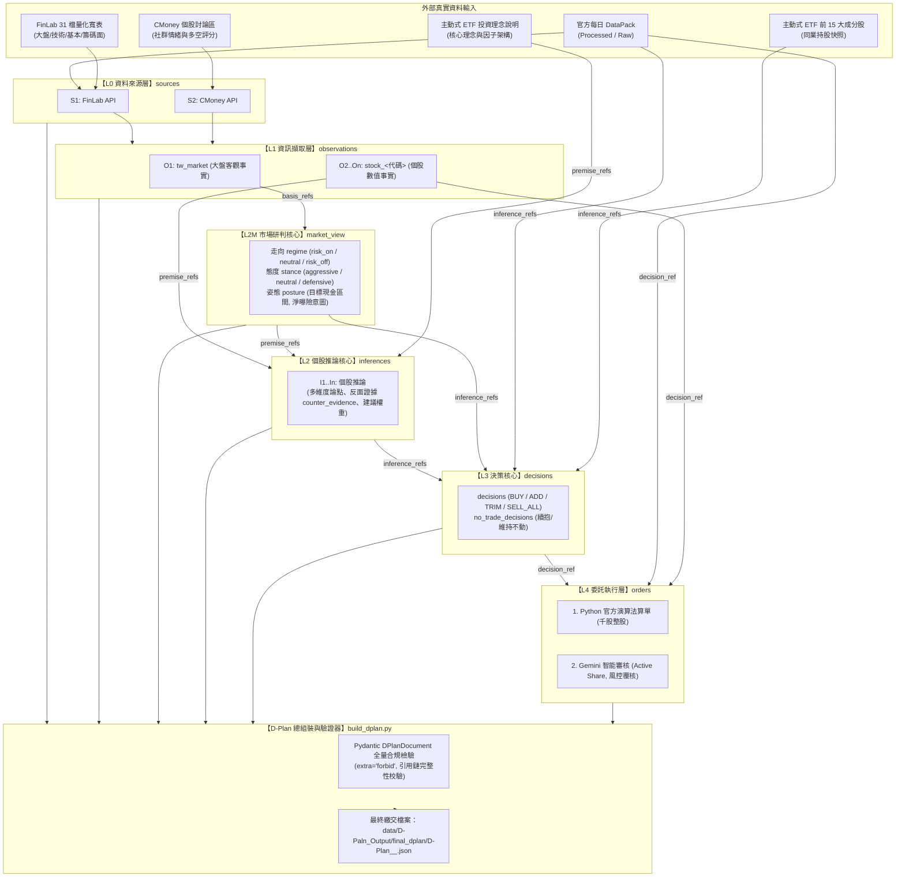

# 2026 玉山人工智慧挑戰賽 (AI CUP 2026)
## Multi-Agent 自主量化投資決策系統 (D-Plan v4.3)

- **參賽隊伍**：`TEAM_11402`
- **競賽主題**：2026 Agent 基金經理人公開挑戰賽
- **核心架構**：階層式因果推論 Multi-Agent 系統 (L0 ➔ L1 ➔ L2M ➔ L2 ➔ L3 ➔ L4 ➔ D-Plan 總組裝)
- **規範標準**：嚴格遵循官方 **D-Plan Schema v4.3** 與 **D-Plan 撰寫指南 v4.3**

---

## 目錄導覽 (Table of Contents)

1. [系統整體架構與因果推論鏈](#一系統整體架構與因果推論鏈)
2. [專案目錄與檔案結構](#二專案目錄與檔案結構)
3. [資料流與目錄輸入輸出對照 (I/O)](#三資料流與目錄輸入輸出對照-io)
4. [各階層 Agent 深度邏輯與運算規範](#四各階層-agent-深度邏輯與運算規範)
   - [L0 資料來源層 (L0_sources)](#l0-資料來源層-l0_sources)
   - [L1 資訊擷取層 (L1_observations)](#l1-資訊擷取層-l1_observations)
   - [L2M 市場判斷鏈 (L2M_market_view)](#l2m-市場判斷鏈-l2m_market_view)
   - [L2 個股推論層 (L2_inferences)](#l2-個股推論層-l2_inferences)
   - [L3 投資組合決策層 (L3_decisions)](#l3-投資組合決策層-l3_decisions)
   - [L4 委託執行層 (L4_orders)](#l4-委託執行層-l4_orders)
   - [D-Plan 總組裝與全量合規校驗 (build_dplan.py)](#d-plan-總組裝與全量合規校驗-build_dplanpy)
5. [端到端每日產線入口 (run_daily_dplan.py)](#五端到端每日產線入口-run_daily_dplanpy)
6. [Gemini Usage 監控與 Token 統計機制](#六gemini-usage-監控與-token-統計機制)
7. [交易日期終端機互動輸入設計](#七交易日期終端機互動輸入設計)
8. [環境建置與憑證設定](#八環境建置與憑證設定)
9. [完整命令列操作手冊 (CLI Cheatsheet)](#九完整命令列操作手冊-cli-cheatsheet)
10. [競賽法規檢核與重要實測注意事項](#十競賽法規檢核與重要實測注意事項)

---

## 一、系統整體架構與因果推論鏈

本系統依據官方 D-Plan 因果引用鏈標準設計，各 Agent 階層具備嚴格的資訊邊界與上下游依賴關係：



### 因果引用鏈規範原則 (Causal Citation Chain)
1. **嚴禁孤兒引用與斷鏈**：`L2M.basis_refs` 必須來自 `L1.obs_id`；`L2.premise_refs` 必須來自 `L1.obs_id`；`L3.inference_refs` 必須來自 `L2.inf_id`；`L4.decision_ref` 必須來自 `L3.decision_id`。
2. **單向無循環**：各層僅能引用直接上層或經定義的合法來源，禁止跨層跳躍或反向引用。
3. **無未定義額外欄位**：全數使用 Pydantic 模型驗證，設定 `extra='forbid'`，確保不會輸出任何競賽官方 Schema 未定義之自訂欄位。

---

## 二、專案目錄與檔案結構

```text
code/
├── configs/                              # 專案環境與共用工具
│   ├── settings.py                       # 隊伍 ID、credentials 憑證讀取、全域路徑常數
│   ├── gemini_client.py                  # Google GenAI SDK 封裝 (支援串流、結構化輸出與 Usage 統計)
│   └── date_utils.py                     # 終端機互動式日期提示、標準化 (YYYYMMDD) 與格式轉換工具
│
├── schemas/                              # 【Schema 定義與檢驗層】
│   ├── dplan_models.py                   # 依 D-Plan Schema v4.3 建立的嚴格 Pydantic 資料模型
│   └── verify_dplan.ipynb                # D-Plan JSON 格式校驗、斷鏈檢測與測試 Notebook
│
├── L0_sources/                           # 【L0 資料來源與爬取層】
│   ├── datapack_loader.py                # 讀取官方每日 DataPack JSON (取現金、庫存、NAV、合規狀態)
│   ├── finlab_market_loader.py           # 透過 FinLab API 下載 31 檔市場與財務寬表並快取為 Parquet
│   ├── finlab_active_etf_loader.py       # 下載主動式 ETF 前 15 大成分股快照與權重
│   ├── cmoney_sentiment_crawler.py       # 爬取 CMoney 討論區個股情緒與多空量化分數
│   ├── market_indicators.py              # 大盤多維度量化指標計算 (均線、報酬、回撤、融資、廣度)
│   ├── stock_indicators.py               # 個股多維度量化指標計算 (ROE、營收動能、量價比、法人買賣超)
│   └── esun_trial_loader.ipynb           # 玉山證券行情 Web API 盤前試撮資料快照測試
│
├── L1_observations/                      # 【L1 資訊擷取層】
│   └── fact_extractor.py                 # 提取客觀事實陳述，產出 values 數值字典，呼叫 Gemini 並記錄 Usage
│
├── L2M_market_view/                      # 【L2M 市場研判核心】
│   └── market_view_agent.py              # 研判市場走勢 (regime)、操作態度 (stance) 與目標水位 (posture)
│
├── L2_inferences/                        # 【L2 個股推論核心】
│   └── stock_inference_agent.py          # 結合 ETF 理念針對 40 檔候選池產出多維度深入推論與反思
│
├── L3_decisions/                         # 【L3 投資組合決策層】
│   └── portfolio_decision_agent.py       # 執行昨日持股全覆蓋分配 (decisions 調整 + no_trade 續抱)，控管 20~30 檔
│
├── L4_orders/                            # 【L4 委託執行層】
│   └── order_calculator.py               # 官方千股整股演算法試算 + Active Share 檢驗 + Gemini 智能覆核
│
├── build_dplan.py                        # 【D-Plan 總組裝與驗證器】全層合規校驗，輸出至 final_dplan
├── run_daily_dplan.py                    # 【每日自動化端到端主產線】排程/一鍵執行 Step 1 ~ Step 5
├── requirements.txt                      # 專案相依 Python 套件清單
├── credentials.json                      # [本地] 本地憑證與 API 金鑰 (已由 .gitignore 忽略保護)
└── README.md                             # 專案完整說明文件 (本檔案)
```

---

## 三、資料流與目錄輸入輸出對照 (I/O)

所有生成資料與中間產物統一維護於專案根目錄的 `data/` 目錄中：

| 階層 / 程式模組 | 主要輸入資料來源路徑 (Input) | 主要產出檔案路徑 (Output) | Gemini Usage 統計路徑 |
| :--- | :--- | :--- | :--- |
| **L0 Sources**<br>`datapack_loader.py` | 官方原始 DataPack JSON：<br>`data/Datapack/Raw/DataPack_*_YYYY-MM-DD.json` | 轉換後結構化 Markdown：<br>`data/Datapack/Processed/DataPack_Processed_YYYYMMDD.md` | *(純資料解析，無呼叫 LLM)* |
| **L0 Sources**<br>`finlab_market_loader.py`<br>`cmoney_sentiment_crawler.py`<br>`finlab_active_etf_loader.py` | FinLab API、CMoney API、主動 ETF 公開資訊 | 行情特徵、輿情與成分股快取：<br>`data/大盤/`, `data/技術面/`, `data/基本面/`, `data/籌碼面/`,<br>`data/CMoney_Sentiment/`, `data/Active_ETF_Holdings/`,<br>`data/D-Paln_Output/l0_sources/sources_finlab_YYYYMMDD.json` | *(純資料爬取，無呼叫 LLM)* |
| **L1 Observations**<br>`fact_extractor.py` | `data/大盤/`, `data/技術面/`, `data/基本面/`, `data/籌碼面/`, `data/CMoney_Sentiment/`, `data/D-Paln_Output/l0_sources/` | `data/D-Paln_Output/l1_observations/`<br>👉 `l1_observations_YYYYMMDD.json` | `data/D-Paln_Output/l1_observations/usage/`<br>👉 `l1_usage_YYYYMMDD.json` |
| **L2M Market View**<br>`market_view_agent.py` | `data/D-Paln_Output/l1_observations/` (大盤觀察),<br>`data/Datapack/Processed/` (帳戶快照) | `data/D-Paln_Output/l2m_market_view/`<br>👉 `l2m_market_view_YYYYMMDD.json` | `data/D-Paln_Output/l2m_market_view/usage/`<br>👉 `l2m_usage_YYYYMMDD.json` |
| **L2 Inferences**<br>`stock_inference_agent.py` | `data/D-Paln_Output/l1_observations/` (個股與大盤),<br>`data/D-Paln_Output/l2m_market_view/`,<br>`data/ETF_Strategy/etf_strategy.md`,<br>`data/Datapack/Processed/` | `data/D-Paln_Output/l2_inferences/`<br>👉 `l2_inferences_YYYYMMDD.json` | `data/D-Paln_Output/l2_inferences/usage/`<br>👉 `l2_usage_YYYYMMDD.json` |
| **L3 Decisions**<br>`portfolio_decision_agent.py` | `data/D-Paln_Output/l2_inferences/`,<br>`data/D-Paln_Output/l2m_market_view/`,<br>`data/Datapack/Processed/` (昨日持股明細),<br>`data/Active_ETF_Holdings/` (前 15 大標竿) | `data/D-Paln_Output/l3_decisions/`<br>👉 `l3_decisions_YYYYMMDD.json` | `data/D-Paln_Output/l3_decisions/usage/`<br>👉 `l3_usage_YYYYMMDD.json` |
| **L4 Orders**<br>`order_calculator.py` | `data/D-Paln_Output/l3_decisions/`,<br>`data/Datapack/Processed/` (NAV 與現有持股),<br>`data/D-Paln_Output/l1_observations/` (收盤價),<br>`data/Active_ETF_Holdings/` | `data/D-Paln_Output/l4_orders/`<br>👉 `l4_orders_YYYYMMDD.json`<br>👉 `l4_orders_python_YYYYMMDD.json` | `data/D-Paln_Output/l4_orders/usage/`<br>👉 `l4_orders_YYYYMMDD.json` |
| **D-Plan Assembler**<br>`build_dplan.py` | 讀入上述所有子目錄中的最新 JSON | `data/D-Paln_Output/final_dplan/`<br>👉 **`D-Plan_<team_id>_<trade_date>.json`** | *(總裝配器，直接彙整 metadata)* |

---

## 四、各階層 Agent 深度邏輯與運算規範

### L0 資料來源層 (`L0_sources`)
- **`datapack_loader.py`**：每日下載或解析主辦單位提供的 DataPack（格式可能為 JSON 或 Markdown），提取 `cash` (可用現金)、`nav_tradable` (可交易淨值)、`holdings` (既有持股名單與股數) 以及 `compliance` 狀態。
- **`finlab_market_loader.py`**：透過 FinLab SDK 下載 31 筆關鍵市場與財務寬表（如收盤價、成交量、融資餘額、投信外資買賣超、ROE、毛利率、月營收年增率等），起始日為 `2025-04-24`，落地存為 `zstd` 高壓縮 Parquet 檔案。
- **`cmoney_sentiment_crawler.py`**：爬取 CMoney 個股討論區之情緒指標與 AI 評分，提供散戶心理與社群熱度量化數據。
- **`market_indicators.py` / `stock_indicators.py`**：將原始寬表向量化精算為標準特徵字典。

### L1 資訊擷取層 (`L1_observations/fact_extractor.py`)
- **職責**：將 raw data 提煉為標準 D-Plan L1 客觀事實陳述，**嚴禁任何推論、預測或情緒性用語**。
- **大盤觀察 (`tw_market`)**：恰好生成 1 筆，包含加權指數收盤、近 20 日均線、20 日報酬率、20 日最大回撤、法人買賣超與市場廣度。
- **個股觀察 (`stock_<ticker>`)**：針對候選股票池（40 檔）逐檔生成 1 筆，包含企業獲利指標、營收動能、均線結構、量價與籌碼指標。
- **數值原值自動補齊**：Prompt 引導 Gemini 提取陳述中提到的重點數值，程式在後處理階段會自動以原始資料集原值補齊該股全部數值字典 (`values`)，確保數字完全精準不失真。

### L2M 市場判斷鏈 (`L2M_market_view/market_view_agent.py`)
- **職責**：產出市場總體環境判斷與整體操作姿態。
- **研判面向**：
  1. **走向 (`regime`)**：依收盤價與 20MA/60MA 排列、20 日報酬與 20 日最大回撤判定：
     - `risk_on`：多頭排列且動能強勁。
     - `neutral`：多頭結構下拉回整理或方向不明。
     - `risk_off`：破線下彎、結構轉弱或回撤過深。
  2. **態度 (`stance`)**：宣告今日操作姿態 (`aggressive` / `neutral` / `defensive`)。
  3. **部位承諾 (`posture`)**：
     - `target_cash_pct_range`：宣告目標現金比例區間 (例如 `[0.05, 0.15]`)。
     - `target_stock_pct_range`：宣告目標股票權重區間。
     - `net_exposure_intent`：明確定義淨曝險意圖（如增加、維持或降低曝險）。
- **合法引用**：`basis_refs` 必須精確指向 L1 的大盤事實 ID (`O1`)。

### L2 個股推論層 (`L2_inferences/stock_inference_agent.py`)
- **職責**：結合主動型 ETF 理念（兼顧企業品質、營運改善與潛在動能），深入剖析候選股票池。
- **四大多維度分析**：
  1. **企業品質**：檢視最新 ROE 獲利護城河與月營收年增率 (YoY) / 月增率 (MoM) 成長態勢。
  2. **技術動能**：比較 5 日與 20 日報酬率、相對大盤超額報酬 (Alpha)、均線乖離率、RSI 與短期波動度。
  3. **籌碼量能**：檢視外資與投信連續買賣超強度、量價配合關係（價漲量增或價跌量縮）。
  4. **市場情緒**：參考 CMoney 討論熱度與多空評分，交叉驗證預期落差。
- **關鍵欄位**：
  - `direction`：個股推論傾向 (`positive` / `neutral` / `negative`)。
  - `target_weight_suggested`：建議配置比重（作為 L3 的依據）。
  - `counter_evidence`：**必須列出反面證據與不確定性**（避免確認偏誤，符合競賽合規規範）。
- **合法引用**：`premise_refs` 必須引用自 L1 的 `obs_id`。

### L3 投資組合決策層 (`L3_decisions/portfolio_decision_agent.py`)
- **職責**：將 L2 推論結論結合昨日部位快照，產出本日最終投資組合配置。
- **交易動作**：
  - `BUY`：新建倉（昨日未持有 ➔ 今日持有）。
  - `ADD`：加碼（昨日已有持股 ➔ 今日提高比重）。
  - `TRIM`：減碼（昨日已有持股 ➔ 今日降低比重但仍保留）。
  - `SELL_ALL`：全數出清（昨日已有持股 ➔ 今日目標權重設為 0.0）。
  - 續抱（維持不動）：昨日已有持股且今日不調整，放入 `no_trade_decisions`。
- **三大競賽硬限制 (Hard Constraints)**：
  1. **昨日持股全覆蓋與互斥原則**：昨日持有的每一檔股票，在本日規劃中**必須恰好分配至 decisions 或 no_trade_decisions 之一**，不可遺漏、不可重複。
  2. **持股檔數限制**：目標投資組合最終持有檔數（非 0 權重者）**必須嚴格落在 20 至 30 檔之間**。
  3. **單一持股權重上限**：一般個股上限不得超過 10% (0.10)；台積電 (2330) 上限不得超過 25% (0.25)。
  4. **現金平衡**：目標持股權重總和 + 現金比例 = 1.0，預估剩餘現金必須落在 L2M 宣告的區間內。

### L4 委託執行層 (`L4_orders/order_calculator.py`)
- **【第一階段：Python 官方演算法機械計算】**
  嚴格依官方手冊演算法計算目標股數，**千股整股，嚴禁手調**：
  $$\text{目標股數} = \left\lfloor \frac{\text{目標權重} \times \text{前日淨值}}{\text{前日收盤價} \times 1000} \right\rfloor \times 1000$$
  $$\text{委託股數} = \text{目標股數} - \text{目前持有股數}$$
  - 差額為正：委託方向 `BUY`。
  - 差額為負：委託方向 `SELL`（股數取絕對值）。
  - 差額為 0：無須產生委託單。
  - 自動生成推導展開文字 `derivation_detail`，例如：
    `floor(0.0800 * 100,000,000 / 985.0 / 1000) * 1000 = 80000 股; 委託 = 80000 - 50000 = +30000 股 (BUY)`
  - 精算 **Active Share**：與市場同業主動式 ETF 前 15 大成分股權重比對，確保主動性比率 $\ge 15\%$。
- **【第二階段：Gemini 智能審查與覆核】**
  將 Python 計算結果、取整偏離率、剩餘現金預估與 Active Share 送交 Gemini 進行風控覆核，確認無超賣違規與流動性隱憂。

### D-Plan 總組裝與全量合規校驗 (`build_dplan.py`)
- **職責**：自動彙整 L0～L4 所有模組成果，自動注入頂層元資料 (`team_id`, `trade_date`, `schema_version: "4.3"`, `agent_metadata`)。
- **自動收集 Agent Metadata**：
  - `model_provider`: `"google"`
  - `model_version`: 讀取 `GeminiClient` 配置模型名稱
  - `run_started_at`: 自動讀取 L0 sources 產出時間 (+08:00)
  - `run_completed_at`: 當前組裝完成時間 (+08:00)
  - `code_version`: 自動透過 `git rev-parse --short HEAD` 抓取 commit hash (如 `git:fbb03c6`)
- **Pydantic 全量校驗**：若有任何斷鏈、孤兒引用、檔數違規或多出欄位，立即報錯拋出例外並中止。
- **正式輸出目錄**：`data/D-Paln_Output/final_dplan/D-Plan_<team_id>_<trade_date>.json`。

---

## 五、端到端每日產線入口 (`run_daily_dplan.py`)

`run_daily_dplan.py` 是每日自動化產線的核心調度器，依序以獨立子進程執行五大步驟：

1. **Step 1/5**：執行 L2M 市場整體判斷 (`L2M_market_view/market_view_agent.py`)
2. **Step 2/5**：執行 L2 個股推論 (`L2_inferences/stock_inference_agent.py`)
3. **Step 3/5**：執行 L3 投資組合決策 (`L3_decisions/portfolio_decision_agent.py`)
4. **Step 4/5**：執行 L4 委託單計算與智能覆核 (`L4_orders/order_calculator.py`)
5. **Step 5/5**：執行 D-Plan 總組裝與全量合規校驗 (`build_dplan.py`)

### 智慧日期繼承特點
- 執行主程式時，若未傳入日期，會在**最開頭詢問一次交易日期**。
- 輸入後，主程式會將 `--date <交易日>` 自動傳遞至 Step 1 ~ Step 4 的所有子腳本，後續執行一氣呵成，**不會中途重複彈出提示**！

---

## 六、Gemini Usage 監控與 Token 統計機制

為了精確掌握 API 調用成本與 Token 消耗量，所有調用 Gemini API 的程式（L1、L2M、L2、L3、L4）皆已內建 Usage 自動統計：

1. **儲存位置**：位於各階段輸出資料夾下的 **`usage/`** 子目錄中：
   - `data/D-Paln_Output/l1_observations/usage/l1_usage_YYYYMMDD.json`
   - `data/D-Paln_Output/l2m_market_view/usage/l2m_usage_YYYYMMDD.json`
   - `data/D-Paln_Output/l2_inferences/usage/l2_usage_YYYYMMDD.json`
   - `data/D-Paln_Output/l3_decisions/usage/l3_usage_YYYYMMDD.json`
   - `data/D-Paln_Output/l4_orders/usage/l4_usage_YYYYMMDD.json`
2. **統計內容結構**：
   ```json
   {
     "timestamp": "2026-10-27T22:00:15+08:00",
     "date": "20261027",
     "stage": "l2",
     "model": "gemini-3.8-flash",
     "prompt_tokens": 3412,
     "candidates_tokens": 1280,
     "total_tokens": 4692,
     "cached_tokens": 0,
     "duration_seconds": 3.85
   }
   ```
3. **備援保障**：若串流事件中未帶完整 Usage 物件，底層 `GeminiClient` 會自動透過官方 `count_tokens` 與字元密度進行備援核算，確保紀錄檔必定生成且內容正確。

---

## 七、交易日期終端機互動輸入設計

考量到競賽實務上「執行程式的日期不一定是實際交易日」（例如週日盤前預先試算週一的 D-Plan），所有入口均支援兩種日期指定模式：

### 1. 互動式終端輸入 (預設)
直接執行命令時（不帶 `--date`），終端機會跳出提示：
```text
>>> [D-Plan 自動產線 - 交易日期] (格式 YYYYMMDD，直接按 Enter 預設為今日 20261027): 
```
- **直接按 Enter**：自動採用今日日期。
- **手動輸入日期**：例如輸入 `20261028` 或 `2026-10-28`，系統會自動清理為標準格式並套用至全線。

### 2. 命令列明確指定 (自動化排程)
若透過外部排程或 Shell Script 呼叫，直接附加 `--date` 參數即可靜默執行：
```bash
python run_daily_dplan.py --date 20261028
```

---

## 八、環境建置與憑證設定

### 1. Conda 環境建立與套件安裝
建議使用 Python 3.11 環境：

```bash
# 建立專案 Conda 環境
conda create -n esunaicup2026_py311 python=3.11 -y
conda activate esunaicup2026_py311

# 安裝所需依賴套件
pip install -r requirements.txt
```

### 2. 憑證設定 (`code/credentials.json`)
在 `code/` 目錄下建立 `credentials.json` 配置隊伍金鑰（此檔案已由 `.gitignore` 排除）：

```json
{
  "team_id": "TEAM_11402",
  "gemini_api_key": "AIzaSy..."
}
```

### 3. FinLab 登入認證
在終端機執行 FinLab 認證指令：
```bash
python -m finlab login
```

---

## 九、完整命令列操作手冊 (CLI Cheatsheet)

### 1. 端到端一鍵完整生成
```bash
# 啟動每日自動化產線 (互動式確認交易日，循序執行 Step 0 轉 DataPack -> Step 1 L2M -> Step 2 L2 -> Step 3 L3 -> Step 4 L4 -> Step 5 組裝 D-Plan)
python run_daily_dplan.py

# 明確指定交易日期
python run_daily_dplan.py --date 20261028

# 指定特定交易日並跳過已完成之階段 (例如重跑 L3~L5)
python run_daily_dplan.py --date 20261028 --skip-l2m --skip-l2
```

### 2. 各模組單獨執行除錯

#### 【L0 資料下載與預處理】
```bash
# --- DataPack 原始檔解析與轉 Markdown ---
python L0_sources/datapack_loader.py                           # 互動式輸入日期 (Enter 帶入今日)，動態搜尋 Raw 目錄
python L0_sources/datapack_loader.py --date 20261028           # 指定轉換特定日期之 DataPack JSON
python L0_sources/datapack_loader.py --raw-path "path/to.json" # 指定特定 Raw JSON 進行轉換

# --- FinLab 市場資料與寬表下載 ---
python L0_sources/finlab_market_loader.py                      # 下載最新行情特徵並快取為 Parquet
python L0_sources/finlab_market_loader.py --date 20261027      # 指定特定日期
python L0_sources/finlab_market_loader.py --only "收盤價" "ROE" # 僅下載/重算特定關鍵指標
python L0_sources/finlab_market_loader.py --overwrite          # 強制覆寫本地既有 Parquet 快取

# --- CMoney 輿情討論與情緒爬取 ---
python L0_sources/cmoney_sentiment_crawler.py                  # 爬取熱門股討論熱度與量化情緒
python L0_sources/cmoney_sentiment_crawler.py --date 20261027  # 指定爬取基準日

# --- 主動式 ETF 前 15 大成分股快照 ---
python L0_sources/finlab_active_etf_loader.py                  # 下載主動式 ETF 標竿持股
python L0_sources/finlab_active_etf_loader.py --date 20261027  # 指定日期快照
```

#### 【L1 ~ L4 Agent 與 D-Plan 組裝】
```bash
# --- L1 客觀事實擷取 ---
python L1_observations/fact_extractor.py                       # 互動式輸入日期 + 串流生成 (自動過濾未來資料)
python L1_observations/fact_extractor.py --date 20261027      # 指定特定日期
python L1_observations/fact_extractor.py --dry-run            # 僅組裝 Prompt 輸出 txt，不呼叫 API

# --- L2M 市場整體研判 ---
python L2M_market_view/market_view_agent.py                   # 互動式輸入日期 (優先精準比對當日 L1 與 DataPack)
python L2M_market_view/market_view_agent.py --date 20261027   # 指定日期
python L2M_market_view/market_view_agent.py --dry-run         # 僅輸出 Prompt 供檢查

# --- L2 個股推論 ---
python L2_inferences/stock_inference_agent.py                 # 互動式輸入日期 (結合 ETF 理念與個股多維度分析)
python L2_inferences/stock_inference_agent.py --date 20261027 # 指定日期
python L2_inferences/stock_inference_agent.py --no-stream     # 關閉串流印出改為單次等待

# --- L3 投資組合決策 ---
python L3_decisions/portfolio_decision_agent.py               # 互動式輸入日期 (控管 20~30 檔持股 + 昨日覆蓋)
python L3_decisions/portfolio_decision_agent.py --date 20261027

# --- L4 委託單計算與審查 ---
python L4_orders/order_calculator.py                          # 完整執行 (Python 算單 + Gemini 覆核)
python L4_orders/order_calculator.py --date 20261027          # 指定日期
python L4_orders/order_calculator.py --no-gemini              # 僅執行 Python 官方公式算單，不調用 Gemini
python L4_orders/order_calculator.py --dry-run                # 僅產出 Prompt 檢視

# --- D-Plan 總組裝與驗證器 ---
python build_dplan.py                                         # 自動組裝最新日期產出至 final_dplan
python build_dplan.py --date 20261027                         # 指定組裝日期
python build_dplan.py --trade-date 2026-10-27                 # 手動覆寫宣告之 trade_date
```

---

## 十、競賽法規檢核與重要實測注意事項

1. **FinLab API 無 Server-Side 篩選**：
   - 經實測，FinLab 的 `data.get(..., universe=...)` 機制屬於地端遮罩，伺服器端永遠全量傳輸全市場資料集。請善用本地 Parquet 快取，**避免頻繁加上 force_download**，每日下載流量額度於台灣時間 08:00 重置。
2. **千股整股與禁止零股**：
   - L4 委託計算一律取 `floor(... / 1000) * 1000`，委託單股數必須為 1,000 的正整數倍，不可含有零股。
3. **持股檔數限制 (20 ~ 30 檔)**：
   - 最終 D-Plan 的目標持股檔數（不包含出清至 0% 者）必須介於 20 至 30 檔之間。競賽首日全現金建倉時，L3 必須一次性產生 20～30 筆 BUY 決策，且 `no_trade_decisions` 必須為空陣列 `[]`。
4. **Active Share 規定 ($\ge 15\%$)**：
   - L4 自動比對同業主動式 ETF 前 15 大成分股權重，確保主動性指標符合規定，避免淪為指數複製基金。
5. **金鑰安全保護**：
   - 嚴禁將包含 API Key 的 `credentials.json` 或含有個人 token 之測試檔案提交至 Git。
