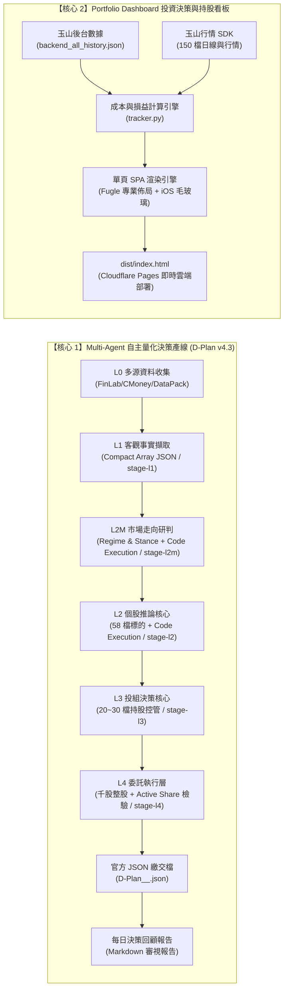
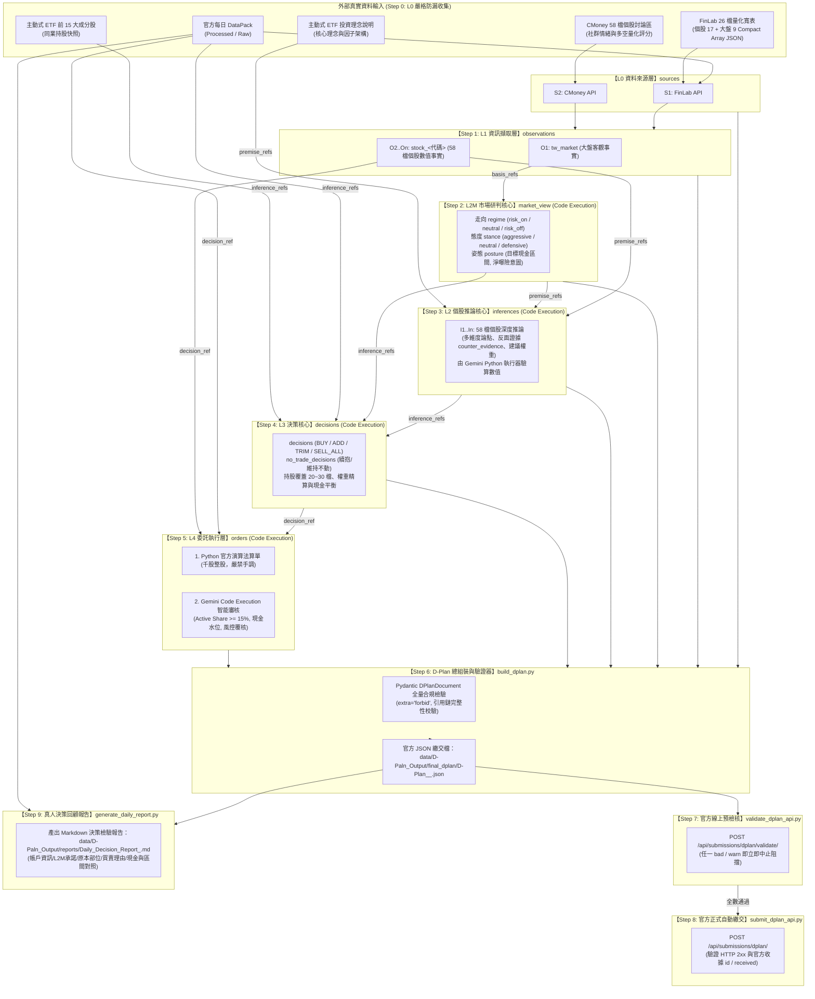

# 2026 玉山人工智慧挑戰賽 (AI CUP 2026)
## Multi-Agent 自主量化投資決策系統 (D-Plan v4.3) & 即時持股看板

- **參賽隊伍**：`TEAM_11402`
- **競賽主題**：2026 Agent 基金經理人公開挑戰賽
- **核心架構**：階層式因果推論 Multi-Agent 產線 (L0 ➔ L1 ➔ L2M ➔ L2 ➔ L3 ➔ L4 ➔ D-Plan 總組裝 ➔ 官方預檢核與自動繳交 ➔ 每日決策回顧報告) + 即時資產與持股監控看板 (Portfolio Dashboard)
- **規範標準**：嚴格遵循官方 **D-Plan Schema v4.3** 與 **D-Plan 撰寫指南 v4.3**
- **模型核心**：LiteLLM Router + Google Gemini 雙軌分流路由架構 (`stage-l1` 採用 `gemini-3.8-flash`，其餘核心決策採用 `gemini-4-argon`，並配置自動 Fallback 降級備援機制與 Gemini 原生 Code Execution 程式碼執行器)

---

## 系統雙核心概覽



### 1. 🤖 Multi-Agent 自主量化投資決策系統
- **LiteLLM 統一管理與 Multi-Model 路由**：全面改用 `litellm.Router` 集中管理大模型調用與自動 Fallback 備援。依任務特性精準分流：L1 客觀事實提取配置輕快且低成本的 `gemini-3.8-flash`；L2M、L2、L3、L4 等高階推理與數值運算階段配置 `gemini-4-argon`。
- **Gemini 原生 Code Execution 強化**：在 L2M 市場研判、L2 個股推論、L3 投組決策與 L4 委託計算階段全面啟用 Gemini 內建 Python 執行沙盒，徹底解決 LLM 在複雜權重配置、千股取整與風控比率時的數值幻覺。
- **因果引用鏈完備**：嚴格落實 L0 ➔ L1 ➔ L2M ➔ L2 ➔ L3 ➔ L4 單向無循環引用，使用 Pydantic `extra='forbid'` 全量驗證，防範孤兒節點與格式錯誤。
- **58 檔精選候選池**：精選 58 檔涵蓋半導體、AI 伺服器、電子零組件、網通、航運、金融與傳統產業代表標的，提供充沛的超額 Alpha 空間。
- **19 項原生 Usage 監控與本地結算**：全量對齊 LiteLLM 原生標準命名（Tokens、Cost、Duration、Reasoning、Code Execution 呼叫明細等），自動合併結算至本地 `usage_history.json`。

### 2. 📊 Portfolio Dashboard 投資決策與持股看板
- **設計風格**：富果 Fugle 專業看盤佈局 + Apple macOS 冷冽藍灰 / 冰川銀液態玻璃（Liquid Glassmorphism），具備**置頂單行懸浮導航膠囊**（下滑自動精簡為單行，零版面位移）與輕量化 GPU 合成優化。
- **六大功能分頁**：
  - **頁籤 1【📊 帳戶總覽】**：可交易淨值 (NAV)、現金水位、累計與當日報酬率、**競賽排名 (總/社會組)**、**NAV/Cash、累計總報酬率、競賽排名與單日報酬率趨勢圖表**、庫存損益明細（含**個股持有天數**、**FIFO 分批買進明細展開抽屜**與即時多欄位排序）。
  - **頁籤 2【📈 行情群組】**：動態劃分「我的持股 (20~30 檔)」與「其餘標的」，具備漲跌幅排序、即時搜尋過濾、微型走勢圖 (Sparklines)。
  - **頁籤 3【🧾 歷史成交明細】**：彙整官方後台 JSON 累計買賣金額、手續費、證交稅與淨已實現損益，並支援依交易日、買賣方向與個股即時篩選成交紀錄。
  - **頁籤 4【📄 決策報告】**：內建安全 Markdown 渲染器（Marked + DOMPurify），支援歷史報告日期切換、自動生成章節目錄與一鍵複製原文。
  - **頁籤 5【🤖 AI 模型成本監控】**：視覺化呈現 19 項 LiteLLM Usage 指標、每日花費/Token 雙軸圖、L1~L4 階段費用佔比、**全階段動態路由與備援架構 (`models_config.yaml`)** 及每日下鑽執行明細。
  - **頁籤 6【💡 專案亮點】**：ETF 投資策略、L0 ➔ L4 決策架構概覽、6 大技術亮點卡片與 GitHub Repository 導覽連結。
- **自動化發布**：每日一鍵更新腳本（支援 `--reports-only` 快速重建），綁定 Cloudflare Pages 免費全自動 Git CI/CD 部署，手機、平板、電腦端隨時檢視最新損益與行情。

---

## 📌 近期系統重大更新 (Recent Updates)

1. **全面接入 LiteLLM Router 與 Multi-Model 動態路由架構**：
   - 建立集中式路由設定檔 `code/models_config.yaml`，透過 `litellm.Router` 統一大模型調用與例外降級。
   - 依任務階層分流規則：
     - `stage-l1`：預設主力 `gemini/gemini-3.8-flash`（Fallback 備援：`gemini/gemini-3.5-flash-lite`）。
     - `stage-l2m`、`stage-l2`、`stage-l3`、`stage-l4`：預設主力高階推理模型 `gemini/gemini-4-argon`（Fallback 備援：`gemini/gemini-3.6-flash`）。
   - 具備自動重試 (`num_retries=2`) 與遇 Rate Limit、超時或異常時無縫降級切換至備援模型之高可用架構。
2. **升級 19 項標準 LiteLLM Usage 指標與歷史自動結算**：
   - 淘汰舊版自訂命名，全面對齊 LiteLLM 原生標準欄位：`timestamp`, `date`, `provider`, `model`, `model_group`, `stage`, `status`, `finish_reason`, `duration_seconds`, `prompt_tokens`, `completion_tokens`, `total_tokens`, `cached_tokens`, `tool_use_tokens`, `reasoning_tokens`, `response_cost`, `code_execution_used`, `code_execution_call_count`, `executed_codes`。
   - 各模組執行完畢自動產出獨立用量檔，產線尾端自動結算匯總至 `data/D-Paln_Output/usage/usage_history.json` 與 `code/portfolio_dashboard/usage_history.json`。
3. **現代化環境變數管理與憑證安全提升 (.env)**：
   - 正式廢除舊版 `credentials.json`，改用產業標準的 `code/.env` 檔案載入 `GEMINI_API_KEY` 與 `TEAM_ID`，並提供 `code/.env.example` 範本以避免私密金鑰誤入版本控制。
4. **多層 JSON 解析防禦與最新 json-repair 整合**：
   - 在串流模式原生傳遞 Pydantic `response_format` 結構模型，由模型解碼底層直接保證 JSON 語法精確。
   - 整合最新版 `json-repair>=0.64.9`，實作 `model_validate_json` $\rightarrow$ `json.loads` $\rightarrow$ `json_repair.loads` 三層容錯防禦鏈，徹底消除超長輸出下的微小格式瑕疵。
5. **產線抽樣除錯指令支援 (`--input-date`, `--max-stocks`)**：
   - 在 `run_daily_dplan.py` 與 `fact_extractor.py` 中支援自訂讀取特定日期輸入與限制測試個股數量（例如抽樣 2~3 檔），大幅節省測試時的 Token 成本與等待時間。
6. **Gemini 3+ / 4 取樣參數規範與 DeprecationWarning 防護**：
   - 遵循 Google 與 LiteLLM 最新規範，針對具備深度思考機制之模型（Gemini 3+ 與 Gemini 4），自動省略傳統 `temperature` / `top_p` 參數，改由提示詞導引取樣，避免終端出現警告訊息。
7. **基本面指標動態回補演算法 (自適應各公司公告時間)**：
   - 針對上市櫃公司季報與月營收公告日期不一的實務挑戰，全面改寫 `stock_indicators.py` 中的三項基本面指標（`roe_latest`、`revenue_yoy_latest`、`revenue_mom_latest`）：
     - **動態回溯最新非空值 (Not-NaN)**：每檔股票獨立檢驗歷史序列，有 Q3 則取 Q3，尚未公布則自動往前遞補取 Q2；有當月營收（如 11 月）則取當月，尚未公布則向前遞補取前一月（如 10 月）。
     - **Compact Array JSON 字典輸出**：回傳 `{"_format": "[value, date]", "個股代碼": {"指標名稱": [數值, 日期/季度]}}`，完整保留每檔股票真實數據對應的發布時間戳。
     - **L1 自動對齊**：由 `fact_extractor.py` 自動提取各自的日期/季度標籤並注入 Prompt，徹底消除過去鎖定單一歷史日期或因空值導致特徵缺失的瓶頸。
8. **候選股票池確立為精選 58 檔**：
   - 依據 `58檔股票池.csv`，將全產線候選標的池精確校準為 58 檔龍頭標的（涵蓋 2330 台積電、2454 聯發科、2383 台光電、2376 技嘉、2603 長榮等），全量同步至 L0 資料爬取、L1 客觀事實、L2 個股推論與 L3 投組決策。
9. **L2 自訂分析邏輯專區升級 (CUSTOM_STOCK_ANALYSIS_LOGIC)**：
   - 在 `stock_inference_agent.py` 確立兩階段推論標準規範：
     - **第一階段（個股深入分析）**：多維度考量企業品質 (ROE/營收)、技術動能結構 (均線/KD/MACD/布林通道)、法人籌碼強度 (外資/投信) 與市場社群討論熱度，並強制產出客觀的反面證據思考 (`counter_evidence`)。
     - **第二階段（選股與組合決策）**：落實主動式 ETF「兼顧企業品質、營運改善與潛在成長動能」之投資理念，進行多維度取捨與權重規劃。
10. **26 檔量化寬表全面 Compact Array JSON 快取**：
    - 大盤 9 檔 + 個股 17 檔指標全面優化為精簡 Compact Array JSON，大幅降低檔案體積與 L1 Prompt Token 消耗。
11. **DataPack 帳戶路徑演變與持倉移動停利追蹤 (`datapack_loader.py`)**：
    - 結合歷史 `DataPack/Raw/*.json` 與 `backend_reports/backend_all_history.json`（保留 4 位小數真實成交價；無 JSON 時退回 `*.htm`），新增賽期進度、帳戶淨值演變（累計報酬、MDD、1D/3D/5D 變化率、連虧天數、近 5 日走勢），並將 `holdings` 合併為每檔單行 Compact JSON（含 `entry_date`、`holding_days`、`avg_cost`、`pnl_pct`、`peak_price`、`peak_pnl_pct`、`dd_from_peak_pct`），同步強化 L2M / L2 / L3 Prompt。
12. **CMoney 個股情緒合併進個股 Compact Array JSON 與確切日期追蹤**：
    - `cmoney_sentiment_crawler.py` 恢復 `統計開始時間` / `統計結束時間`；`fact_extractor.py` 新增情緒三占比計算（含樣本數為 0 防護）並併入個股指標 JSON，同時於 L1 / L2 Prompt 補充數值含意指引。
13. **Portfolio Dashboard 5 分頁擴充與冷冽液態玻璃視覺重構 (`builder.py`, `tracker.py`)**：
    - 新增 **FIFO 分批買進明細**、**個股持有天數**與**累計總報酬率 (%) 趨勢圖**，並新增 Tab 3（AI 成本監控）、Tab 4（每日決策報告瀏覽器）與 Tab 5（專案架構與技術亮點 + GitHub 連結）。
    - 統一全站液態膠囊按鈕與 Model 水滴微膠囊標籤、重構為冷冽藍灰／冰川銀背景、實作下滑單行懸浮導航（零版面位移遲滯偵測），並移除高耗能濾鏡與重繪瓶頸大幅提升流暢度。
14. **後台數據管線全面升級為 Python OAuth2 SSO 全自動直抓 (`backend_history_loader.py`)**：
    - 淘汰過去手動另存 `.htm` 與 Tampermonkey 手動匯出，改由 `L0_sources/backend_history_loader.py` 透過官方 OAuth2 SSO 自動登入並抓取後台 API，輸出全賽期完整的 `data/backend_reports/backend_all_history.json`（保留 `*.htm` 為備援）。
    - 採「增量更新 + 重抓最新 1 日」模式（支援 `--full` 全量重抓）與原子寫入，並直接整合進 `run_daily_dplan.py`（Step 0a，先於 `datapack_loader.py` 執行）與 `portfolio_dashboard/run_update.py`，提供 4 位小數精確成交價、手續費／證交稅、官方單日／累計報酬率與競賽排名給下游 `datapack_loader.py` 與 `tracker.py`。
15. **CMoney 個股情緒 API 免登入全自動訪客憑證萃取 (`cmoney_sentiment_crawler.py`)**：
    - 淘汰過去需每日手動從瀏覽器複製 `Authorization` Bearer Token 與 Session 的繁瑣流程，徹底消除超過 24 小時即驗證失效導致自動化產線中斷的痛點。
    - **核心運作原理**：利用 CMoney 採用 **SSR（伺服器端渲染）** 架構的特性，每次以無狀態請求訪問討論區 HTML 時，後端皆會在原始碼內嵌一組全新的 24 小時訪客 JWT（`is_guest: true`、`app_id: 21`）。
    - **全自動驗證與容錯**：程式啟動時透過 `ensure_guest_token()` 自動抓取討論區 HTML 並萃取出 `eyJ...` 訪客 Token，搭配 `is_token_valid()` 解碼 JWT 檢查 `exp` 效期（預留 60 秒緩衝）與動態生成的 `DEVICE_ID`，且在遭遇 `401` 時自動強制重抓憑證並重試，實現零人工介入的全自動批次抓取。
16. **DataPack API 全自動下載與 D-Plan / 看板端到端連動 (`datapack_loader.py`, `run_daily_dplan.py`, `run_update.py`)**：
    - **淘汰手動下載 DataPack**：`datapack_loader.py` 複用 `EsunChallengeClient` 的 OAuth2 SSO 登入，自動呼叫後台 `/api/data-pack/` 下載並原子更新 `data/Datapack/Raw/` 最新檔案（若指定過去日期會自動退回本地歷史檔，亦提供 `--no-fetch` 離線模式）。
    - **後端與看板單向自動連動**：`run_daily_dplan.py` 自動化產線最後會自動呼叫 `portfolio_dashboard/run_update.py --skip-backend-fetch` 同步更新看板（不重複登入後台 API，加上 `--push-dashboard` 可自動 `git commit & push` 部署至 Cloudflare Pages）；而日常單獨執行 `run_update.py` 則會同步最新後台歷史、最新 DataPack 與看板，不會觸發 D-Plan 產線。
17. **官方後台線上預檢核、正式自動繳交與 L4 市值精算修正 (`validate_dplan_api.py`, `submit_dplan_api.py`, `order_calculator.py`)**：
    - **Step 7 官方預檢核 (`validate_dplan_api.py`)**：於 D-Plan 組裝完成後自動上傳 `/api/submissions/dplan/validate/` 進行線上預檢核，並以易讀中文格式彙整各分組（如 `交易規則`、`警告`）之 `bad` / `warn` 項目；預設採嚴格模式，任何未通過（`bad > 0` 或 `warn > 0`）即立刻中止流程，阻擋後續繳交。
    - **Step 8 官方正式自動繳交 (`submit_dplan_api.py`)**：僅於 Step 7 預檢核完全通過後才呼叫 `/api/submissions/dplan/` 正式送出，並嚴格驗證 `2xx` 回應、`counts.bad == 0` 與官方收據欄位（`id` / `status=received` / `stored.gcs_path`），同步顯示繳交編號與今日剩餘次數（支援 `--dry-run` 安全測試）。
    - **L4 預估持股市值與現金修正 (`order_calculator.py`)**：修正 `calculate_orders_python()` 過去僅計算有異動決策 (`decisions`) 而遺漏續抱部位的問題，改以全量既有持股為基準更新目標股數，並以 DataPack `close_price` 補齊 L1 缺漏收盤價，確保預估股票市值、剩餘現金比率與 Active Share 完全精確。

---

## 目錄導覽 (Table of Contents)

1. [系統整體架構與因果推論鏈](#一系統整體架構與因果推論鏈)
2. [專案目錄與檔案結構](#二專案目錄與檔案結構)
3. [資料流與目錄輸入輸出對照 (I/O)](#三資料流與目錄輸入輸出對照-io)
4. [各階層 Agent 深度邏輯與運算規範](#四各階層-agent-深度邏輯與運算規範)
   - [L0 資料來源與爬取層 (L0_sources)](#l0-資料來源與爬取層-l0_sources)
   - [L1 資訊擷取層 (L1_observations)](#l1-資訊擷取層-l1_observations)
   - [L2M 市場判斷鏈 (L2M_market_view)](#l2m-市場判斷鏈-l2m_market_view)
   - [L2 個股推論層 (L2_inferences)](#l2-個股推論層-l2_inferences)
   - [L3 投資組合決策層 (L3_decisions)](#l3-投資組合決策層-l3_decisions)
   - [L4 委託執行層 (L4_orders)](#l4-委託執行層-l4_orders)
   - [D-Plan 總組裝與全量合規校驗 (build_dplan.py)](#d-plan-總組裝與全量合規校驗-build_dplanpy)
   - [每日決策與帳戶回顧報告 (generate_daily_report.py)](#每日決策與帳戶回顧報告-generate_daily_reportpy)
5. [端到端每日產線入口 (run_daily_dplan.py)](#五端到端每日產線入口-run_daily_dplanpy)
6. [Gemini 內建 Code Execution (程式碼執行) 機制](#六gemini-內建-code-execution-程式碼執行-機制)
7. [Prompt 自動存檔與日後回溯機制](#七prompt-自動存檔與日後回溯機制)
8. [LiteLLM 原生 19 項標準 Usage 監控與本地結算機制](#八litellm-原生-19-項標準-usage-監控與本地結算機制)
9. [交易日期終端機互動輸入設計](#九交易日期終端機互動輸入設計)
10. [環境建置與憑證設定](#十環境建置與憑證設定)
11. [完整命令列操作手冊 (CLI Cheatsheet)](#十一完整命令列操作手冊-cli-cheatsheet)
12. [投資決策與持股看板 (Portfolio Dashboard)](#十二投資決策與持股看板-portfolio-dashboard)
13. [競賽法規檢核與重要實測注意事項](#十三競賽法規檢核與重要實測注意事項)

---

## 一、系統整體架構與因果推論鏈

本系統依據官方 D-Plan 因果引用鏈標準設計，各 Agent 階層具備嚴格的資訊邊界與上下游依賴關係：



### 因果引用鏈規範原則 (Causal Citation Chain)
1. **嚴禁孤兒引用與斷鏈**：`L2M.basis_refs` 必須來自 `L1.obs_id`；`L2.premise_refs` 必須來自 `L1.obs_id`；`L3.inference_refs` 必須來自 `L2.inf_id`；`L4.decision_ref` 必須來自 `L3.decision_id`。
2. **單向無循環**：各層僅能引用直接上層或經定義的合法來源，禁止跨層跳躍或反向引用。
3. **無未定義額外欄位**：全數使用 Pydantic 模型驗證，設定 `extra='forbid'`，確保不會輸出任何競賽官方 Schema 未定義之自訂欄位。
4. **全端無漏抓檢核**：資料收集各環節具備失敗拋錯阻斷機制，確保進入 L1 之前的基礎特徵完全齊備。

---

## 二、專案目錄與檔案結構

```text
2026玉山人工智慧賽/
├── .gitignore                                # 全專案忽略規則 (排除 .env、金鑰、Google Drive 捷徑等)
├── README.md                                 # 專案完整說明文件 (本檔案)
│
├── code/                                     # 【核心程式碼與自動化產線】
│   ├── models_config.yaml                    # LiteLLM Multi-Model 路由群組與 Fallback 設定檔
│   ├── .env.example                          # 環境變數安全範本 (GEMINI_API_KEY, TEAM_ID, ESUN_EMAIL, ESUN_PASSWORD)
│   ├── configs/                              # 專案環境與共用工具
│   │   ├── settings.py                       # 環境變數 (.env) 載入、路徑常數與金鑰管理
│   │   ├── gemini_client.py                  # LiteLLM Router 封裝 (支援串流、結構化輸出、Code Execution 與 19 項標準 Usage 統計)
│   │   ├── date_utils.py                     # 終端機互動式日期提示、標準化 (YYYYMMDD) 與格式轉換工具
│   │   └── json_utils.py                     # 精簡 Compact JSON 序列化工具
│   ├── schemas/                              # 【Schema 定義與檢驗層】
│   │   ├── dplan_models.py                   # 依 D-Plan Schema v4.3 建立的嚴格 Pydantic 資料模型
│   │   └── verify_dplan.ipynb                # D-Plan JSON 格式校驗、斷鏈檢測與測試 Notebook
│   ├── L0_sources/                           # 【L0 資料來源與爬取層】(嚴格防漏，任一失敗即報錯中斷)
│   │   ├── backend_history_loader.py         # 透過 OAuth2 SSO 自動抓取競賽後台歷史數據 (輸出 backend_all_history.json)
│   │   ├── datapack_loader.py                # 讀取官方每日 DataPack JSON (取現金、庫存、NAV、合規狀態)
│   │   ├── finlab_market_loader.py           # 透過 FinLab API 計算 26 檔指標並輸出為 Compact Array JSON
│   │   ├── finlab_active_etf_loader.py       # 下載主動式 ETF 前 15 大成分股快照與權重
│   │   ├── cmoney_sentiment_crawler.py       # 爬取 CMoney 討論區 58 檔個股情緒與多空量化分數
│   │   ├── market_indicators.py              # 大盤多維度量化指標計算 (均線、報酬、回撤、融資、多空家數差)
│   │   ├── stock_indicators.py               # 58 檔個股多維度量化指標計算 (ROE、營收動能、量價比、法人買賣超)
│   │   └── esun_trial_loader.ipynb           # 玉山證券行情 Web API 盤前試撮資料快照測試
│   ├── L1_observations/                      # 【L1 資訊擷取層】
│   │   └── fact_extractor.py                 # 提取客觀事實陳述，解析 Compact Array JSON，呼叫 Gemini 並記錄 Prompt 與 Usage
│   ├── L2M_market_view/                      # 【L2M 市場研判核心】
│   │   └── market_view_agent.py              # 研判市場走勢 (regime)、操作態度 (stance) 與目標水位 (posture)，支援 Code Execution 並存檔 Prompt
│   ├── L2_inferences/                        # 【L2 個股推論核心】
│   │   └── stock_inference_agent.py          # 結合 58 檔標的與 ETF 理念產出深入推論與反思 (預設啟用 Code Execution)
│   ├── L3_decisions/                         # 【L3 投資組合決策層】
│   │   └── portfolio_decision_agent.py       # 執行持股全覆蓋分配 (decisions + no_trade)，控管 20~30 檔 (預設啟用 Code Execution)
│   ├── L4_orders/                            # 【L4 委託執行層】
│   │   └── order_calculator.py               # 官方千股整股演算法試算 + Active Share 檢驗 + Gemini 智能覆核 (預設啟用 Code Execution)
│   ├── portfolio_dashboard/                  # 【即時投資決策與持股看板】
│   │   ├── tracker.py                        # 成本與損益計算引擎 (優先解析 backend_all_history.json 與 Datapack/Raw/*.json)
│   │   ├── market_api.py                     # 玉山行情 API 模組 (取得 150 檔標的最新報價與歷史走勢)
│   │   ├── builder.py                        # 前端單頁應用 HTML 產生器 (富果 Fugle 佈局 + iOS 毛玻璃)
│   │   ├── run_update.py                     # 每日一鍵執行調度腳本 (支援 --push 自動發布至 Cloudflare Pages)
│   │   ├── dist/index.html                   # 最終產出之單頁完整應用 (SPA)
│   │   └── README.md                         # 看板使用與 Cloudflare Pages 部署說明
│   ├── etf_strategy/                         # 主動式 ETF 投資理念與選股因子研究
│   ├── convert_slack_qa/                     # 官方競賽 Slack 諮詢問答轉換與整理工具
│   ├── archive/                              # 舊版腳本與歷史封存檔案
│   ├── build_dplan.py                        # 【D-Plan 總組裝與驗證器】全層合規校驗，輸出至 final_dplan
│   ├── validate_dplan_api.py                 # 【官方線上預檢核】上傳 /validate/ 嚴格檢查 bad/warn，未通過即阻擋
│   ├── submit_dplan_api.py                   # 【官方正式繳交】上傳 /dplan/ 正式送出並驗證收據與剩餘次數
│   ├── generate_daily_report.py              # 【每日決策與帳戶回顧報告】Python 自動生成高品質 Markdown 審視報告
│   ├── run_daily_dplan.py                    # 【每日自動化端到端主產線】排程/一鍵循序執行 Step 0 ~ Step 10
│   ├── requirements.txt                      # 專案相依 Python 套件清單
│   ├── credentials.json                      # [本地] 舊版憑證 (已由 .gitignore 忽略保護)
│   └── .env                                  # [本地] 環境變數與 API 金鑰 (已由 .gitignore 忽略保護)
│
├── data/                                     # 【資料輸入與各階段生成產物】
│   ├── Datapack/                             # 官方每日 DataPack 原始檔 (Raw/) 與解析結果 (Processed/)
│   ├── backend_reports/                      # 玉山競賽後台歷史數據 JSON (backend_all_history.json) 與備援 HTML 快照
│   ├── 大盤/, 基本面/, 技術面/, 籌碼面/       # FinLab 26 檔指標 Compact Array JSON 快取
│   ├── CMoney_Sentiment/                     # CMoney 討論區情緒爬取結果
│   ├── Active_ETF_Holdings/                  # 主動式 ETF 前 15 大持股標竿快照
│   ├── ETF_Strategy/                         # 主動式 ETF 投資理念 Markdown 文件
│   └── D-Paln_Output/                        # 各 Agent 產出 JSON、Prompt、Usage 與最終 D-Plan
│
└── docs/                                     # 【競賽參考文件、架構圖與研究資料】
    ├── 官方參考文件/                          # 官方競賽辦法、D-Plan Schema v4.3、DataPack 規格書與範例
    ├── 股票池/                                # 候選股票池篩選紀錄與歷次清單 (40/58/59/62 檔)
    ├── 架構圖/                                # Multi-Agent 系統架構圖 (.drawio / .png)
    ├── API說明/                               # 相關 API 參考文件
    ├── slackdump/                            # 官方 Slack 問答備份壓縮檔
    ├── 20261112 個股指標_修改_新增.docx       # 個股指標規劃與調整紀錄文件
    └── 課程完成證明截圖-Team_11402.png         # 隊伍課程完成證明截圖
```

---

## 三、資料流與目錄輸入輸出對照 (I/O)

所有生成資料與中間產物統一維護於專案根目錄的 `data/` 目錄中：

| 階層 / 程式模組 | 主要輸入資料來源路徑 (Input) | 主要產出檔案路徑 (Output) | Prompt 留存與 Usage 統計 |
| :--- | :--- | :--- | :--- |
| **L0 Sources**<br>`backend_history_loader.py` | 玉山競賽後台 OAuth2 SSO + API (`dashboard` / `portfolio` / `trades`) | 官方後台歷史 JSON：<br>`data/backend_reports/backend_all_history.json` | *(增量更新 + 重抓最新 1 日；`--full` 全量重建)* |
| **L0 Sources**<br>`datapack_loader.py` | 玉山競賽後台 `/api/data-pack/` (自動下載最新)、<br>本地 `data/Datapack/Raw/DataPack_*_YYYY-MM-DD.json`、<br>後台成交紀錄：`data/backend_reports/backend_all_history.json` | 原始 JSON：`data/Datapack/Raw/DataPack_*.json`<br>轉換後 Markdown：`data/Datapack/Processed/DataPack_Processed_YYYYMMDD.md` | *(支援 `--no-fetch` 離線模式)* |
| **L0 Sources**<br>`finlab_market_loader.py`<br>`cmoney_sentiment_crawler.py`<br>`finlab_active_etf_loader.py` | FinLab API、CMoney API、主動 ETF 公開資訊 | Compact Array JSON 快取：<br>`data/大盤/*.json`, `data/技術面/*.json`,<br>`data/基本面/*.json`, `data/籌碼面/*.json`,<br>`data/CMoney_Sentiment/`, `data/Active_ETF_Holdings/`,<br>`data/D-Paln_Output/l0_sources/` | *(純資料下載與向量計算，失敗立即阻斷)* |
| **Step 1: L1 Observations**<br>`fact_extractor.py` | `data/大盤/*.json`, `data/技術面/*.json`, `data/基本面/*.json`, `data/籌碼面/*.json`, `data/CMoney_Sentiment/` | `data/D-Paln_Output/l1_observations/`<br>👉 `l1_observations_YYYYMMDD.json` | **Prompt**:<br>`l1_observations_prompt_YYYYMMDD.txt`<br>**Usage**:<br>`usage/l1_usage_YYYYMMDD.json` |
| **Step 2: L2M Market View**<br>`market_view_agent.py`<br>*(預設啟用 Code Execution)* | `data/D-Paln_Output/l1_observations/` (大盤觀察),<br>`data/Datapack/Processed/` (帳戶快照) | `data/D-Paln_Output/l2m_market_view/`<br>👉 `l2m_market_view_YYYYMMDD.json` | **Prompt**:<br>`l2m_market_view_prompt_YYYYMMDD.txt`<br>**Usage**:<br>`usage/l2m_usage_YYYYMMDD.json` |
| **Step 3: L2 Inferences**<br>`stock_inference_agent.py` | `data/D-Paln_Output/l1_observations/` (58 檔個股與大盤),<br>`data/D-Paln_Output/l2m_market_view/`,<br>`data/ETF_Strategy/etf_strategy.md`,<br>`data/Datapack/Processed/` | `data/D-Paln_Output/l2_inferences/`<br>👉 `l2_inferences_YYYYMMDD.json` | **Prompt**:<br>`l2_inferences_prompt_YYYYMMDD.txt`<br>**Usage**:<br>`usage/l2_usage_YYYYMMDD.json`<br>*(預設啟用 Code Execution)* |
| **Step 4: L3 Decisions**<br>`portfolio_decision_agent.py` | `data/D-Paln_Output/l2_inferences/`,<br>`data/D-Paln_Output/l2m_market_view/`,<br>`data/Datapack/Processed/` (昨日持股明細),<br>`data/Active_ETF_Holdings/` (前 15 大標竿) | `data/D-Paln_Output/l3_decisions/`<br>👉 `l3_decisions_YYYYMMDD.json` | **Prompt**:<br>`l3_decisions_prompt_YYYYMMDD.txt`<br>**Usage**:<br>`usage/l3_usage_YYYYMMDD.json`<br>*(預設啟用 Code Execution)* |
| **Step 5: L4 Orders**<br>`order_calculator.py` | `data/D-Paln_Output/l3_decisions/`,<br>`data/Datapack/Processed/` (NAV 與現有持股),<br>`data/D-Paln_Output/l1_observations/` (收盤價),<br>`data/Active_ETF_Holdings/` | `data/D-Paln_Output/l4_orders/`<br>👉 `l4_orders_YYYYMMDD.json`<br>👉 `l4_orders_python_YYYYMMDD.json` | **Prompt**:<br>`l4_orders_prompt_YYYYMMDD.txt`<br>**Usage**:<br>`usage/l4_usage_YYYYMMDD.json`<br>*(預設啟用 Code Execution)* |
| **Step 6: D-Plan Assembler**<br>`build_dplan.py` | 讀入上述所有子目錄中的最新 JSON | `data/D-Paln_Output/final_dplan/`<br>👉 **`D-Plan_<team_id>_<trade_date>.json`** | *(總裝配器，校驗引用鏈並注入 metadata)* |
| **Step 7: Official Pre-Validation**<br>`validate_dplan_api.py` | 最終 `D-Plan_<team_id>_<trade_date>.json` | 終端機精簡中文檢核摘要 | *(呼叫官方 `/api/submissions/dplan/validate/`；有 `bad`/`warn` 即中斷阻擋)* |
| **Step 8: Official Submission**<br>`submit_dplan_api.py` | 最終 `D-Plan_<team_id>_<trade_date>.json` | 官方後台收據（`id`、`status=received`、`attempts_remaining`） | *(僅於 Step 7 通過後送出 `/api/submissions/dplan/`；支援 `--dry-run`)* |
| **Step 9: Review Report**<br>`generate_daily_report.py` | 最終 `D-Plan_*.json`、原始 `DataPack_*.json` | `data/D-Paln_Output/reports/`<br>👉 **`Daily_Decision_Report_<YYYYMMDD>.md`** | *(由 Python 產出真人檢視與風控對照報告)* |
| **Step 10 / 獨立執行: Portfolio Dashboard**<br>`run_update.py` | `data/backend_reports/backend_all_history.json` (後台歷史 JSON),<br>`data/Datapack/Raw/`, 玉山行情 SDK | `code/portfolio_dashboard/dist/`<br>👉 **`index.html`** (單頁看板應用) | *(由 `run_daily_dplan.py` Step 10 自動連動，或單獨執行；支援 `--skip-backend-fetch` 與 `--push`)* |

---

## 四、各階層 Agent 深度邏輯與運算規範

### L0 資料來源與爬取層 (`L0_sources`)
- **嚴格防漏機制**：資料收集是後續推論基礎，各模組皆設有嚴格驗證。**任何一項下載或爬取失敗，立即拋出 `RuntimeError` 並中斷整個產線**，絕不容許缺漏資料進入模型。
- **`backend_history_loader.py`**：透過官方 OAuth2 SSO 自動登入玉山競賽後台，以「增量 + 最新日覆核」模式抓取每日排名、投組績效與完整分頁成交明細（4 位小數成交價、手續費與證交稅），寫入 `data/backend_reports/backend_all_history.json`。
- **`datapack_loader.py`**：透過 OAuth2 SSO 自動從後台 `/api/data-pack/` 下載最新 DataPack JSON（支援 `--no-fetch` 離線模式與歷史日退回），並結合 `backend_all_history.json` 計算持倉成本與移動停利追蹤，輸出 `DataPack_Processed_YYYYMMDD.md`。
- **`cmoney_sentiment_crawler.py`**：透過解析 CMoney SSR 網頁原始碼自動萃取 24 小時訪客 JWT Token（免登入、無需手動複製憑證，並內建 JWT `exp` 效期檢查與 401 自動重取重試機制），爬取討論區個股多空評分與社群熱度；**必須全數標的抓取成功**，若有失敗檔數立即報錯中斷。
- **`finlab_market_loader.py`**：透過 FinLab API 計算 26 檔市場特徵（個股 17 + 大盤 9），輸出為 Compact Array JSON 格式儲存；若有任何指標計算失敗即終止進程。
- **`stock_indicators.py` 基本面動態遞補演算法**：
  - 三大指標（`roe_latest`、`revenue_yoy_latest`、`revenue_mom_latest`）採個別股票動態回溯最新非空值（Not-NaN）：
    - ROE：最新公布 Q3 則取 Q3，未公布則向前遞補取 Q2。
    - 營收年增/月增率：最新公布當月營收則取當月，未公布則向前遞補取前一月。
  - 直接回傳 Compact Array JSON 格式，標註真實公告時間點，避免因公司公布時差產生空值或鎖定固定歷史日期的缺陷。
- **`finlab_active_etf_loader.py`**：下載同業主動式 ETF 前 15 大成分股快照與權重，供 Active Share 監控使用。

### L1 資訊擷取層 (`L1_observations/fact_extractor.py`)
- **職責**：將 raw data 提煉為客觀事實陳述，**嚴禁推論與預測**。
- **精簡 Compact Array JSON 整合**：直接讀取 `data/大盤/`, `data/基本面/`, `data/技術面/`, `data/籌碼面/` 下的 JSON 檔案，以 `[數值, 日期/季度]` 格式注入 Prompt，顯著減少 Token 佔用並提升解析速度。
- **大盤事實 (`tw_market`)**：恰好生成 1 筆大盤關鍵數據（指數點位、20MA/60MA、報酬率、最大回撤、法人買賣超、多空排列家數差）。
- **個股事實 (`stock_<ticker>`)**：針對 58 檔候選池逐檔生成 1 筆客觀事實，提取關鍵數值後由系統以資料原值完整補齊 `values` 字典。

### L2M 市場判斷鏈 (`L2M_market_view/market_view_agent.py`)
- **走向 (`regime`)**：`risk_on` / `neutral` / `risk_off`。
- **態度 (`stance`)**：`aggressive` / `neutral` / `defensive`。
- **姿態 (`posture`)**：
  - `target_cash_pct_range`：目標現金比例區間承諾（如 `[0.05, 0.15]`）。
  - `net_exposure_intent`：淨曝險意圖（`increase` 淨買超 / `hold` 維持 / `reduce` 淨賣超）。首日全現金建倉必須為 `increase`。
- **引用鏈**：`basis_refs` 必須引用 L1 的大盤事實 ID (`O1`)。

### L2 個股推論層 (`L2_inferences/stock_inference_agent.py`)
- **兩階段分析架構 (`CUSTOM_STOCK_ANALYSIS_LOGIC`)**：
  - **第一階段（個股深入分析）**：
    1. 企業營運與成長（最新 ROE 獲利品質、月營收年增率與月增率成長動能）。
    2. 價格趨勢與相對強弱（5日/20日報酬、20日相對大盤超額報酬 excess_return_20d、均線斜率與乖離、KD/MACD轉折動態、布林通道波動帶寬）。
    3. 交易活躍度與法人籌碼（量價配合關係、外資與投信近5日買賣超強度）。
    4. 情緒與討論風向（CMoney 討論度與多空評分、市場預期落差分析）。
    5. 個股綜合評估與反向證據（必須於 `counter_evidence` 詳列反面證據思考與不確定性）。
  - **第二階段（選股與組合決策）**：秉持主動式 ETF 理念進行客觀取捨，整合全維度支持與不利依據。
- **Gemini Code Execution 強化**：預設啟用 Gemini 內建 Python 執行器，由模型自主撰寫程式碼驗算數值與權重區間，確保數值推論的一致性與邏輯嚴謹性。
- **引用鏈**：`premise_refs` 必須引用 L1 的個股與大盤事實。

### L3 投資組合決策層 (`L3_decisions/portfolio_decision_agent.py`)
- **動作分類**：`BUY`（新建倉）、`ADD`（加碼）、`TRIM`（減碼）、`SELL_ALL`（全出清），不調整者分配至 `no_trade_decisions`（續抱）。
- **四大硬限制**：
  1. **昨日持股全覆蓋**：昨日持股必須 100% 恰好落在 decisions 或 no_trade_decisions 之一。
  2. **持股檔數限制**：非 0 權重持股檔數必須嚴格落於 **20 至 30 檔**。
  3. **個股權重上限**：一般股 $\le 10\%$；台積電 (2330) $\le 25\%$。
  4. **現金平衡**：預估現金必須落於 L2M 宣告之區間內。
- **Gemini Code Execution 強化**：預設啟用 Python 程式碼執行器，在生成決策前由模型自行編寫程式計算所有目標持股權重總和、剩餘現金比與檔數邊界，徹底防止配置超出 100% 或違反檔數規定。

### L4 委託執行層 (`L4_orders/order_calculator.py`)
- **Python 機械算單 (千股整股，嚴禁手調)**：
  $$\text{目標股數} = \left\lfloor \frac{\text{目標權重} \times \text{前日淨值}}{\text{前日收盤價} \times 1000} \right\rfloor \times 1000$$
  $$\text{委託股數} = \text{目標股數} - \text{目前持有股數}$$
- **Active Share 精算**：與主動式 ETF 標竿比對，確保主動性指標 $\ge 15\%$。
- **Gemini Code Execution 智能覆核**：針對 Active Share、取整偏離、剩餘現金與超賣風險進行雙重審視，透過執行驗算確保風控合規。

### D-Plan 總組裝與全量合規校驗 (`build_dplan.py`)
- **組裝元資料**：自動注入 `schema_version: "4.3"`, `team_id`, `trade_date`, 以及 `agent_metadata` (含 git commit hash 與執行時間戳)。
- **Pydantic 嚴格檢驗**：執行完整反向因果鏈與格式校驗 (`extra='forbid'`)，產出官方最終提交檔：
  `data/D-Paln_Output/final_dplan/D-Plan_<team_id>_<trade_date>.json`。

### 每日決策與帳戶回顧報告 (`generate_daily_report.py`)
- **目的**：提供真人經理人於自動化產線執行完畢後，快速進行全面覆核與風控確認。
- **核心章節**：
  1. **官方帳戶現況快照**：可交易淨值 (NAV)、現有現金、現金比、持股檔數、累計違規狀態。
  2. **L2M 大盤分析與承諾**：Regime、Stance、淨曝險意圖、**目標現金承諾區間**、推論邏輯與反向風險提示。
  3. **原有持股部位明細 (權重由高至低排序)**：排名、股票代號、股數、張數、昨日市價、現值、權重。
  4. **今日部位增減明細與決策理由**：列出每筆 BUY / SELL 之委託張數、預估金額、目標權重，以及**為什麼增減部位的具體決策理由**；列出續抱 (HOLD) 清單。
  5. **財務試算與 L2M 承諾對照檢驗**：
     - 買進總額 vs 賣出總額 ➔ **淨現金收支 (淨花費 / 淨套現)**。
     - **執行後預估剩餘現金**與**預估現金比例**。
     - **L2M 承諾對照**：預估現金比是否落入目標區間 (🟢 PASS / 🔴 FAIL)。
     - **淨曝險意圖檢驗**：承諾 increase / hold / reduce 與實際淨資金流向是否一致。
     - **持股檔數檢驗**：預估持股檔數是否符合 20 ~ 30 檔限制。
  6. **投資經理人覆核結論**：統整全量合規判定。

---

## 五、端到端每日產線入口 (`run_daily_dplan.py`)

`run_daily_dplan.py` 是每日自動化產線的核心調度器，完整串接 Step 0 到 Step 10：

```text
Step 0: L0 多源資料收集 (backend_history -> datapack -> cmoney -> finlab_market -> finlab_active_etf，任一失敗即報錯中斷)
Step 1: L1 事實提取 (fact_extractor.py)
Step 2: L2M 市場整體判斷 (market_view_agent.py, 啟用 Code Execution)
Step 3: L2 個股推論 (stock_inference_agent.py, 啟用 Code Execution)
Step 4: L3 投資組合配置決策 (portfolio_decision_agent.py, 啟用 Code Execution)
Step 5: L4 委託單計算與智能覆核 (order_calculator.py, 啟用 Code Execution)
Step 6: D-Plan 總組裝與全量合規校驗 (build_dplan.py) -> 產出 D-Plan_<team_id>_<trade_date>.json
Step 7: 官方後台線上預檢核 (validate_dplan_api.py) -> 任一 bad / warn 即立即中止，阻擋後續繳交
Step 8: 官方後台正式繳交 (submit_dplan_api.py) -> 僅於預檢核通過後送出並驗證收據成功
Step 9: 每日投資決策與投資組合回顧報告生成 (generate_daily_report.py) -> 產出 Markdown 報告供真人回顧
Step 10: 結算 LiteLLM Usage 並同步更新 Portfolio Dashboard (portfolio_dashboard/run_update.py --skip-backend-fetch)
```

### 命令列常用開關
- `--date <YYYYMMDD>`：指定交易日期（不提供時會於終端機詢問一次）。
- `--trade-date <YYYY-MM-DD>`：手動指定官方繳交檔宣告的 trade_date。
- `--team-id <TEAM_ID>`：指定參賽隊伍編號（預設 `TEAM_11402`）。
- `--skip-l0`：跳過 L0 資料收集階段（使用本地既有快取）。
- `--skip-l1`：跳過 L1 事實提取。
- `--skip-l2m` / `--skip-l2` / `--skip-l3` / `--skip-l4`：跳過指定 Agent 階段。
- `--skip-validate`：跳過 Step 7 官方後台線上預檢核。
- `--skip-submit`：跳過 Step 8 官方後台正式繳交（僅產出、檢核與更新看板，不實際送出繳交）。
- `--skip-report`：跳過 Step 9 Markdown 決策回顧報告產出。
- `--skip-dashboard`：跳過 Step 10 同步更新 Portfolio Dashboard 網頁。
- `--push-dashboard`：Step 10 更新完看板後自動執行 `git commit & push`（部署至 Cloudflare Pages）。

---

## 六、Gemini 內建 Code Execution (程式碼執行) 機制

在量化投資與資產配置中，LLM 對多位數四則運算、累積權重加總、取整偏差計算極易出現隨機數值幻覺。本系統在 `code/configs/gemini_client.py` 中完整實作 Google Gemini 原生 **Code Execution** 工具：

1. **核心原理**：向 LiteLLM Router 注入 `tools=[{"code_execution": {}}]` 工具宣告。當模型在 L2M 核算目標現金區間與市場風險指標、在 L2 進行因子權重加權、在 L3 進行 20~30 檔持股權重百分比配比、或在 L4 覆核千股整股與剩餘現金時，模型會**自主生成 Python 程式碼並在 Google 沙盒環境中執行**，直接以執行回傳的精確數值作為結構化 JSON 的填值依據。
2. **串流與非串流原始程式碼捕捉**：底層包裝 `ModelResponseIterator` 與 `completion_response._hidden_params`，完整捕捉沙盒執行的程式碼片段與次數，並存入 Usage 記錄的 `executed_codes`。
3. **預設啟用**：`market_view_agent.py`、`stock_inference_agent.py`、`portfolio_decision_agent.py`、`order_calculator.py` 均預設開啟 Code Execution。
4. **靈活開關**：若需關閉或進行離線測試，各腳本皆支援傳入 `--no-code-exec` 旗標以傳統純推論模式運行。

---

## 七、Prompt 自動存檔與日後回溯機制

為了解決手動測試與每日自動化執行時的除錯與審計需求，系統對所有 LLM 環節實施了**無條件 Prompt 自動存檔機制**：

1. **存檔時機**：無論是透過 `--dry-run` 執行、正常單獨執行、或經由 `run_daily_dplan.py` 調度，在呼叫大模型之前，系統皆會**第一時間將組裝完成的完整 Prompt 輸出至磁碟**。
2. **存檔路徑一覽**：
   - `data/D-Paln_Output/l1_observations/l1_observations_prompt_YYYYMMDD.txt`
   - `data/D-Paln_Output/l2m_market_view/l2m_market_view_prompt_YYYYMMDD.txt`
   - `data/D-Paln_Output/l2_inferences/l2_inferences_prompt_YYYYMMDD.txt`
   - `data/D-Paln_Output/l3_decisions/l3_decisions_prompt_YYYYMMDD.txt`
   - `data/D-Paln_Output/l4_orders/l4_orders_prompt_YYYYMMDD.txt`
3. **優勢**：若模型產生非預期推論或格式錯誤，研發人員可隨時開啟當日對應的 prompt 文字檔，精準比對輸入內容、資料長度與指令細節，大幅提升排查效率。

---

## 八、LiteLLM 原生 19 項標準 Usage 監控與本地結算機制

為了精確掌握多模型調用成本、Token 消耗量與代碼執行細節，本系統全面對齊 LiteLLM 原生標準欄位：

1. **各階段單獨用量記錄**：位於各階段輸出資料夾下的 **`usage/`** 子目錄中：
   - `data/D-Paln_Output/l1_observations/usage/l1_usage_YYYYMMDD.json`
   - `data/D-Paln_Output/l2m_market_view/usage/l2m_usage_YYYYMMDD.json`
   - `data/D-Paln_Output/l2_inferences/usage/l2_usage_YYYYMMDD.json`
   - `data/D-Paln_Output/l3_decisions/usage/l3_usage_YYYYMMDD.json`
   - `data/D-Paln_Output/l4_orders/usage/l4_usage_YYYYMMDD.json`
2. **19 項標準欄位結構**：
   - **時間與路由識別**：`timestamp`, `date`, `provider`, `model`, `model_group`, `stage`, `status`, `finish_reason`, `duration_seconds`
   - **LiteLLM 原生 Token 與成本**：`prompt_tokens`, `completion_tokens`, `total_tokens`, `cached_tokens`, `tool_use_tokens`, `reasoning_tokens`, `response_cost`
   - **Code Execution 追蹤**：`code_execution_used`, `code_execution_call_count`, `executed_codes`
3. **本地歷史結算中心**：
   產線在每日結束時會自動呼叫 `settle_usage_history()`，將當日所有階段的調用記錄匯總合併至：
   - `data/D-Paln_Output/usage/usage_history.json`
   - `code/portfolio_dashboard/usage_history.json`

---

## 九、交易日期終端機互動輸入設計

考量到競賽實務上「執行程式的日期不一定是實際交易日」（例如週日盤前預先試算週一的 D-Plan），所有入口均支援兩種日期指定模式：

1. **互動式終端輸入 (預設)**：直接執行命令時（不帶 `--date`），終端機會跳出提示，按 Enter 直接帶入今日，或手動鍵入目標日期。
2. **命令列明確指定 (自動化排程)**：排程腳本直接傳入 `--date 20261113` 即可靜默執行。

---

## 十、環境建置與憑證設定

### 1. Conda 環境建立與套件安裝
建議使用 Python 3.11 環境：
```bash
conda create -n esunaicup2026_py311 python=3.11 -y
conda activate esunaicup2026_py311
pip install -r code/requirements.txt
```

### 2. 環境變數設定 (`code/.env`)
複製 `code/.env.example` 建立 `code/.env`（由 `.gitignore` 排除，嚴禁提交真實金鑰）：
```bash
cp code/.env.example code/.env
```
`code/.env` 內容格式：
```ini
GEMINI_API_KEY="AIzaSy..."
TEAM_ID="TEAM_11402"
ESUN_EMAIL="your_email@example.com"
ESUN_PASSWORD="your_password"
```

### 3. LiteLLM 路由設定 (`code/models_config.yaml`)
系統在 `code/` 目錄下維護 `models_config.yaml`，可自由指定各任務階段的模型別名與降級備援清單：
```yaml
model_list:
  - model_name: stage-l1
    litellm_params:
      model: gemini/gemini-3.8-flash
  - model_name: stage-l1-fallback
    litellm_params:
      model: gemini/gemini-3.5-flash-lite
  - model_name: stage-l2
    litellm_params:
      model: gemini/gemini-4-argon
  - model_name: stage-l2-fallback
    litellm_params:
      model: gemini/gemini-3.6-flash
router_settings:
  fallbacks:
    - stage-l1: ["stage-l1-fallback"]
    - stage-l2: ["stage-l2-fallback"]
```

### 4. FinLab 登入認證
在終端機執行認證指令：
```bash
python -m finlab login
```

---

## 十一、完整命令列操作手冊 (CLI Cheatsheet)

> 以下指令皆假設已切換至 `code/` 目錄執行（`cd code`）。

### 1. 端到端一鍵完整生成
```bash
# 啟動每日全自動產線 (循序執行 Step 0 至 Step 10：抓取資料、決策、線上預檢核、正式繳交、報告與更新看板)
python run_daily_dplan.py

# 全自動產線 + 更新完看板後自動 git commit & push (含 Cloudflare Pages 自動部署)
python run_daily_dplan.py --push-dashboard

# 明確指定交易日期（若僅測試產出但不實際送出正式繳交，可加上 --skip-submit）
python run_daily_dplan.py --date 20261113 --skip-submit

# 抽樣測試模式 (讀取 20261112 輸入、測試輸出至 20261113，並僅抽樣前 3 檔標的)
python run_daily_dplan.py --date 20261113 --input-date 20261112 --max-stocks 3 --skip-l0

# 指定特定交易日並跳過已完成之階段 (例如重跑 L3 至報告)
python run_daily_dplan.py --date 20261113 --skip-l0 --skip-l1 --skip-l2m --skip-l2
```

### 2. 各模組單獨執行除錯

#### 【L0 資料下載與預處理】
```bash
# --- 玉山競賽後台歷史數據自動抓取 (OAuth2 SSO) ---
python L0_sources/backend_history_loader.py                    # 增量更新 + 重抓最新 1 日至 backend_all_history.json
python L0_sources/backend_history_loader.py --full             # 從 Day 1 全量重抓並覆蓋

# --- DataPack 自動下載、解析與轉 Markdown ---
python L0_sources/datapack_loader.py                           # 自動從 /api/data-pack/ 下載最新 DataPack 並轉換
python L0_sources/datapack_loader.py --date 20261028           # 指定日期 (若非 API 最新日則自動退回本地歷史 Raw 檔)
python L0_sources/datapack_loader.py --no-fetch --date 20261028 # 跳過 API 下載，僅使用本地 Raw 檔

# --- FinLab 市場資料與 Compact Array JSON 下載 ---
python L0_sources/finlab_market_loader.py                      # 下載 26 檔指標並快取為 Compact JSON
python L0_sources/finlab_market_loader.py --date 20261027      # 指定特定日期
python L0_sources/finlab_market_loader.py --overwrite          # 強制重新下載覆寫既有快取

# --- CMoney 輿情討論與情緒爬取 (58 檔) ---
python L0_sources/cmoney_sentiment_crawler.py                  # 爬取 58 檔熱門股討論熱度與量化情緒
python L0_sources/cmoney_sentiment_crawler.py --date 20261027  # 指定爬取基準日

# --- 主動式 ETF 前 15 大成分股快照 ---
python L0_sources/finlab_active_etf_loader.py                  # 下載主動式 ETF 標竿持股
python L0_sources/finlab_active_etf_loader.py --date 20261027  # 指定日期快照
```

#### 【L1 ~ L4 Agent、D-Plan 組裝與報告產出】
```bash
# --- L1 客觀事實擷取 ---
python L1_observations/fact_extractor.py                       # 互動式輸入日期 + 串流生成
python L1_observations/fact_extractor.py --date 20261113      # 指定特定輸出日期
python L1_observations/fact_extractor.py --date 20261113 --input-date 20261112 --max-stocks 3 # 抽樣測試模式
python L1_observations/fact_extractor.py --dry-run            # 僅組裝 Prompt 輸出 txt，不呼叫 API

# --- L2M 市場整體研判 ---
python L2M_market_view/market_view_agent.py                   # 研判走向、態度與現金水位承諾 (預設啟用 Code Execution)
python L2M_market_view/market_view_agent.py --no-code-exec     # 關閉 Code Execution
python L2M_market_view/market_view_agent.py --date 20261027
python L2M_market_view/market_view_agent.py --dry-run

# --- L2 個股推論 (58 檔) ---
python L2_inferences/stock_inference_agent.py                 # 個股多維度分析 + Code Execution 驗算
python L2_inferences/stock_inference_agent.py --date 20261027
python L2_inferences/stock_inference_agent.py --no-code-exec  # 關閉 Code Execution
python L2_inferences/stock_inference_agent.py --dry-run

# --- L3 投資組合決策 ---
python L3_decisions/portfolio_decision_agent.py               # 昨日持股全覆蓋 + 控管 20~30 檔
python L3_decisions/portfolio_decision_agent.py --date 20261027
python L3_decisions/portfolio_decision_agent.py --no-code-exec

# --- L4 委託單計算與審查 ---
python L4_orders/order_calculator.py                          # 完整執行 (Python 千股算單 + Gemini Code Execution 覆核)
python L4_orders/order_calculator.py --date 20261027
python L4_orders/order_calculator.py --no-gemini              # 僅執行 Python 官方公式算單
python L4_orders/order_calculator.py --no-code-exec           # 關閉 Code Execution
python L4_orders/order_calculator.py --dry-run

# --- D-Plan 總組裝與驗證器 ---
python build_dplan.py                                         # 自動組裝最新日期產出至 final_dplan
python build_dplan.py --date 20261027                         # 指定組裝日期
python build_dplan.py --trade-date 2026-10-27                 # 手動指定宣告之 trade_date

# --- 官方後台線上預檢核與正式繳交 ---
python validate_dplan_api.py                                  # 預檢核最新 D-Plan (有 bad/warn 即結束碼 1)
python validate_dplan_api.py --file "path/to/D-Plan.json"     # 預檢核指定檔案 (加 --allow-warn 可僅阻擋 bad)
python submit_dplan_api.py --dry-run                          # 測試 SSO 登入與讀檔，不實際送出繳交 POST
python submit_dplan_api.py --file "path/to/D-Plan.json"       # 正式送出 D-Plan 並驗證官方收據

# --- 每日決策與帳戶回顧 Markdown 報告 ---
python generate_daily_report.py                               # 根據最新 D-Plan 產出回顧報告
python generate_daily_report.py --date 20261028              # 指定日期
python generate_daily_report.py --dplan-path "path/to.json"   # 指定特定 D-Plan JSON 產生報告
```

---

## 十二、投資決策與持股看板 (Portfolio Dashboard)

除了每日自動化產線產出官方 D-Plan JSON 與 Markdown 報告外，本專案提供富果 Fugle 專業看盤佈局與 Apple macOS 冷冽藍灰 / 冰川銀液態玻璃美學的即時互動視覺化看板（詳細部署說明請見 [code/portfolio_dashboard/README.md](code/portfolio_dashboard/README.md)）：

### 1. 核心特色（6 大分頁）
- **頁籤 1【📊 帳戶總覽】**：
  - 即時呈現可交易淨值 (NAV)、現金餘額、累計與當日報酬率、**競賽總排名／社會組排名**。
  - **NAV / Cash、累計總報酬率 (%)、每日競賽排名走勢與單日報酬率 (%) 四組趨勢圖表**。
  - 持股損益明細表（支援**持有天數**、**FIFO 分批買進明細展開抽屜**與即時多欄位升降序排序）。
- **頁籤 2【📈 行情群組】**：
  - 動態群組切換：「我的持股」與「其餘標的」。
  - 即時搜尋股票代碼與名稱，支援漲跌幅即時排序。
  - 嵌入微型股價走勢圖 (Sparklines)，一眼掌握標的近期價格趨勢。
- **頁籤 3【🧾 歷史成交明細】**：
  - 統計累計買進／賣出金額、手續費與證交稅摩擦成本、扣費稅後淨已實現損益，並支援依交易日、買賣方向與關鍵字篩選每日成交明細。
- **頁籤 4【📄 決策報告】**：
  - 內建安全 Markdown 渲染器（Marked + DOMPurify），支援歷史報告日期切換、自動章節目錄與一鍵複製原文。
- **頁籤 5【🤖 AI 模型成本監控】**：
  - 視覺化呈現 19 項 LiteLLM Usage 指標、每日花費與 Token 消耗趨勢、L1~L4 階段費用佔比、全階段模型路由與備援降級架構及每日下鑽執行明細。
- **頁籤 6【💡 專案亮點】**：
  - 呈現 ETF 投資策略、L0 ➔ L4 決策架構概覽、6 大技術亮點與 GitHub Repository 導覽連結。
- **三段式主題（淺色預設）、懸浮導航與 RWD 適配**：
  - 支援淺色（預設，冰川銀灰）／深色（冷冽藍灰）／跟隨裝置三段切換（含 Android Chrome 動態網址列 `theme-color`），下滑自動精簡為單行懸浮導航膠囊，並針對手機、平板與電腦端提供輕量化流暢瀏覽體驗。

### 2. 每日收盤自動更新流程
1. **確認環境憑證**：於 `code/.env` 設定 `ESUN_EMAIL` 與 `ESUN_PASSWORD`（`run_update.py` 與 `run_daily_dplan.py` 執行時會自動登入後台 API 同步 `data/backend_reports/backend_all_history.json` 與最新 `data/Datapack/Raw/`）。
2. **一鍵執行更新**：
   ```bash
   cd code/portfolio_dashboard
   python run_update.py
   ```
   *(若已設定 Git，可加上 `--push` 自動提交並觸發 Cloudflare Pages 雲端部署)*：
   ```bash
   python run_update.py --push
   ```
3. **查看看板**：直接於瀏覽器開啟 [https://esun-ai-cup-2026-team11402-portfolio.pages.dev](https://esun-ai-cup-2026-team11402-portfolio.pages.dev)。

---

## 十三、競賽法規檢核與重要實測注意事項

1. **資料收集零漏抓原則**：
   - 每日資料收集（後台歷史數據、DataPack、CMoney 58 檔、FinLab 26 檔指標、Active ETF）為後續推論命脈，任一模組抓取異常或資料缺漏會直接中止產線，請確保網路與憑證正常。
2. **千股整股與禁止零股**：
   - L4 委託計算一律取 `floor(... / 1000) * 1000`，委託單股數必須為 1,000 的正整數倍，不可含有零股。
3. **持股檔數限制 (20 ~ 30 檔)**：
   - 最終目標持股檔數必須嚴格介於 20 至 30 檔之間。競賽首日全現金建倉時，L3 必須一次性產生 20～30 筆 BUY 決策，且 `no_trade_decisions` 必須為空陣列 `[]`。
4. **Active Share 規定 ($\ge 15\%$)**：
   - L4 自動比對同業主動式 ETF 前 15 大成分股權重，確保主動性指標符合規定，避免淪為指數複製基金。
5. **Code Execution 驗證**：
   - 建議維持預設開啟 Code Execution，確保持股權重加總、現金收支與 Active Share 皆經 Python 精確驗算。
6. **Prompt 永久留存與稽核**：
   - 所有階段產生的 Prompt 皆會保留於磁碟，若線上執行有疑慮可隨時調閱回溯。
7. **金鑰安全保護**：
   - 嚴禁將包含 API Key 的 `.env`、`credentials.json` 或 `docs/Google AI API Key.md` 提交至 Git。
