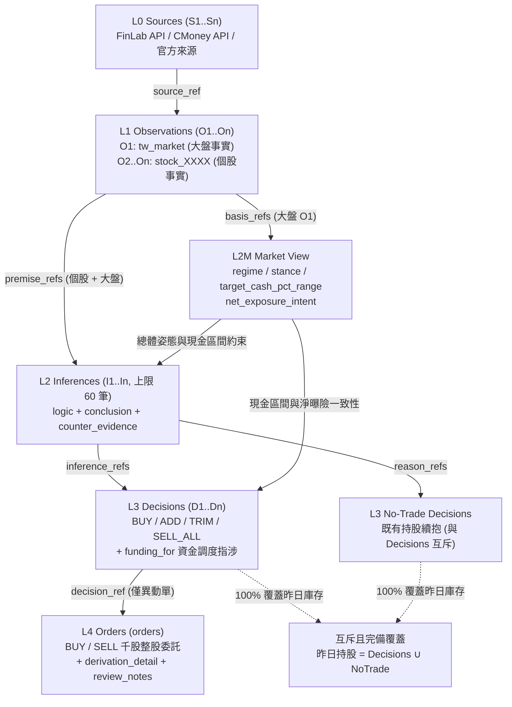

<div align="center">

# 🤖 2026 玉山人工智慧挑戰賽 · Multi-Agent 自主量化投資決策系統
### Autonomous Multi-Agent Quantitative Portfolio System (D-Plan v4.3) & Real-Time Portfolio Dashboard

**繁體中文** | [English](README_EN.md)

[](https://www.python.org/)
[](https://github.com/BerriAI/litellm)
[](https://ai.google.dev/)
[](https://docs.pydantic.dev/)
[](https://www.finlab.tw/)
[](https://esun-ai-cup-2026-team11402-portfolio.pages.dev)

**參賽隊伍**：`TEAM_11402` ｜ **競賽主題**：2026 Agent 基金經理人公開挑戰賽（社會組）｜ **規範標準**：D-Plan Schema v4.3 ｜ **初期資金**：新台幣 10 億元（`1,000,000,000`）

🌐 **[線上即時持股與 AI 成本監控看板 (Live Dashboard Demo)](https://esun-ai-cup-2026-team11402-portfolio.pages.dev)**

</div>

---

> **給技術面試官與架構師的閱讀指南**：本文件以系統白皮書架構撰寫，即使**完全不翻閱程式碼**，也能在 3～5 分鐘內透過架構圖、工程痛點對照、L0 ➔ L4 真實 JSON 資料流走查、45 項量化指標與風控數學推導，完整掌握本專案如何將 LLM 從「對話原型」工程化為「零數值幻覺、合規零容錯、端到端無人值守的金融級 Multi-Agent 生產系統」。

---

## 目錄導覽

1. [競賽實戰成果與系統預覽](#1-競賽實戰成果與系統預覽)
2. [專案背景與核心工程挑戰](#2-專案背景與核心工程挑戰)
3. [系統雙核心全景架構](#3-系統雙核心全景架構)
4. [AI 應用工程 8 大技術亮點](#4-ai-應用工程-8-大技術亮點)
5. [各階層 Agent 運作邏輯與端到端資料流走查](#5-各階層-agent-運作邏輯與端到端資料流走查)
6. [量化特徵工程總覽（45 項核心指標 + 篩選與輿情指標）](#6-量化特徵工程總覽45-項核心指標--篩選與輿情指標)
7. [風控合規機制與數學公式推導](#7-風控合規機制與數學公式推導)
8. [Portfolio Dashboard 即時投資決策與持股看板](#8-portfolio-dashboard-即時投資決策與持股看板)
9. [快速開始 (Quick Start)](#9-快速開始-quick-start)
10. [附錄（完整目錄樹、I/O 矩陣、單模組 CLI 手冊）](#10-附錄完整目錄樹io-矩陣單模組-cli-手冊)

---

## 1. 競賽實戰成果與系統預覽

<!-- POST_COMPETITION_RESULTS_START: 賽期 (2026-10-27 ~ 2026-11-27) 結束後可直接替換下表與截圖佔位符 -->
> [!NOTE]
> **賽後結算成果更新區**（競賽期間 `2026-10-27` 至 `2026-11-27`；以下為賽後最終結算指標與系統畫面預留位，待官方結算後填入最終數值與截圖）。

| 評估維度 | 最終實戰表現（待賽後結算填入） | 說明 |
| :--- | :--- | :--- |
| **最終累計報酬率 (`cum_return_pct`)** | `[待填入，例如 +XX.XX%]` | 初始可交易淨值新台幣 10 億元 |
| **競賽總排名 / 社會組排名** | `[待填入，例如 #XX / XXX 隊（社會組 #XX）]` | 依據玉山挑戰賽官方後台結算 |
| **最大回撤 (`MDD`)** | `[待填入，例如 -X.XX%]` | 賽期峰值至谷底淨值最大跌幅 |
| **合規違規次數 / 自動繳交成功率** | `0 次違規 / 100% 通過官方預檢核` | Step 7 線上預檢核零容忍阻斷機制把關 |
| **累計自動決策交易日數** | `[待填入，例如 22 個交易日]` | 完整留存每日 Prompt、D-Plan JSON 與回顧報告 |
| **平均單日全產線 AI 推論成本** | `[待填入，例如 $0.XX USD / 日]` | 透過 LiteLLM 19 項原生 Usage Callback 精算 |

### 線上看板與系統截圖預覽

- **Live Demo**：[https://esun-ai-cup-2026-team11402-portfolio.pages.dev](https://esun-ai-cup-2026-team11402-portfolio.pages.dev)
- **三代表性系統畫面**（可於 `docs/screenshots/` 放入對應截圖後取消註解）：
  - **帳戶總覽與 FIFO 庫存抽屜**：NAV/Cash、累計總報酬率、競賽排名走勢與逐筆持有天數/成本追蹤 `<!--  -->`
  - **行情群組與 Sparklines**：動態持股與其餘標的即時報價、漲跌幅排序與微型趨勢圖 `<!--  -->`
  - **AI 模型成本監控 (FinOps)**：19 項 LiteLLM Usage 指標、階段花費佔比、Fallback 路由圖與沙盒 Code Execution 執行稽核 `<!--  -->`
<!-- POST_COMPETITION_RESULTS_END -->

---

## 2. 專案背景與核心工程挑戰

玉山人工智慧公開挑戰賽要求參賽團隊打造自主投資決策 Agent，每日針對台股 **150 檔法定上市櫃標的（上市 100 檔 + 上櫃 50 檔）** 產出符合 **D-Plan Schema v4.3** 規範的結構化投資計畫書（涵蓋資訊來源、客觀事實、市場研判、個股推論、投組決策與委託執行），並在嚴格合規限制下管理 **新台幣 10 億元** 的模擬主動式 ETF 基金。

在將 LLM 導入真實高頻量化決策產線時，我們必須同時解決三大工程難題：

| 工程維度 | 實務痛點 | 本系統架構解法 |
| :--- | :--- | :--- |
| **1. 金融法規與合規零容錯** | 每日必須嚴守 **20～30 檔持股**、一般個股 ≤ 10%（台積電 ≤ 25%）、千股整股、Active Share ≥ 15%；且盤後現金比若超過 25.0% 即整批作廢並記警告（累計 3 次失格）。 | 將法規邊界直接內嵌於 **Pydantic 硬驗證 + Python 機械算單 + 22% 主動現金安全線**，並在送出前經官方 `/validate/` 端點執行零容忍閘門檢查。 |
| **2. LLM 的量化與結構化缺陷** | 純 LLM 進行多檔權重加總、手續費扣減與股數取整極易產生「算術幻覺」；長輸出易引發 JSON 格式截斷或 FSM 狀態爆炸；多階段推論易產生孤兒引用斷鏈。 | 採用 **LiteLLM Multi-Model 路由** + **Gemini 原生 Code Execution 沙盒** + **雙層 Pydantic Schema（`Draft` vs `Final`）** + **三層 JSON 容錯鏈** + **DAG 全圖驗證**。 |
| **3. 多源異質資料自動化串接** | 每日須整合玉山競賽後台歷史明細、DataPack、FinLab 量化寬表、CMoney 社群討論情緒與同業 ETF 成分股；過去依賴手動複製 Token 與下載檔案極易中斷。 | 實作 **OAuth2 SSO 自動登入**、**CMoney SSR 訪客 JWT 自動萃取與 401 重試**、**資料就緒守護機制**，串聯成一鍵執行的 Step 0～10 無人值守產線。 |

---

## 3. 系統雙核心全景架構

本系統由 **【核心 1】Multi-Agent 自主量化決策產線** 與 **【核心 2】Portfolio Dashboard 即時投資看板** 雙核心構成，透過單向資料與 Usage 結算鏈完美協作：

```mermaid
flowchart LR
    subgraph Core1["核心 1：Multi-Agent 自主量化決策產線 (Step 0 ~ 10)"]
        direction LR
        S0["Step 0: L0 多源資料收集\nBackend SSO / DataPack /\n150 檔動態股票池 (stage-l0) /\nCMoney JWT / FinLab 45 指標"] --> S1["Step 1: L1 客觀事實擷取\nCompact Array JSON\nstage-l1 (gemini-3.8-flash)\n原始數值程式覆寫防幻覺"]
        S1 --> S2["Step 2: L2M 市場走向研判\nRegime / Stance / Posture\nstage-l2m (gemini-4-carbon)\n+ Code Execution"]
        S2 --> S3["Step 3: L2 個股推論核心\n兩階段分析 + 反面證據\nstage-l2 (gemini-4-carbon)\n+ Code Execution"]
        S3 --> S4["Step 4: L3 投資組合決策\n20~30 檔 + 權重上限 + 資金調度\nstage-l3 (gemini-4-carbon)\n+ Code Execution"]
        S4 --> S5["Step 5: L4 委託執行層\nPython 千股機械算單\n+ Active Share Gemini 覆核"]
        S5 --> S6["Step 6: D-Plan 總組裝\nPydantic DAG 全圖驗證"]
        S6 --> S7["Step 7: 官方線上預檢核\n任一 bad 或 warn 即阻斷"]
        S7 --> S8["Step 8: 官方正式自動繳交\n驗證 HTTP 2xx 與官方收據"]
        S8 --> S9["Step 9: 真人決策回顧報告\n7 章節 Markdown 稽核報告"]
    end

    subgraph Core2["核心 2：Portfolio Dashboard 即時投資看板 (Step 10 / 獨立執行)"]
        direction TB
        HIST["玉山後台 OAuth2 SSO\nbackend_all_history.json"] --> TRK["成本與損益計算引擎\ntracker.py (FIFO / 持有天數)"]
        SDK["玉山行情 SDK\n2330 開市日曆 + 150 檔日線"] --> TRK
        USAGE["LiteLLM Usage 結算\n19 項標準指標 usage_history.json"] --> BLD["單頁 SPA 渲染引擎\nbuilder.py (6 大分頁)"]
        TRK --> BLD
        S9 --> BLD
        BLD --> DIST["dist/index.html\nCloudflare Pages CI/CD 部署"]
    end

    S9 -.->|"Step 10 自動連動\n(--skip-backend-fetch)"| Core2
```



### L0 ➔ L4 嚴格因果引用鏈 (Causal Citation DAG)

依據官方 **D-Plan Schema v4.3** 規範，系統強制執行「單向無循環有向無環圖（DAG）」引用驗證。任何孤兒引用、跨層跳躍、未定義欄位（`extra="forbid"`）或互斥衝突都會在組裝階段立即攔截：



---

## 4. AI 應用工程 8 大技術亮點

| # | 工程痛點 | 系統設計解法 | 核心程式碼實作與效益 |
| :-: | :--- | :--- | :--- |
| **1** | **大模型高成本與單點失效風險** | **LiteLLM Multi-Model 動態路由與自動 Fallback** | 透過 `code/models_config.yaml` 依任務複雜度分流：`stage-l1` 採輕快低價的 `gemini-3.8-flash`（Fallback: `gemini-3.6-flash`）；`stage-l0/l2m/l2/l3/l4` 採高階推理 `gemini-4-carbon`（Fallback: `gemini-4-argon`），配置 `num_retries=2` 與 `cooldown_time=30` 實現零中斷降級。 |
| **2** | **LLM 量化算術與權重配置幻覺** | **Gemini 原生 Code Execution 沙盒 + 底層原始碼攔截 Hook** | 在 L0、L2M、L2、L3、L4 全數注入 `tools=[{"code_execution": {}}]`，模型主動撰寫 Python 驗算權重加總、手續費與現金水位；並在 `gemini_client.py` 攔截 LiteLLM `VertexGeminiConfig` 與 `ModelResponseIterator`，於串流/非串流模式下皆完整擷取 `executable_code` 存入稽核紀錄。 |
| **3** | **Structured Outputs FSM 狀態爆炸與長輸出截斷** | **雙層 Pydantic 模型 + 三層 JSON 容錯解析鏈** | 為每個階段分離 `Draft`（輕量無 `Dict[str, float]` 與繁重正則，避免解碼器 FSM 狀態爆炸）與 `Final`（`extra="forbid"` 嚴格驗證與 DAG 引用檢查）；並整合 `model_validate_json` ➔ `json.loads` ➔ `json_repair>=0.64.9` 三層容錯。 |
| **4** | **L1 事實擷取漏指標或抄錯浮點數** | **Deterministic Grounding（原始數值程式覆寫機制）** | `fact_extractor.py` 僅要求 LLM 在 `values` 填入 `statement` 提及的關鍵數值以省輸出 Token；後處理 `finalize_stock_observations()` 再以程式端保留的精確原始數據與 `source_ref` **100% 覆寫補齊**所有指標，徹底杜絕數值失真。 |
| **5** | **150 檔多期資料 Token 膨脹與財報時差缺值** | **Compact Array JSON + 動態非空值遞補演算法** | 自訂 `to_compact_json()` 將 `[value, "YYYY-MM-DD"]` 壓為單行大幅降低 Token；`stock_indicators.py` 對 `roe_latest`、`revenue_yoy_latest`、`revenue_mom_latest` 逐股回溯最新非空季報/月營收並保留各自時間戳，解決財報公告時差。 |
| **6** | **固定股票池僵化與遺漏轉機股** | **三階段 150 檔動態股票池篩選引擎** | `stock_pool_screener.py` 每日從 150 檔母體出發：**Rule 1**（5D/10D 相對市場報酬雙正直接鎖定）＋ **`stage-l0` LLM**（依集保千張大戶、融資水位與同業本益比百分位補撈遺珠）＋ **DataPack 目前持股強制聯集**。 |
| **7** | **人工登入複製 Token 易過期中斷** | **全自動認證擷取 + 雙重官方 API 閘門** | `backend_history_loader.py` 與 `datapack_loader.py` 透過 OAuth2 SSO 直連後台並驗證資料就緒（`missing=[]`）；`cmoney_sentiment_crawler.py` 解析 SSR HTML 自動萃取 24 小時訪客 JWT（含 `exp` 檢查與 `401` 重抓重試）；Step 7/8 串接官方 `/validate/`（`bad`/`warn` 零容忍阻斷）與 `/dplan/` 收據確認。 |
| **8** | **多階段除錯困難與成本不透明** | **無條件 Prompt 存檔 + 19 項原生 Usage FinOps 監控** | 無論是否 `--dry-run`，所有 LLM 階段於呼叫前強制將完整 Prompt 寫入磁碟；LiteLLM 全域 `success/failure_callback` 自動收集 19 項標準 Token、Cached Token、Reasoning Token、Cost 與 Code Execution 次數，自動匯總至儀表板。 |

### 補充技術細節：LiteLLM 19 項標準 Usage 監控欄位

系統在 `code/configs/gemini_client.py` 註冊全域 Callback，每次呼叫自動記錄並結算至 `code/portfolio_dashboard/usage_history.json` 與 `data/D-Paln_Output/usage_history.json`：

- **時間與路由識別 (9 項)**：`timestamp`, `date`, `provider`, `model`, `model_group`, `stage`, `status`, `finish_reason`, `duration_seconds`
- **Token 與成本精算 (7 項)**：`prompt_tokens`, `completion_tokens`, `total_tokens`, `cached_tokens`, `tool_use_tokens`, `reasoning_tokens`, `response_cost`
- **Code Execution 稽核 (3 項)**：`code_execution_used`, `code_execution_call_count`, `executed_codes`

---

## 5. 各階層 Agent 運作邏輯與端到端資料流走查

### 5.1 各階層核心職責與邏輯設計

| 階段 | 對應腳本與路由 | 核心運作邏輯與硬性約束 |
| :--- | :--- | :--- |
| **Step 0**<br>L0 資料收集與動態股票池 | `L0_sources/*.py`<br>*(0c 路由 `stage-l0`)* | **嚴格防漏中斷**：任一模組抓取失敗即拋出 `RuntimeError` 中止產線。<br>依序同步後台歷史 (`0a`) ➔ 下載並驗證 DataPack 就緒、結合後台 4 位小數成交價計算持倉移動停利追蹤 (`0b`) ➔ 執行 150 檔動態股票池篩選 (`0c`) ➔ 依動態池抓取 CMoney 討論情緒 (`0d`)、計算 FinLab 45 項指標 (`0e`) 與同業主動式 ETF 前 15 大持股 (`0f`)。 |
| **Step 1**<br>L1 客觀事實擷取 | `fact_extractor.py`<br>*(`stage-l1`: `gemini-3.8-flash`)* | **純客觀陳述，嚴禁推論或預測**。<br>讀入 `data/大盤/`、`技術面/`、`基本面/`、`籌碼面/`、`CMoney_Sentiment/` 中嚴格吻合目標日期 `_YYYYMMDD` 的檔案（有 `.json` 優先讀 `.json`），跨資料夾依 4 碼代號整合為 Compact Array JSON 注入 Prompt。產出 1 筆 `tw_market` (`O1`) 與每檔標的恰好 1 筆 `stock_<代碼>` (`O2..On`)，並由程式端以原始數值覆寫 `values` 與 `source_ref`。 |
| **Step 2**<br>L2M 市場研判鏈 | `market_view_agent.py`<br>*(`stage-l2m` + Code Execution)* | 引用 `O1` 評估八大總體構面：均線乖離與生命線動能、櫃買 OTC vs 加權強弱、法人買賣超分歧、全市場多空排列家數差與融資槓桿、產業 RS 輪動、現有部位風險、賽期進度與主動現金防禦。<br>輸出 `regime` (`risk_on`/`neutral`/`risk_off`)、`stance` (`aggressive`/`neutral`/`defensive`)、`posture`（`target_cash_pct_range` 與 `net_exposure_intent`）及必檢 `counter_evidence`。 |
| **Step 3**<br>L2 個股推論核心 | `stock_inference_agent.py`<br>*(`stage-l2` + Code Execution)* | 採**兩階段分析架構**：<br>**階段一（個股深入分析）**：交叉比對企業品質 (ROE/營收)、技術結構 (均線/KD/MACD/布林/ADX)、量價籌碼、CMoney 情緒落差，以及既有持股移動停利狀態（若 `peak_pnl_pct >= +10%` 且 `dd_from_peak_pct <= -4%` 主動規劃鎖利）。<br>**階段二（選股與組合決策）**：考量來回約 0.585% 摩擦成本與賽期剩餘天數，規劃 20～30 檔目標權重並撰寫反面證據（上限 60 筆推論）。 |
| **Step 4**<br>L3 投資組合決策 | `portfolio_decision_agent.py`<br>*(`stage-l3` + Code Execution)* | 產出 `decisions`（`BUY` / `ADD` / `TRIM` / `SELL_ALL`）與 `no_trade_decisions`（續抱）。<br>強制執行：**昨日持股 100% 互斥覆蓋**、**總持股嚴格落於 20～30 檔**、**個股權重上限**（一般 ≤ 10%、2330 ≤ 25%）、**L2M `hold` 2% NAV 淨買賣容差**、**真實資金缺口檢查（`funding_for`）**與 **Active Share ≥ 15%**。 |
| **Step 5**<br>L4 委託單與覆核 | `order_calculator.py`<br>*(`stage-l4` + Code Execution)* | **階段一（Python 機械算單）**：依官方千股整股向下取整公式計算 `target_shares` 與委託股數，自動產出 `derivation_detail` 並精算執行後現金比與 Active Share。<br>**階段二（Gemini 覆核）**：由 LLM + Code Execution 覆核 Active Share ≥ 15%、無超賣、現金落於 L2M 區間與格式規範，產出最終 `orders` 與 `review_notes`。 |
| **Step 6~9**<br>組裝、預檢核、繳交與報告 | `build_dplan.py`<br>`validate_dplan_api.py`<br>`submit_dplan_api.py`<br>`generate_daily_report.py` | **Step 6**：注入 `agent_metadata`（含 Git commit hash）並通過 Pydantic `DPlanDocument` (`extra="forbid"`) 全圖驗證。<br>**Step 7**：上傳官方 `/api/submissions/dplan/validate/`，預設採零容忍模式（任何 `bad > 0` 或 `warn > 0` 立即中止）。<br>**Step 8**：預檢核通過後正式 POST `/api/submissions/dplan/` 並驗證官方收據欄位。<br>**Step 9**：產出含 7 大章節的 Markdown 審視報告（含 L0 動態股票池篩選回顧）。 |

---

### 5.2 端到端資料流走查：一筆決策如何誕生？（以 `2330` 為例）

以下展示單一個股從 **L0 原始指標 ➔ L1 事實 ➔ L2M 總體約束 ➔ L2 推論 ➔ L3 決策 ➔ L4 委託單** 的真實資料契約演變（已精簡部分輔助欄位）：

```jsonc
// 1. [L0 輸出] Compact Array JSON (節省 Token 且保留各異質資料源真實時間戳)
{
  "_format": "[value, date]",
  "2330": {
    "roe_latest": [32.45, "2026-Q3"],
    "revenue_yoy_latest": [29.8, "2026-10"],
    "close_latest": [1085, "2026-11-23"],
    "excess_return_5d": [2.35, "2026-11-23"],
    "foreign_net_buy_intensity_5d": [8.42, "2026-11-23"],
    "cmoney_sentiment_情緒分數": [68.4, "2026-11-23"]
  }
}

// 2. [L1 輸出] 客觀事實 (O2) — LLM 撰寫純客觀陳述，程式端以原始數值 100% 覆寫補齊 values
{
  "obs_id": "O2",
  "source_ref": ["S1", "S2"],
  "topic": "stock_2330",
  "statement": "台積電 (2330) 收盤價 1085 元，近 5 日相對大盤超額報酬 +2.35pp，外資近 5 日買超強度 +8.42%，最新季 ROE 為 32.45%，CMoney 情緒分數 68.4。",
  "values": { "roe_latest": 32.45, "revenue_yoy_latest": 29.8, "close_latest": 1085.0, "...": "..." }
}

// 3. [L2M 輸出] 市場研判 — 引用 O1 (tw_market) 決定總體姿態與現金區間
{
  "basis_refs": ["O1"],
  "regime": "risk_on",
  "stance": "aggressive",
  "posture": { "net_exposure_intent": "increase", "target_cash_pct_range": [0.08, 0.16] }
}

// 4. [L2 輸出] 個股推論 (I1) — 必須引用 O2 並強制揭露 counter_evidence
{
  "inf_id": "I1",
  "premise_refs": ["O1", "O2"],
  "logic": "依據 O2，2330 最新季 ROE 達 32.45% 且月營收年增 29.8%，近 5 日超額報酬 +2.35pp 伴隨外資買超強度 +8.42%，配合 O1 大盤 risk_on 格局，建議作為核心權值配置 8.0%。",
  "conclusion": "建議加碼/建倉 2330 作為核心權值基石，目標權重 8.0%。",
  "counter_evidence": "短線已累積正超額報酬且情緒分數 68.4 偏樂觀，須留意追高震盪風險。",
  "confidence": 0.82
}

// 5. [L3 輸出] 投組決策 (D1) — 指向 I1，並由 Code Execution 驗算 20~30 檔與總權重 100%
{
  "decision_id": "D1",
  "ticker": "2330",
  "action": "BUY",
  "target_weight": 0.08,
  "inference_refs": ["I1"],
  "risk_check": "目標權重 8.0% <= 2330 法規上限 25%；組合共 24 檔 ∈ [20, 30]，預估現金 12.4% 落於 [8%, 16%]。",
  "funding_for": null
}

// 6. [L4 輸出] 千股整股委託單 — Python 機械算單 + Gemini Code Execution 覆核 Active Share
{
  "ticker": "2330",
  "side": "BUY",
  "shares": 73000,
  "decision_ref": "D1",
  "derivation_detail": "target_shares = floor(0.08 × 1,000,000,000 / 1085 / 1000) × 1000 = 73,000；現持 0 → BUY 73,000"
}
```

---

## 6. 量化特徵工程總覽（45 項核心指標 + 篩選與輿情指標）

本系統透過 `finlab_market_loader.py` 每日計算 **45 項核心量化指標**（大盤 **16 項** + 個股 **29 項**，涵蓋基本面、技術面、籌碼面與多層級複合指標），並結合 **L0 股票池篩選 12 項指標**、**CMoney 社群情緒 10 項指標** 及 **DataPack 帳戶/移動停利追蹤欄位**，全數以 Compact Array JSON 格式傳遞。

### 6.1 L0 動態股票池篩選指標（12 項，`stock_pool_screener.py`）

從 150 檔上市櫃母體回推 35 個日曆日（確保覆蓋 11 個共同交易日與 2 期集保週資料）計算：

| 構面 | 指標 Key | 定義與篩選角色 |
| :--- | :--- | :--- |
| **價格動能（規則一）** | `ret_5d_pct` / `ret_10d_pct` | 個股近 5 日 / 近 10 日收盤報酬率（%）。 |
| **相對市場報酬（規則一）** | `rel_ret_5d_pp` / `rel_ret_10d_pp` | 個股相對所屬市場指數（上市比 TAIEX、上櫃比櫃買指數，均不含息）近 5/10 日超額報酬（pp）。**兩者皆 > 0 時 `rule1_selected = true` 直接鎖定納入**。 |
| **集保持股籌碼（週資料）** | `chip_over_1000_chg_pp` / `chip_under_50_chg_pp` / `chip_holders_chg_pct` | 千張大戶占比近 1 期變化 (pp)、50 張以下散戶占比變化 (pp)、全部持有人數變化率 (%)；供 `stage-l0` 偵測「大戶吸籌、散戶退場」。 |
| **融資槓桿（日資料）** | `margin_balance_lots` / `margin_chg_5d_pct` / `margin_pct_10d` | 最新融資餘額（張）、近 5 日變化率 (%)、近 10 日升冪百分位 (0～100)；搭配張數判讀籌碼去槓桿程度。 |
| **同產業估值（日資料）** | `pe_ratio` / `pe_industry_pct` | 最新正值本益比，以及在 150 檔同產業群組內的升冪百分位（0～100，越低代表同業相對越便宜）。 |

### 6.2 大盤與全市場指標（16 項，`market_indicators.py`）

| # | 指標 Key | 類別 | 定義與單位 | 市場判讀邏輯 |
| :-: | :--- | :--- | :--- | :--- |
| 1 | `taiex_close_latest` | 指數點位 | 加權報酬/價格指數最新收盤點位（點） | 基準指數水位 |
| 2 | `taiex_return_5d` | 短期動能 | 加權指數近 5 日報酬率（%） | 短期漲跌動能強度 |
| 3 | `taiex_vs_ma10_pct` | 均線乖離 | 相對 10 日雙週線乖離率（%） | 極短線強弱與過熱/超跌程度 |
| 4 | `taiex_vs_ma20_pct` | 均線乖離 | 相對 20 日月線乖離率（%） | `> 0` 站穩月線之上、`< 0` 跌破月線 |
| 5 | `taiex_range_pos_10d` | 區間位置 | 10 日價格區間相對位置（0%～100%） | `> 80%` 逼近高點、`< 20%` 瀕臨破底 |
| 6 | `taiex_max_drawdown_5d` | 下行風險 | 近 5 日滾動最大回撤（%，負值） | 評估近期實際波動與下行壓力 |
| 7 | `otc_vs_taiex_return_5d` | 內資風向 | 櫃買指數 5D 報酬 － 加權 5D 報酬（pp） | `> 0` 中小型題材股強於權值股；`< 0` 內資退潮 |
| 8 | `market_foreign_net_buy_5d` | 法人資金 | 外資（不含外資自營商）近 5 日上市淨買賣超（元） | 中短線外資資金趨勢方向 |
| 9 | `market_foreign_net_buy_1d` | 法人資金 | 外資最新單日上市淨買賣超（元） | 最新交易日外資態度 |
| 10 | `market_trust_net_buy_5d` | 法人資金 | 投信近 5 日上市淨買賣超（元） | 內資法人近一週買盤延續性 |
| 11 | `market_trust_net_buy_1d` | 法人資金 | 投信最新單日上市淨買賣超（元） | 最新交易日投信動向 |
| 12 | `market_advance_decline_ratio` | 市場廣度 | 全市場上漲家數 ÷ 下跌家數（倍） | `> 1` 漲多於跌；與指數背離時提示漲勢集中風險 |
| 13 | `listed_margin_balance_change_5d` | 槓桿籌碼 | 上市融資交易金額近 5 日變化率（%） | 指數跌破 20MA 且融資續增時警戒多殺多 |
| 14 | `market_alignment` | 均線結構 | `market_alignment_diff`：(5MA ≥ 10MA ≥ 30MA 多頭家數) − (5MA < 10MA < 30MA 空頭家數)（家） | 衡量全市場真實多空排列家數結構（不受 150 檔限制） |
| 15 | `market_lifeline` | 生命線動能 | 拆分為 4 項：`index_vs_ma5_pct`、`index_vs_ma20_pct`、`ma5_change_3d_pct`、`ma20_change_5d_pct`（%） | 同時追蹤加權報酬指數乖離與 5MA/20MA 生命線斜率轉折 |
| 16 | `industry_relative_strength` | 產業輪動 | 針對各上市類股指數產出 5 項：`*_return_1d`、`*_rs_change_1d`、`*_rs_change_3d`、`*_rs_change_5d`、`*_rs_momentum_change`（`RS = 產業指數 ÷ 大盤`） | 區分實質領漲、相對抗跌與動能加速轉強族群 |

### 6.3 個股多維度指標（29 項，`stock_indicators.py`）

| 構面 | # | 指標 Key | 展開欄位 / 定義與運算邏輯 |
| :--- | :-: | :--- | :--- |
| **基本面 (3)** | 1–3 | `roe_latest`, `revenue_yoy_latest`, `revenue_mom_latest` | 最新季稅後 ROE (%)、月營收年增率 (%)、月營收月增率 (%)。採**逐股動態非空值遞補演算法**，完整保留每檔公司真實公告期別。 |
| **價量報酬 (9)** | 4–12 | `close_latest`, `return_1d`, `return_5d`, `return_20d`, `excess_return_5d`, `volume_ratio_1d`, `volume_ratio_3d`, `volume_ma5_to_ma20`, `amount_ma5` | 最新收盤價、當日/5日/20日還原報酬率 (%)、近 5 日相對加權報酬指數超額報酬 (pp)、當日量比 (vs 前 10 日均量)、3 日量比、5/20 日均量比與 5 日均成交額（流動性）。 |
| **波動與均線位置 (9)** | 13–21 | `volatility_10d`, `ma10_change_3d`, `price_vs_ma5`, `price_vs_ma20`, `price_range_pos_10d`, `price_dist_to_high_10d`, `price_dist_to_low_10d`, `price_vs_min_close_10d`, `rsi_7` | 10 日報酬標準差 (%)、10MA 近 3 日斜率 (%)、5MA/20MA 乖離率 (%)、10 日價格區間位置 (%)、距 10 日高低點與前 10 日最低收盤支撐幅度 (%)、7 日還原價 RSI。 |
| **技術複合動態 (4)** | 22–25 | `kd_latest`, `macd_latest`, `bollinger_latest`, `adx_latest` | • **KD (5,3,3)**：`k_5`, `d_5`, `k_change_3d`, `kd_above_d_days`, `kd_below_d_days`, `kd_cross_days_ago_20d`<br>• **MACD (6,13,5)**：`macd_dif`, `macd_hist`, `macd_hist_change_3d`, `macd_hist_increasing_days`, `macd_hist_decreasing_days`, `macd_cross_days_ago_20d`<br>• **布林通道 (10日, 1.9σ)**：`bollinger_position_pct`, `bollinger_bandwidth_pct`, `bollinger_bandwidth_change_3d_pp`, `bollinger_contraction_days`, `bollinger_expansion_days`, `bollinger_bandwidth_percentile_60d`<br>• **ADX (7日)**：`plus_di`, `minus_di`, `di_diff`, `adx`, `adx_change_3d` |
| **法人籌碼 (4)** | 26–29 | `foreign_net_buy_intensity_5d`, `foreign_net_buy_1d`, `trust_net_buy_intensity_5d`, `trust_net_buy_1d` | 外資與投信近 5 日買賣超股數 ÷ 5 日總成交股數 (%)，以及最新單日買賣超佔當日成交量比重 (%)。 |

### 6.4 輿情情緒與帳戶追蹤補充特徵

- **CMoney 社群情緒（10 項，`cmoney_sentiment_crawler.py` + `fact_extractor.py`）**：`cmoney_sentiment_情緒分數` (0～100)、`樣本數`（含資料日期停滯偵測低討論度）、五級情緒討論則數（`極度樂觀` / `樂觀` / `中立` / `謹慎` / `極度謹慎`），以及程式自動計算並防除零的三分類占比（`樂觀占比` / `中立占比` / `謹慎占比`）。
- **DataPack 賽期與移動停利追蹤欄位（`datapack_loader.py`）**：結合 `backend_all_history.json`（保留 4 位小數真實成交價）提供賽期進度（`remaining_trading_days`, `phase`）、帳戶淨值演變（`cum_return_pct`, `drawdown_from_peak_pct`, `nav_return_3d_pct`, `consecutive_loss_days`）與個股移動停利追蹤（`entry_date`, `holding_days`, `avg_cost`, `pnl_pct`, `peak_price`, `peak_pnl_pct`, `dd_from_peak_pct`）。

---

## 7. 風控合規機制與數學公式推導

為確保 AI 產出的每日投資計畫書在極端市場下仍 100% 符合官方競賽規範，系統將以下六大數學規則注入 L2M / L2 / L3 / L4 的 Prompt 與 Python 檢核器中：

### 7.1 被動現金比率飆升防護與 22% 安全天花板

官方規定每日收盤結算後**現金比率不得超過 25.0%**（超過即該批交易作廢並記警告）。然而當股市下跌 `d` 時，固定現金 `C` 不變、持股市值 `S` 縮水，盤後現金比率 `Cash Ratio'` 會**被動飆升**：

$$
\text{Cash Ratio}' = \frac{C}{C + S \cdot (1 - d)} \le 0.25
$$

考量每日皆會重新檢視調整，且台股單日最大跌幅上限為 `d = 10%`（`0.10`），若當日規劃現金目標比率為 22%（`C / NAV = 0.22`、`S / NAV = 0.78`），即使當日持股**全數跌停**，盤後結算現金比率為：

$$
\text{Cash Ratio}'_{\text{worst}} = \frac{0.22}{0.22 + 0.78 \times (1 - 0.10)} = \frac{0.22}{0.922} \approx 23.86\% < 25.0\%
$$

因此系統內建兩道強制防線：
1. **目標現金上限防線**：將 `target_cash_pct_range` 上限建議控制在 22%（`0.22`）以下，在不犧牲過多現金彈性的前提下徹底免疫單日跌停被動違規。
2. **強制淨買超觸發**：當 DataPack 顯示現金水位超過 20%（`cash_ratio_tradable > 0.20`）時，L2M 必須強制宣告 `net_exposure_intent = "increase"`，L3 必須執行淨買超，主動拉開與 25% 天花板的安全距離。

### 7.2 L4 千股整股機械算單（嚴禁人為手調）

台股盤中/委託須以千股（一張）為最小單位，系統於 Python 階段嚴格執行向下取整計算：

$$
\text{Target Shares}_i = \left\lfloor \frac{w_i \times \text{NAV}_{\text{tradable}}}{P_i \times 1000} \right\rfloor \times 1000, \qquad \Delta\text{Shares}_i = \text{Target Shares}_i - \text{Current Shares}_i
$$

其中 `w_i` 為 L3 決議目標權重（一般股 `w_i ≤ 0.10`，台積電 `2330` 則為 `w_2330 ≤ 0.25`），`P_i` 為前日收盤價（L1 缺漏時自動以 DataPack 補齊）。`ΔShares_i > 0` 為 `BUY`、`< 0` 為 `SELL`、`= 0` 不送出委託；並於 `drafts_to_orders()` 驗證賣出股數不可超過庫存持股。

### 7.3 主動投資比率 (Active Share) 門檻檢驗

為避免淪為複製大盤或市售主動式 ETF 的「隱形指數基金」，系統於 L3 規劃與 L4 覆核階段皆比對市場指定主動型 ETF 前 15 大持股權重，強制要求與每一檔標竿 ETF 均須滿足：

$$
\text{Active Share} = \frac{1}{2} \sum_{i} \left| w_{\text{port}, i} - w_{\text{ETF}, i} \right| \ge 0.15 \quad (15\%)
$$

### 7.4 交易摩擦成本與換股門檻

系統以 DataPack 前日收盤價估算成交金額，並從現金部位精算扣除實際手續費與證交稅：

- **買進總支出**：`Amount_buy × (1 + 0.001425)`（買進手續費 0.1425%）
- **賣出淨收入**：`Amount_sell × (1 - 0.001425 - 0.003)`（賣出手續費 0.1425% + 證交稅 0.3%，合計 0.4425%）
- **雙邊來回摩擦成本**：約 0.585%；因此 L2 / L3 明確要求若換股預期改善無法覆蓋交易摩擦且無明顯結構性惡化，應優先納入 `no_trade_decisions` 避免無效週轉。

### 7.5 L2M `hold` 淨曝險 2% NAV 容差檢核

當 L2M 宣告 `net_exposure_intent = "hold"`（維持曝險大致持平）時，L3 透過 Gemini Code Execution 驗證當日總買賣金額差必須落於可交易淨值的 2% 容差內：

$$
\left| \sum \text{Amount}_{\text{buy}} - \sum \text{Amount}_{\text{sell}} \right| \le 0.02 \times \text{NAV}_{\text{tradable}}
$$

### 7.6 L3 昨日持股全覆蓋互斥定理 & `funding_for` 資金缺口條件

- **全覆蓋互斥原則**（非首日適用）：令 `H_prev` 為昨日持股集合、`D` 為異動決策集合、`N` 為續抱集合，`drafts_to_decisions()` 與 `DPlanDocument.validate_reference_chains()` 嚴格強制昨日持股完全覆蓋且兩集合互斥，同時最終非零目標持股檔數嚴格落於 `[20, 30]` 區間：

$$
H_{\text{prev}} \subseteq (D \cup N) \quad \land \quad (D \cap N = \emptyset)
$$

- **`funding_for` 資金調度真實缺口檢查**：僅當「不執行賣出、僅執行買進並計入買進手續費後，預估現金比率低於 `target_cash_pct_range[0]`（真實資金缺口存在）」時，對應之 `TRIM` / `SELL_ALL` 決策才允許填寫 `funding_for` 指向受支應的買進決策 ID；否則一律強制為 `null`。

---

## 8. Portfolio Dashboard 即時投資決策與持股看板

除了產線自動化外，本專案另打造了無須後端伺服器、單頁可離線開啟且綁定 Cloudflare Pages Git CI/CD 自動部署的互動式視覺化看板（詳細部署見 [code/portfolio_dashboard/README.md](code/portfolio_dashboard/README.md)）：

- **前端工程與視覺體驗**：採用 **富果 (Fugle) 專業看盤資訊密度佈局** 結合 **Apple Liquid Glassmorphism（冷冽藍灰／冰川銀）** 設計，支援**淺色（預設）／深色／跟隨系統**三段主題切換（含 Android Chrome 動態 `theme-color`）、下滑自動收合為單行懸浮導航膠囊（零版面位移），並移除高耗能重繪瓶頸以維持手機端滑動流暢。
- **六大功能分頁一覽**：
  1. **📊 帳戶總覽**：可交易 NAV、現金水位、累計與單日報酬率、**競賽總／社會組排名**、四組趨勢圖（NAV/Cash、累計報酬率、排名走勢、單日報酬率）與庫存損益表（含**持有天數**、**FIFO 分批買進明細展開抽屜**與多欄排序）。
  2. **📈 行情群組**：動態區分「我的持股」與「其餘標的」，支援漲跌幅排序、即時搜尋與微型走勢圖 (Sparklines)。
  3. **🧾 歷史成交明細**：彙整後台 4 位小數精確成交明細、累計手續費／證交稅摩擦成本與淨已實現損益，支援多維度篩選。
  4. **📄 決策報告**：內建安全 Markdown 渲染器（Marked + DOMPurify），支援歷史報告日期切換、自動章節目錄與一鍵複製。
  5. **🤖 AI 模型成本監控**：視覺化呈現 19 項 LiteLLM Usage 指標、每日花費／Token 雙軸圖、各階段費用佔比、動態路由／Fallback 架構與每日下鑽執行明細。
  6. **💡 專案亮點**：呈現 ETF 投資策略、L0 ➔ L4 系統架構與專案技術亮點導覽。
- **行情日曆自校準與同步機制**：`market_api.py` 先以 `2330` 同步官方開市日曆，偵測快取缺失或非交易日即自動重建歷史日 K；日常使用玉山 `intraday.quote` 高速更新，並於 `run_daily_dplan.py` Step 10 透過 `--skip-backend-fetch` 與 `--push-dashboard` 無縫連動。

---

## 9. 快速開始 (Quick Start)

### 9.1 環境建置與憑證設定

```bash
# 1. 建立 Python 3.11 環境並安裝套件
conda create -n esunaicup2026_py311 python=3.11 -y
conda activate esunaicup2026_py311
pip install -r code/requirements.txt

# 2. 設定環境變數 (code/.env 已列入 .gitignore，嚴禁上傳金鑰)
cp code/.env.example code/.env
# 請於 code/.env 填入：GEMINI_API_KEY, TEAM_ID, ESUN_EMAIL, ESUN_PASSWORD

# 3. 登入 FinLab API
python -m finlab login
```

### 9.2 最常用執行指令

```bash
cd code

# 1. 一鍵啟動每日全自動端到端產線 (Step 0 ~ Step 10：抓資料 -> L0~L4 -> 組裝 -> 預檢核 -> 繳交 -> 報告 -> 更新看板)
python run_daily_dplan.py --push-dashboard

# 2. 產線測試模式 (執行完整推理、組裝與預檢核，但不實際送出正式繳交)
python run_daily_dplan.py --date 20261124 --skip-submit

# 3. 僅單獨更新 Portfolio Dashboard 並部署至 Cloudflare Pages (不重跑 D-Plan)
cd portfolio_dashboard && python run_update.py --push
```

---

## 10. 附錄（完整目錄樹、I/O 矩陣、單模組 CLI 手冊）

<details>
<summary><b>📁 展開查看：完整專案目錄結構</b></summary>

```text
2026玉山人工智慧賽/
├── .gitignore                                # 排除 .env、本地金鑰與暫存檔
├── README.md                                 # 專案白皮書說明文件 (繁體中文)
├── README_EN.md                              # Project Whitepaper Documentation (English)
│
├── code/                                     # 【核心程式碼與自動化產線】
│   ├── models_config.yaml                    # LiteLLM Multi-Model 路由群組與 Fallback 設定
│   ├── .env.example                          # 環境變數範本 (GEMINI_API_KEY, TEAM_ID, ESUN_EMAIL, ESUN_PASSWORD)
│   ├── requirements.txt                      # Python 相依套件清單
│   ├── configs/                              # 共用基礎設施
│   │   ├── settings.py                       # 環境變數、路徑常數與預設路由別名
│   │   ├── gemini_client.py                  # LiteLLM Router 封裝 (串流/結構化/Code Execution/19 項 Usage/json-repair)
│   │   ├── date_utils.py                     # 交易日期互動提示與格式標準化 (YYYYMMDD)
│   │   └── json_utils.py                     # Compact Array JSON ([value, date]) 壓縮序列化工具
│   ├── schemas/                              # Schema 定義與校驗層
│   │   ├── dplan_models.py                   # D-Plan v4.3 雙層 Pydantic 模型 (Draft + Final DAG 驗證)
│   │   └── verify_dplan.ipynb                # D-Plan JSON 驗證測試 Notebook
│   ├── L0_sources/                           # 【L0 多源資料與動態股票池】
│   │   ├── backend_history_loader.py         # OAuth2 SSO 增量抓取後台排名、淨值與 4 位小數成交明細
│   │   ├── datapack_loader.py                # OAuth2 SSO 下載 DataPack、就緒檢查與持倉移動停利計算
│   │   ├── stock_pool_screener.py            # 150 檔動態股票池篩選 (規則一 + stage-l0 補撈 + 目前持股聯集)
│   │   ├── cmoney_sentiment_crawler.py       # CMoney SSR 訪客 JWT 自動萃取與討論情緒爬蟲
│   │   ├── finlab_market_loader.py           # FinLab 45 項指標排程運算與 Compact Array JSON 存檔
│   │   ├── market_indicators.py              # 大盤與全市場 16 項指標定義庫
│   │   ├── stock_indicators.py               # 個股 29 項指標定義庫 (含基本面動態遞補演算法)
│   │   └── finlab_active_etf_loader.py       # 同業主動式 ETF 前 15 大成分股標竿下載
│   ├── L1_observations/                      # 【L1 客觀事實擷取】
│   │   └── fact_extractor.py                 # Compact Array JSON 解析、LLM 摘要與原始數值覆寫防幻覺
│   ├── L2M_market_view/                      # 【L2M 市場整體判斷】
│   │   └── market_view_agent.py              # 研判 regime / stance / posture (含 Code Execution)
│   ├── L2_inferences/                        # 【L2 個股推論】
│   │   └── stock_inference_agent.py          # 兩階段多維度個股分析與反面證據推論 (含 Code Execution)
│   ├── L3_decisions/                         # 【L3 投資組合決策】
│   │   └── portfolio_decision_agent.py       # 持股 20~30 檔分配、權重控管、資金調度與覆蓋驗證
│   ├── L4_orders/                            # 【L4 委託執行層】
│   │   └── order_calculator.py               # Python 千股機械算單 + Active Share 計算 + Gemini 智能覆核
│   ├── portfolio_dashboard/                  # 【即時投資決策與持股看板】
│   │   ├── tracker.py                        # FIFO 成本、損益與歷史曲線引擎
│   │   ├── market_api.py                     # 玉山行情 SDK (2330 開市日曆對齊與 150 檔報價)
│   │   ├── builder.py                        # Fugle 佈局 + Liquid Glassmorphism 6 分頁 SPA 生成器
│   │   ├── run_update.py                     # 一鍵更新與 Git CI/CD 部署腳本
│   │   ├── usage_history.json                # 結算後之 19 項 LiteLLM Usage 歷史紀錄
│   │   ├── dist/index.html                   # 單頁完整看板應用 (Cloudflare Pages 發布目標)
│   │   └── README.md                         # 看板詳細操作與 Cloudflare Pages 部署教學
│   ├── build_dplan.py                        # D-Plan v4.3 總組裝與全圖引用鏈驗證器
│   ├── validate_dplan_api.py                 # 官方線上預檢核閘門 (/api/submissions/dplan/validate/)
│   ├── submit_dplan_api.py                   # 官方正式自動繳交與收據驗證 (/api/submissions/dplan/)
│   ├── generate_daily_report.py              # 真人決策與帳戶回顧 7 章節 Markdown 報告生成器
│   └── run_daily_dplan.py                    # Step 0 ~ Step 10 端到端自動化主產線入口
│
├── data/                                     # 【資料輸入與各階段生成產物】
│   ├── Datapack/                             # 官方每日 DataPack Raw JSON 與 Processed Markdown
│   ├── Stock_Pool/                           # stock_list_*.json、screening_result_*.json、metrics/、prompts/、usage/
│   ├── backend_reports/                      # backend_all_history.json 與備援 HTML 快照
│   ├── 大盤/, 基本面/, 技術面/, 籌碼面/       # FinLab 45 項指標 Compact Array JSON 快取
│   ├── CMoney_Sentiment/                     # CMoney 個股情緒討論資料
│   ├── Active_ETF_Holdings/                  # 主動式 ETF 前 15 大成分股標竿快照
│   ├── ETF_Strategy/                         # 主動式 ETF 投資理念文件 (etf_strategy.md)
│   └── D-Paln_Output/                        # 各層產出 JSON、Prompt 紀錄、Usage 統計、final_dplan/ 與 reports/
│
└── docs/                                     # 競賽官方規範、架構圖與 API 說明文件
```

</details>

<details>
<summary><b>🔄 展開查看：Step 0 ~ Step 10 全產線資料輸入輸出 (I/O) 與審計路徑矩陣</b></summary>

| 階層 / 模組 | 主要輸入來源 (Input) | 主要產出檔案 (Output) | Prompt 留存與 Usage 紀錄 |
| :--- | :--- | :--- | :--- |
| **Step 0a** `backend_history_loader.py` | 玉山競賽後台 OAuth2 SSO API | `data/backend_reports/backend_all_history.json` | 增量更新 + 重抓最新 1 日（`--full` 全量重建） |
| **Step 0b** `datapack_loader.py` | 後台 `/api/data-pack/`、`backend_all_history.json` | `data/Datapack/Raw/DataPack_*.json`<br>`data/Datapack/Processed/DataPack_Processed_YYYYMMDD.md` | 支援 `--no-fetch` 離線退回本地檔 |
| **Step 0c** `stock_pool_screener.py` | FinLab API (150 檔價量/集保/融資/PE)、DataPack 持股 | `data/Stock_Pool/stock_list_YYYYMMDD.json`<br>`data/Stock_Pool/screening_result_YYYYMMDD.json`<br>`data/Stock_Pool/metrics/stock_pool_metrics_YYYYMMDD.json` | **Prompt**: `data/Stock_Pool/prompts/l0_prompt_YYYYMMDD.txt`<br>**Usage**: `data/Stock_Pool/usage/l0_usage_YYYYMMDD.json` |
| **Step 0d~0f** `cmoney_sentiment_crawler.py`<br>`finlab_market_loader.py`<br>`finlab_active_etf_loader.py` | `data/Stock_Pool/stock_list_YYYYMMDD.json`、CMoney SSR、FinLab API | `data/CMoney_Sentiment/`、`data/Active_ETF_Holdings/`、`data/{大盤,基本面,技術面,籌碼面}/*.json`、`data/D-Paln_Output/l0_sources/` | 失敗立即拋出錯誤阻斷產線 |
| **Step 1 (L1)** `fact_extractor.py` | `data/{大盤,基本面,技術面,籌碼面,CMoney_Sentiment}/` | `data/D-Paln_Output/l1_observations/l1_observations_YYYYMMDD.json` | **Prompt**: `l1_observations_prompt_YYYYMMDD.txt`<br>**Usage**: `usage/l1_usage_YYYYMMDD.json` |
| **Step 2 (L2M)** `market_view_agent.py` | `l1_observations` (大盤 O1)、`DataPack_Processed` | `data/D-Paln_Output/l2m_market_view/l2m_market_view_YYYYMMDD.json` | **Prompt**: `l2m_market_view_prompt_YYYYMMDD.txt`<br>**Usage**: `usage/l2m_usage_YYYYMMDD.json` |
| **Step 3 (L2)** `stock_inference_agent.py` | `l1_observations`、`l2m_market_view`、`etf_strategy.md`、`DataPack_Processed` | `data/D-Paln_Output/l2_inferences/l2_inferences_YYYYMMDD.json` | **Prompt**: `l2_inferences_prompt_YYYYMMDD.txt`<br>**Usage**: `usage/l2_usage_YYYYMMDD.json` |
| **Step 4 (L3)** `portfolio_decision_agent.py` | `l2_inferences`、`l2m_market_view`、`DataPack_Processed`、`Active_ETF_Holdings` | `data/D-Paln_Output/l3_decisions/l3_decisions_YYYYMMDD.json` | **Prompt**: `l3_decisions_prompt_YYYYMMDD.txt`<br>**Usage**: `usage/l3_usage_YYYYMMDD.json` |
| **Step 5 (L4)** `order_calculator.py` | `l3_decisions`、`DataPack Raw/Processed`、`l1_observations`、`Active_ETF_Holdings` | `data/D-Paln_Output/l4_orders/l4_orders_YYYYMMDD.json`<br>`data/D-Paln_Output/l4_orders/l4_orders_python_YYYYMMDD.json` | **Prompt**: `l4_orders_prompt_YYYYMMDD.txt`<br>**Usage**: `usage/l4_usage_YYYYMMDD.json` |
| **Step 6** `build_dplan.py` | L0 ~ L4 產出 JSON + Git commit hash | `data/D-Paln_Output/final_dplan/D-Plan_<team_id>_<trade_date>.json` | Pydantic `DPlanDocument` 全圖引用驗證 |
| **Step 7 & 8** `validate_dplan_api.py` / `submit_dplan_api.py` | 最終 `D-Plan_<team_id>_<trade_date>.json` | 終端機中文預檢核報告 / 官方收據 JSON | `bad > 0` 或 `warn > 0` 嚴格中止 |
| **Step 9** `generate_daily_report.py` | `D-Plan_*.json`、`DataPack_*.json`、`screening_result_*.json` | `data/D-Paln_Output/reports/Daily_Decision_Report_YYYYMMDD.md` | 7 大章節真人稽核報告 |
| **Step 10** `portfolio_dashboard/run_update.py` | `backend_all_history.json`、`Datapack/Raw/`、玉山行情 SDK、Usage 紀錄 | `code/portfolio_dashboard/dist/index.html` | 結算 `usage_history.json`；可選 `--push` |

</details>

<details>
<summary><b>⌨️ 展開查看：進階單模組 CLI 操作與除錯手冊</b></summary>

> 以下指令皆假設已切換至 `code/` 目錄執行（`cd code`）。不帶 `--date` 時所有模組皆支援終端機互動日期輸入。

```bash
# --- 端到端產線局部重跑與抽樣除錯 ---
python run_daily_dplan.py --date 20261124 --input-date 20261123 --max-stocks 3 --skip-l0 --skip-submit
python run_daily_dplan.py --date 20261124 --skip-l0 --skip-l1 --skip-l2m --skip-l2   # 僅重跑 L3 至看板

# --- L0 各資料源單獨執行 ---
python L0_sources/backend_history_loader.py --full
python L0_sources/datapack_loader.py --date 20261124 --no-fetch
python L0_sources/stock_pool_screener.py --date 20261124 --dry-run
python L0_sources/stock_pool_screener.py --date 20261124 --use-cached-metrics
python L0_sources/stock_pool_screener.py --date 20261124 --skip-llm
python L0_sources/cmoney_sentiment_crawler.py --date 20261124
python L0_sources/finlab_market_loader.py --date 20261124 --overwrite
python L0_sources/finlab_active_etf_loader.py --date 20261124

# --- L1 ~ L4 單獨執行與 --dry-run / --no-code-exec ---
python L1_observations/fact_extractor.py --date 20261124 --dry-run
python L2M_market_view/market_view_agent.py --date 20261124 --no-code-exec
python L2_inferences/stock_inference_agent.py --date 20261124 --dry-run
python L3_decisions/portfolio_decision_agent.py --date 20261124 --no-stream
python L4_orders/order_calculator.py --date 20261124 --no-gemini

# --- 組裝、官方預檢核、繳交與報告 ---
python build_dplan.py --date 20261124 --trade-date 2026-11-24
python validate_dplan_api.py --date 20261124                 # 加上 --allow-warn 可僅阻擋 bad
python submit_dplan_api.py --date 20261124 --dry-run
python generate_daily_report.py --date 20261124

# --- Portfolio Dashboard 局部操作 ---
cd portfolio_dashboard
python run_update.py --reports-only                          # 僅依快取行情重繪報告與網頁
python run_update.py --rebuild-candles                       # 自 10/27 重建 150 檔官方日 K 線
```

</details>
