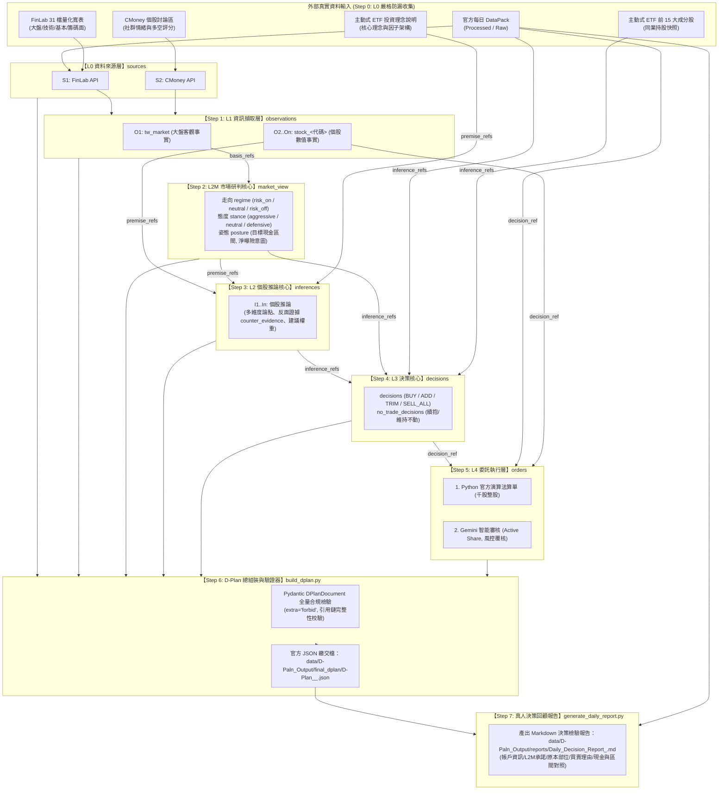

# 2026 玉山人工智慧挑戰賽 (AI CUP 2026)
## Multi-Agent 自主量化投資決策系統 (D-Plan v4.3)

- **參賽隊伍**：`TEAM_11402`
- **競賽主題**：2026 Agent 基金經理人公開挑戰賽
- **核心架構**：階層式因果推論 Multi-Agent 系統 (L0 ➔ L1 ➔ L2M ➔ L2 ➔ L3 ➔ L4 ➔ D-Plan 總組裝 ➔ 每日決策回顧報告)
- **規範標準**：嚴格遵循官方 **D-Plan Schema v4.3** 與 **D-Plan 撰寫指南 v4.3**

---

## 目錄導覽 (Table of Contents)

1. [系統整體架構與因果推論鏈](#一系統整體架構與因果推論鏈)
2. [專案目錄與檔案結構](#二專案目錄與檔案結構)
3. [資料流與目錄輸入輸出對照 (I/O)](#三資料流與目錄輸入輸出對照-io)
4. [各階層 Agent 深度邏輯與運算規範](#四各階層-agent-深度邏輯與運算規範)
   - [L0 資料來源與爬取層 (L0_sources)](#l0-資料來源與爬取層-l0_sources)
   - [L1 資訊擷取層 (L1_observations)](#l1-資訊擷取層-l1_observations)
   - [L2M 市場判斷鏈 (L2M_market_view)](#l2m-市場判斷鏈-l2m_market_view)
   - [L2 個股推論層 (L2_inferences)](#l2-個股推論層-l2_inferences)
   - [L3 投資組合決策層 (L3_decisions)](#l3-投資組合決策層-l3_decisions)
   - [L4 委託執行層 (L4_orders)](#l4-委託執行層-l4_orders)
   - [D-Plan 總組裝與全量合規校驗 (build_dplan.py)](#d-plan-總組裝與全量合規校驗-build_dplanpy)
   - [每日決策與帳戶回顧報告 (generate_daily_report.py)](#每日決策與帳戶回顧報告-generate_daily_reportpy)
5. [端到端每日產線入口 (run_daily_dplan.py)](#五端到端每日產線入口-run_daily_dplanpy)
6. [Prompt 自動存檔與日後回溯機制](#六prompt-自動存檔與日後回溯機制)
7. [Gemini Usage 監控與 Token 統計機制](#七gemini-usage-監控與-token-統計機制)
8. [交易日期終端機互動輸入設計](#八交易日期終端機互動輸入設計)
9. [環境建置與憑證設定](#九環境建置與憑證設定)
10. [完整命令列操作手冊 (CLI Cheatsheet)](#十完整命令列操作手冊-cli-cheatsheet)
11. [競賽法規檢核與重要實測注意事項](#十一競賽法規檢核與重要實測注意事項)

---

## 一、系統整體架構與因果推論鏈

本系統依據官方 D-Plan 因果引用鏈標準設計，各 Agent 階層具備嚴格的資訊邊界與上下游依賴關係：



### 因果引用鏈規範原則 (Causal Citation Chain)
1. **嚴禁孤兒引用與斷鏈**：`L2M.basis_refs` 必須來自 `L1.obs_id`；`L2.premise_refs` 必須來自 `L1.obs_id`；`L3.inference_refs` 必須來自 `L2.inf_id`；`L4.decision_ref` 必須來自 `L3.decision_id`。
2. **單向無循環**：各層僅能引用直接上層或經定義的合法來源，禁止跨層跳躍或反向引用。
3. **無未定義額外欄位**：全數使用 Pydantic 模型驗證，設定 `extra='forbid'`，確保不會輸出任何競賽官方 Schema 未定義之自訂欄位。
4. **全端無漏抓檢核**：資料收集各環節具備失敗拋錯阻斷機制，確保進入 L1 之前的基礎特徵完全齊備。

---

## 二、專案目錄與檔案結構

```text
code/
├── configs/                              # 專案環境與共用工具
│   ├── settings.py                       # 隊伍 ID、credentials 憑證讀取、全域路徑常數
│   ├── gemini_client.py                  # Google GenAI SDK 封裝 (支援串流、結構化輸出與 Usage 統計)
│   └── date_utils.py                     # 終端機互動式日期提示、標準化 (YYYYMMDD) 與格式轉換工具
│
├── schemas/                              # 【Schema 定義與檢驗層】
│   ├── dplan_models.py                   # 依 D-Plan Schema v4.3 建立的嚴格 Pydantic 資料模型
│   └── verify_dplan.ipynb                # D-Plan JSON 格式校驗、斷鏈檢測與測試 Notebook
│
├── L0_sources/                           # 【L0 資料來源與爬取層】(嚴格防漏，任一失敗即報錯中斷)
│   ├── datapack_loader.py                # 讀取官方每日 DataPack JSON (取現金、庫存、NAV、合規狀態)
│   ├── finlab_market_loader.py           # 透過 FinLab API 下載 31 檔市場與財務寬表並快取為 Parquet
│   ├── finlab_active_etf_loader.py       # 下載主動式 ETF 前 15 大成分股快照與權重
│   ├── cmoney_sentiment_crawler.py       # 爬取 CMoney 討論區個股情緒與多空量化分數
│   ├── market_indicators.py              # 大盤多維度量化指標計算 (均線、報酬、回撤、融資、廣度)
│   ├── stock_indicators.py               # 個股多維度量化指標計算 (ROE、營收動能、量價比、法人買賣超)
│   └── esun_trial_loader.ipynb           # 玉山證券行情 Web API 盤前試撮資料快照測試
│
├── L1_observations/                      # 【L1 資訊擷取層】
│   └── fact_extractor.py                 # 提取客觀事實陳述，產出 values 數值字典，呼叫 Gemini 並記錄 Prompt 與 Usage
│
├── L2M_market_view/                      # 【L2M 市場研判核心】
│   └── market_view_agent.py              # 研判市場走勢 (regime)、操作態度 (stance) 與目標水位 (posture)，存檔 Prompt
│
├── L2_inferences/                        # 【L2 個股推論核心】
│   └── stock_inference_agent.py          # 結合 ETF 理念針對 40 檔候選池產出深入推論與反思，存檔 Prompt
│
├── L3_decisions/                         # 【L3 投資組合決策層】
│   └── portfolio_decision_agent.py       # 執行持股全覆蓋分配 (decisions + no_trade)，控管 20~30 檔，存檔 Prompt
│
├── L4_orders/                            # 【L4 委託執行層】
│   └── order_calculator.py               # 官方千股整股演算法試算 + Active Share 檢驗 + Gemini 智能覆核，存檔 Prompt
│
├── build_dplan.py                        # 【D-Plan 總組裝與驗證器】全層合規校驗，輸出至 final_dplan
├── generate_daily_report.py              # 【每日決策與帳戶回顧報告】Python 自動生成高品質 Markdown 審視報告
├── run_daily_dplan.py                    # 【每日自動化端到端主產線】排程/一鍵循序執行 Step 0 ~ Step 7
├── requirements.txt                      # 專案相依 Python 套件清單
├── credentials.json                      # [本地] 本地憑證與 API 金鑰 (已由 .gitignore 忽略保護)
└── README.md                             # 專案完整說明文件 (本檔案)
```

---

## 三、資料流與目錄輸入輸出對照 (I/O)

所有生成資料與中間產物統一維護於專案根目錄的 `data/` 目錄中：

| 階層 / 程式模組 | 主要輸入資料來源路徑 (Input) | 主要產出檔案路徑 (Output) | Prompt 留存與 Usage 統計 |
| :--- | :--- | :--- | :--- |
| **L0 Sources**<br>`datapack_loader.py` | 官方原始 DataPack JSON：<br>`data/Datapack/Raw/DataPack_*_YYYY-MM-DD.json` | 轉換後結構化 Markdown：<br>`data/Datapack/Processed/DataPack_Processed_YYYYMMDD.md` | *(純資料解析)* |
| **L0 Sources**<br>`finlab_market_loader.py`<br>`cmoney_sentiment_crawler.py`<br>`finlab_active_etf_loader.py` | FinLab API、CMoney API、主動 ETF 公開資訊 | 行情特徵、輿情與成分股快取：<br>`data/大盤/`, `data/技術面/`, `data/基本面/`, `data/籌碼面/`,<br>`data/CMoney_Sentiment/`, `data/Active_ETF_Holdings/`,<br>`data/D-Paln_Output/l0_sources/` | *(純資料下載，失敗立即阻斷)* |
| **Step 1: L1 Observations**<br>`fact_extractor.py` | `data/大盤/`, `data/技術面/`, `data/基本面/`, `data/籌碼面/`, `data/CMoney_Sentiment/`, `data/D-Paln_Output/l0_sources/` | `data/D-Paln_Output/l1_observations/`<br>👉 `l1_observations_YYYYMMDD.json` | **Prompt**:<br>`l1_observations_prompt_YYYYMMDD.txt`<br>**Usage**:<br>`usage/l1_usage_YYYYMMDD.json` |
| **Step 2: L2M Market View**<br>`market_view_agent.py` | `data/D-Paln_Output/l1_observations/` (大盤觀察),<br>`data/Datapack/Processed/` (帳戶快照) | `data/D-Paln_Output/l2m_market_view/`<br>👉 `l2m_market_view_YYYYMMDD.json` | **Prompt**:<br>`l2m_market_view_prompt_YYYYMMDD.txt`<br>**Usage**:<br>`usage/l2m_usage_YYYYMMDD.json` |
| **Step 3: L2 Inferences**<br>`stock_inference_agent.py` | `data/D-Paln_Output/l1_observations/` (個股與大盤),<br>`data/D-Paln_Output/l2m_market_view/`,<br>`data/ETF_Strategy/etf_strategy.md`,<br>`data/Datapack/Processed/` | `data/D-Paln_Output/l2_inferences/`<br>👉 `l2_inferences_YYYYMMDD.json` | **Prompt**:<br>`l2_inferences_prompt_YYYYMMDD.txt`<br>**Usage**:<br>`usage/l2_usage_YYYYMMDD.json` |
| **Step 4: L3 Decisions**<br>`portfolio_decision_agent.py` | `data/D-Paln_Output/l2_inferences/`,<br>`data/D-Paln_Output/l2m_market_view/`,<br>`data/Datapack/Processed/` (昨日持股明細),<br>`data/Active_ETF_Holdings/` (前 15 大標竿) | `data/D-Paln_Output/l3_decisions/`<br>👉 `l3_decisions_YYYYMMDD.json` | **Prompt**:<br>`l3_decisions_prompt_YYYYMMDD.txt`<br>**Usage**:<br>`usage/l3_usage_YYYYMMDD.json` |
| **Step 5: L4 Orders**<br>`order_calculator.py` | `data/D-Paln_Output/l3_decisions/`,<br>`data/Datapack/Processed/` (NAV 與現有持股),<br>`data/D-Paln_Output/l1_observations/` (收盤價),<br>`data/Active_ETF_Holdings/` | `data/D-Paln_Output/l4_orders/`<br>👉 `l4_orders_YYYYMMDD.json`<br>👉 `l4_orders_python_YYYYMMDD.json` | **Prompt**:<br>`l4_orders_prompt_YYYYMMDD.txt`<br>**Usage**:<br>`usage/l4_usage_YYYYMMDD.json` |
| **Step 6: D-Plan Assembler**<br>`build_dplan.py` | 讀入上述所有子目錄中的最新 JSON | `data/D-Paln_Output/final_dplan/`<br>👉 **`D-Plan_<team_id>_<trade_date>.json`** | *(總裝配器，校驗引用鏈並注入 metadata)* |
| **Step 7: Review Report**<br>`generate_daily_report.py` | 最終 `D-Plan_*.json`、原始 `DataPack_*.json` | `data/D-Paln_Output/reports/`<br>👉 **`Daily_Decision_Report_<YYYYMMDD>.md`** | *(由 Python 產出真人檢視與風控對照報告)* |

---

## 四、各階層 Agent 深度邏輯與運算規範

### L0 資料來源與爬取層 (`L0_sources`)
- **嚴格防漏機制**：資料收集是後續推論基礎，各模組皆設有嚴格驗證。**任何一項下載或爬取失敗，立即拋出 `RuntimeError` 並中斷整個產線**，絕不容許缺漏資料進入模型。
- **`datapack_loader.py`**：解析官方 DataPack JSON，提取 `cash`、`nav_tradable`、`holdings` 及 `compliance` 違規次數。
- **`cmoney_sentiment_crawler.py`**：爬取 CMoney 討論區個股多空評分與社群熱度；**必須全數 40 檔抓取成功**，若有失敗檔數立即報錯中斷。
- **`finlab_market_loader.py`**：透過 FinLab API 下載 31 筆大盤與個股特徵寬表存為 Parquet；若有任何指標計算失敗即終止進程。
- **`finlab_active_etf_loader.py`**：下載同業主動式 ETF 前 15 大成分股快照與權重，供 Active Share 監控使用。

### L1 資訊擷取層 (`L1_observations/fact_extractor.py`)
- **職責**：將 raw data 提煉為客觀事實陳述，**嚴禁推論與預測**。
- **大盤事實 (`tw_market`)**：恰好生成 1 筆大盤關鍵數據（指數點位、20MA/60MA、報酬率、最大回撤、法人買賣超、騰落比）。
- **個股事實 (`stock_<ticker>`)**：針對 40 檔候選池逐檔生成 1 筆，提取數值後由系統以資料原值完整補齊 `values` 字典。

### L2M 市場判斷鏈 (`L2M_market_view/market_view_agent.py`)
- **走向 (`regime`)**：`risk_on` / `neutral` / `risk_off`。
- **態度 (`stance`)**：`aggressive` / `neutral` / `defensive`。
- **姿態 (`posture`)**：
  - `target_cash_pct_range`：目標現金比例區間承諾（如 `[0.05, 0.15]`）。
  - `net_exposure_intent`：淨曝險意圖（`increase` 淨買超 / `hold` 維持 / `reduce` 淨賣超）。首日全現金建倉必須為 `increase`。
- **引用鏈**：`basis_refs` 必須引用 L1 的大盤事實 ID (`O1`)。

### L2 個股推論層 (`L2_inferences/stock_inference_agent.py`)
- **四維分析**：企業品質 (ROE/營收動能)、技術動能 (Alpha/乖離)、籌碼量能 (法人買賣超)、市場情緒 (CMoney 討論熱度)。
- **合規關鍵**：每檔推論必須具備 `counter_evidence`（反向證據思考），避免確認偏誤。
- **引用鏈**：`premise_refs` 必須引用 L1 的個股與大盤事實。

### L3 投資組合決策層 (`L3_decisions/portfolio_decision_agent.py`)
- **動作分類**：`BUY`（新建倉）、`ADD`（加碼）、`TRIM`（減碼）、`SELL_ALL`（全出清），不調整者分配至 `no_trade_decisions`（續抱）。
- **三大硬限制**：
  1. **昨日持股全覆蓋**：昨日持股必須 100% 恰好落在 decisions 或 no_trade_decisions 之一。
  2. **持股檔數限制**：非 0 權重持股檔數必須嚴格落於 **20 至 30 檔**。
  3. **個股權重上限**：一般股 $\le 10\%$；台積電 (2330) $\le 25\%$。
  4. **現金平衡**：預估現金必須落於 L2M 宣告之區間內。

### L4 委託執行層 (`L4_orders/order_calculator.py`)
- **Python 機械算單 (千股整股，嚴禁手調)**：
  $$\text{目標股數} = \left\lfloor \frac{\text{目標權重} \times \text{前日淨值}}{\text{前日收盤價} \times 1000} \right\rfloor \times 1000$$
  $$\text{委託股數} = \text{目標股數} - \text{目前持有股數}$$
- **Active Share 精算**：與主動式 ETF 標竿比對，確保主動性指標 $\ge 15\%$。
- **Gemini 智能覆核**：針對 Active Share、取整偏離、剩餘現金與超賣風險進行雙重審視。

### D-Plan 總組裝與全量合規校驗 (`build_dplan.py`)
- **組裝元資料**：自動注入 `schema_version: "4.3"`, `team_id`, `trade_date`, 以及 `agent_metadata` (含 git commit hash 與執行時間戳)。
- **Pydantic 嚴格檢驗**：執行完整反向因果鏈與格式校驗 (`extra='forbid'`)，產出官方最終提交檔：
  `data/D-Paln_Output/final_dplan/D-Plan_<team_id>_<trade_date>.json`。

### 每日決策與帳戶回顧報告 (`generate_daily_report.py`)
- **目的**：提供真人經理人於自動化產線執行完畢後，快速進行全面覆核與風控確認。
- **六大核心章節**：
  1. **官方帳戶現況快照**：可交易淨值 (NAV)、現有現金、現金比、持股檔數、累計違規狀態。
  2. **L2M 大盤分析與承諾**：Regime、Stance、淨曝險意圖、**目標現金承諾區間**、推論邏輯與反向風險提示。
  3. **原有持股部位明細 (權重由高至低排序)**：排名、股票代號、股數、張數、昨日市價、現值、權重。
  4. **今日部位增減明細與決策理由**：列出每筆 BUY / SELL 之委託張數、預估金額、目標權重，以及**為什麼增減部位的具體決策理由**；列出續抱 (HOLD) 清單。
  5. **財務試算與 L2M 承諾對照檢驗**：
     - 買進總額 vs 賣出總額 ➔ **淨現金收支 (淨花費 / 淨套現)**。
     - **執行後預估剩餘現金**與**預估現金比例**。
     - **L2M 承諾對照**：預估現金比是否落入目標區間 (🟢 PASS / 🔴 FAIL)。
     - **淨曝險意圖檢驗**：承諾 increase / hold / reduce 與實際淨資金流向是否一致。
     - **持股檔數檢驗**：預估持股檔數是否符合 20 ~ 30 檔限制。
  6. **投資經理人覆核結論**：統整全量合規判定。

---

## 五、端到端每日產線入口 (`run_daily_dplan.py`)

`run_daily_dplan.py` 是每日自動化產線的核心調度器，完整串接 Step 0 到 Step 7：

```text
Step 0: L0 多源資料收集 (datapack -> cmoney -> finlab_market -> finlab_active_etf，任一失敗即報錯中斷)
Step 1: L1 事實提取 (fact_extractor.py)
Step 2: L2M 市場整體判斷 (market_view_agent.py)
Step 3: L2 個股推論 (stock_inference_agent.py)
Step 4: L3 投資組合配置決策 (portfolio_decision_agent.py)
Step 5: L4 委託單計算與智能覆核 (order_calculator.py)
Step 6: D-Plan 總組裝與全量合規校驗 (build_dplan.py) -> 產出 D-Plan_<team_id>_<trade_date>.json
Step 7: 每日投資決策與投資組合回顧報告生成 (generate_daily_report.py) -> 產出 Markdown 報告供真人回顧
```

### 命令列常用開關
- `--date <YYYYMMDD>`：指定交易日期（不提供時會於終端機詢問一次）。
- `--trade-date <YYYY-MM-DD>`：手動指定官方繳交檔宣告的 trade_date。
- `--team-id <TEAM_ID>`：指定參賽隊伍編號（預設 `TEAM_11402`）。
- `--skip-l0`：跳過 L0 資料收集階段（使用本地既有快取）。
- `--skip-l1`：跳過 L1 事實提取。
- `--skip-l2m` / `--skip-l2` / `--skip-l3` / `--skip-l4`：跳過指定 Agent 階段。
- `--skip-report`：跳過 Markdown 決策回顧報告產出。

---

## 六、Prompt 自動存檔與日後回溯機制

為了解決手動測試與每日自動化執行時的除錯與審計需求，系統對所有 LLM 環節實施了**無條件 Prompt 自動存檔機制**：

1. **存檔時機**：無論是透過 `--dry-run` 執行、正常單獨執行、或經由 `run_daily_dplan.py` 調度，在呼叫 Gemini API 之前，系統皆會**第一時間將組裝完成的完整 Prompt 輸出至磁碟**。
2. **存檔路徑一覽**：
   - `data/D-Paln_Output/l1_observations/l1_observations_prompt_YYYYMMDD.txt`
   - `data/D-Paln_Output/l2m_market_view/l2m_market_view_prompt_YYYYMMDD.txt`
   - `data/D-Paln_Output/l2_inferences/l2_inferences_prompt_YYYYMMDD.txt`
   - `data/D-Paln_Output/l3_decisions/l3_decisions_prompt_YYYYMMDD.txt`
   - `data/D-Paln_Output/l4_orders/l4_orders_prompt_YYYYMMDD.txt`
3. **優勢**：若模型產生非預期推論或格式錯誤，研發人員可隨時開啟當日對應的 prompt 文字檔，精準比對輸入內容、資料長度與指令細節，大幅提升排查效率。

---

## 七、Gemini Usage 監控與 Token 統計機制

為了精確掌握 API 調用成本與 Token 消耗量，所有調用 Gemini API 的程式皆內建 Usage 自動統計：

1. **儲存位置**：位於各階段輸出資料夾下的 **`usage/`** 子目錄中：
   - `data/D-Paln_Output/l1_observations/usage/l1_usage_YYYYMMDD.json`
   - `data/D-Paln_Output/l2m_market_view/usage/l2m_usage_YYYYMMDD.json`
   - `data/D-Paln_Output/l2_inferences/usage/l2_usage_YYYYMMDD.json`
   - `data/D-Paln_Output/l3_decisions/usage/l3_usage_YYYYMMDD.json`
   - `data/D-Paln_Output/l4_orders/usage/l4_usage_YYYYMMDD.json`
2. **統計內容結構**：包含時間戳記、日期、模型版本、`prompt_tokens`、`candidates_tokens`、`total_tokens` 及耗時秒數。

---

## 八、交易日期終端機互動輸入設計

考量到競賽實務上「執行程式的日期不一定是實際交易日」（例如週日盤前預先試算週一的 D-Plan），所有入口均支援兩種日期指定模式：

1. **互動式終端輸入 (預設)**：直接執行命令時（不帶 `--date`），終端機會跳出提示，按 Enter 直接帶入今日，或手動鍵入目標日期。
2. **命令列明確指定 (自動化排程)**：排程腳本直接傳入 `--date 20261028` 即可靜默執行。

---

## 九、環境建置與憑證設定

### 1. Conda 環境建立與套件安裝
建議使用 Python 3.11 環境：
```bash
conda create -n esunaicup2026_py311 python=3.11 -y
conda activate esunaicup2026_py311
pip install -r requirements.txt
```

### 2. 憑證設定 (`code/credentials.json`)
在 `code/` 目錄下建立 `credentials.json` 配置隊伍金鑰（已由 `.gitignore` 排除）：
```json
{
  "team_id": "TEAM_11402",
  "gemini_api_key": "AIzaSy..."
}
```

### 3. FinLab 登入認證
在終端機執行認證指令：
```bash
python -m finlab login
```

---

## 十、完整命令列操作手冊 (CLI Cheatsheet)

### 1. 端到端一鍵完整生成
```bash
# 啟動每日自動化產線 (循序執行 Step 0 至 Step 7，產出 D-Plan JSON 與 Markdown 回顧報告)
python run_daily_dplan.py

# 明確指定交易日期
python run_daily_dplan.py --date 20261028

# 指定特定交易日並跳過已完成之階段 (例如重跑 L3 至報告)
python run_daily_dplan.py --date 20261028 --skip-l0 --skip-l1 --skip-l2m --skip-l2
```

### 2. 各模組單獨執行除錯

#### 【L0 資料下載與預處理】
```bash
# --- DataPack 原始檔解析與轉 Markdown ---
python L0_sources/datapack_loader.py                           # 互動式輸入日期 (Enter 帶入今日)
python L0_sources/datapack_loader.py --date 20261028           # 指定轉換特定日期之 DataPack JSON

# --- FinLab 市場資料與寬表下載 ---
python L0_sources/finlab_market_loader.py                      # 下載最新行情特徵並快取為 Parquet
python L0_sources/finlab_market_loader.py --date 20261027      # 指定特定日期
python L0_sources/finlab_market_loader.py --overwrite          # 強制重新下載覆寫既有快取

# --- CMoney 輿情討論與情緒爬取 ---
python L0_sources/cmoney_sentiment_crawler.py                  # 爬取熱門股討論熱度與量化情緒
python L0_sources/cmoney_sentiment_crawler.py --date 20261027  # 指定爬取基準日

# --- 主動式 ETF 前 15 大成分股快照 ---
python L0_sources/finlab_active_etf_loader.py                  # 下載主動式 ETF 標竿持股
python L0_sources/finlab_active_etf_loader.py --date 20261027  # 指定日期快照
```

#### 【L1 ~ L4 Agent、D-Plan 組裝與報告產出】
```bash
# --- L1 客觀事實擷取 ---
python L1_observations/fact_extractor.py                       # 互動式輸入日期 + 串流生成
python L1_observations/fact_extractor.py --date 20261027      # 指定特定日期
python L1_observations/fact_extractor.py --dry-run            # 僅組裝 Prompt 輸出 txt，不呼叫 API

# --- L2M 市場整體研判 ---
python L2M_market_view/market_view_agent.py                   # 研判走向、態度與現金水位承諾
python L2M_market_view/market_view_agent.py --date 20261027
python L2M_market_view/market_view_agent.py --dry-run

# --- L2 個股推論 ---
python L2_inferences/stock_inference_agent.py                 # 個股多維度分析 + 反向思考
python L2_inferences/stock_inference_agent.py --date 20261027
python L2_inferences/stock_inference_agent.py --dry-run

# --- L3 投資組合決策 ---
python L3_decisions/portfolio_decision_agent.py               # 昨日持股全覆蓋 + 控管 20~30 檔
python L3_decisions/portfolio_decision_agent.py --date 20261027

# --- L4 委託單計算與審查 ---
python L4_orders/order_calculator.py                          # 完整執行 (Python 千股整股算單 + Gemini 覆核)
python L4_orders/order_calculator.py --date 20261027
python L4_orders/order_calculator.py --no-gemini              # 僅執行 Python 官方公式算單
python L4_orders/order_calculator.py --dry-run

# --- D-Plan 總組裝與驗證器 ---
python build_dplan.py                                         # 自動組裝最新日期產出至 final_dplan
python build_dplan.py --date 20261027                         # 指定組裝日期
python build_dplan.py --trade-date 2026-10-27                 # 手動指定宣告之 trade_date

# --- 每日決策與帳戶回顧 Markdown 報告 ---
python generate_daily_report.py                               # 根據最新 D-Plan 產出回顧報告
python generate_daily_report.py --date 20261028              # 指定日期
python generate_daily_report.py --dplan-path "path/to.json"   # 指定特定 D-Plan JSON 產生報告
```

---

## 十一、競賽法規檢核與重要實測注意事項

1. **資料收集零漏抓原則**：
   - 每日資料收集（DataPack、CMoney、FinLab、Active ETF）為後續推論命脈，任一模組抓取異常或資料缺漏會直接中止產線，請確保網路與憑證正常。
2. **千股整股與禁止零股**：
   - L4 委託計算一律取 `floor(... / 1000) * 1000`，委託單股數必須為 1,000 的正整數倍，不可含有零股。
3. **持股檔數限制 (20 ~ 30 檔)**：
   - 最終目標持股檔數必須嚴格介於 20 至 30 檔之間。競賽首日全現金建倉時，L3 必須一次性產生 20～30 筆 BUY 決策，且 `no_trade_decisions` 必須為空陣列 `[]`。
4. **Active Share 規定 ($\ge 15\%$)**：
   - L4 自動比對同業主動式 ETF 前 15 大成分股權重，確保主動性指標符合規定，避免淪為指數複製基金。
5. **Prompt 永久留存與稽核**：
   - 所有階段產生的 Prompt 皆會保留於磁碟，若線上執行有疑慮可隨時調閱回溯。
6. **金鑰安全保護**：
   - 嚴禁將包含 API Key 的 `credentials.json` 或含有個人 token 之測試檔案提交至 Git。
