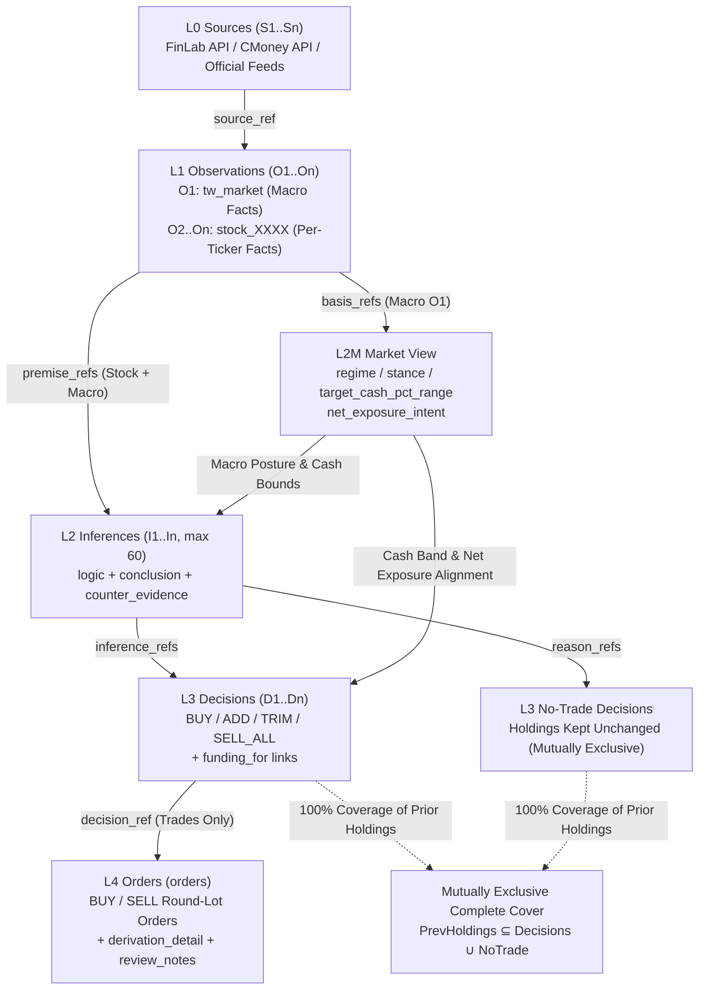

<div align="center">

# 🤖 E.SUN AI Challenge 2026 · Autonomous Multi-Agent Quantitative Investment System
### Multi-Agent Quantitative Decision Pipeline (D-Plan v4.3) & Real-Time Portfolio Dashboard

[繁體中文](README.md) | **English**

[](https://www.python.org/)
[](https://github.com/BerriAI/litellm)
[](https://ai.google.dev/)
[](https://docs.pydantic.dev/)
[](https://www.finlab.tw/)
[](https://esun-ai-cup-2026-team11402-portfolio.pages.dev)

**Team**: `TEAM_11402` ｜ **Competition**: E.SUN AI Cup 2026 — Agent Fund Manager Open Challenge (Open Division) ｜ **Specification**: D-Plan Schema v4.3 ｜ **Initial Capital**: NT\$1,000,000,000

🌐 **[Live Portfolio & AI Cost Monitoring Dashboard](https://esun-ai-cup-2026-team11402-portfolio.pages.dev)**

</div>

---

> **Reader's Guide for Engineering Leaders & Interviewers**: This document is structured as a system architecture whitepaper. Even **without reading a single line of source code**, you can understand within 3–5 minutes—via dual-core architecture diagrams, engineering pain-point tradeoffs, an L0 ➔ L4 end-to-end JSON trace walkthrough, 45 quantitative indicators, and mathematical risk derivations—how this project productionizes LLMs into a **zero-hallucination, zero-compliance-tolerance, fully unattended financial Multi-Agent system**.

---

## Table of Contents

1. [Competition Results & System Preview](#1-competition-results--system-preview)
2. [Project Background & Core Engineering Challenges](#2-project-background--core-engineering-challenges)
3. [Dual-Core System Architecture](#3-dual-core-system-architecture)
4. [8 Key AI Application Engineering Highlights](#4-8-key-ai-application-engineering-highlights)
5. [Layer-by-Layer Agent Logic & End-to-End JSON Walkthrough](#5-layer-by-layer-agent-logic--end-to-end-json-walkthrough)
6. [Quantitative Feature Engineering (45 Core Indicators + Screening & Sentiment)](#6-quantitative-feature-engineering-45-core-indicators--screening--sentiment)
7. [Risk Management & Mathematical Formulations](#7-risk-management--mathematical-formulations)
8. [Portfolio Dashboard (Real-Time Analytics & FinOps)](#8-portfolio-dashboard-real-time-analytics--finops)
9. [Quick Start](#9-quick-start)
10. [Appendices (Directory Tree, I/O Matrix, Advanced CLI)](#10-appendices-directory-tree-io-matrix-advanced-cli)

---

## 1. Competition Results & System Preview

<!-- POST_COMPETITION_RESULTS_START: Update placeholders once the competition (2026-10-27 ~ 2026-11-27) concludes -->
> [!NOTE]
> **Post-Competition Results Section** (Competition window: `2026-10-27` to `2026-11-27`. Final settlement metrics and UI screenshots are reserved below for final post-competition update).

| Evaluation Dimension | Final Performance (To Be Filled Post-Settlement) | Notes |
| :--- | :--- | :--- |
| **Cumulative Return (`cum_return_pct`)** | `[TBD, e.g., +XX.XX%]` | Initial tradable NAV: NT\$1,000,000,000 |
| **Overall Rank / Open Division Rank** | `[TBD, e.g., #XX / XXX teams (Division #XX)]` | Official E.SUN competition backend settlement |
| **Maximum Drawdown (`MDD`)** | `[TBD, e.g., -X.XX%]` | Peak-to-trough NAV drawdown across competition |
| **Compliance Violations / Submission Pass Rate** | `0 Violations / 100% Pre-Validation Pass` | Enforced by Step 7 zero-tolerance validation gate |
| **Automated Trading Days Executed** | `[TBD, e.g., 22 trading days]` | Full archive of Prompts, D-Plan JSONs, and audit reports |
| **Average Daily Pipeline AI Cost** | `[TBD, e.g., $0.XX USD / day]` | Metered via 19 native LiteLLM Usage Callback fields |

### Live Dashboard & UI Preview

- **Live Demo**: [https://esun-ai-cup-2026-team11402-portfolio.pages.dev](https://esun-ai-cup-2026-team11402-portfolio.pages.dev)
- **Three Signature Views** (add images under `docs/screenshots/` and uncomment when ready):
  - **Account Overview & FIFO Lot Drawer**: NAV/Cash curve, cumulative return, ranking trend, holding days, and FIFO lot-level cost tracking `<!--  -->`
  - **Market Watchlist & Sparklines**: Dynamic holdings vs. universe quotes, return sorting, and inline sparkline charts `<!--  -->`
  - **AI Cost & Routing Monitor (FinOps)**: 19 LiteLLM Usage metrics, per-stage cost breakdown, Fallback routing topology, and sandbox Code Execution audit `<!--  -->`
<!-- POST_COMPETITION_RESULTS_END -->

---

## 2. Project Background & Core Engineering Challenges

The E.SUN AI Challenge 2026 requires teams to build an autonomous fund-manager agent that ingests Taiwan market data across a statutory **150-stock universe (100 TWSE + 50 OTC)** and generates a daily **D-Plan Schema v4.3** investment plan—covering sources, objective observations, market view, stock inferences, portfolio decisions, and execution orders—managing a simulated **NT\$1,000,000,000** active ETF under strict financial regulations.

Moving LLMs from chat prototypes into a daily high-stakes quantitative pipeline required solving three core engineering challenges:

| Engineering Pillar | Real-World Pain Point | System Design Solution |
| :--- | :--- | :--- |
| **1. Zero-Tolerance Financial Compliance** | Portfolio must hold **20–30 stocks**, single-stock cap $\le 10\%$ (TSMC `2330` $\le 25\%$), 1,000-share round lots, Active Share $\ge 15\%$, and post-close cash ratio $\le 25.0\%$ (any breach voids the entire batch and issues a strike; 3 strikes = disqualification). | Hard constraints baked directly into **Pydantic validators + deterministic Python order sizing + a 22% proactive cash safety ceiling**, gated by the official `/validate/` API before submission. |
| **2. Structural & Arithmetic Weaknesses of LLMs** | Pure LLMs hallucinate floating-point sums, fee deductions, and share rounding; long JSON outputs trigger FSM state explosion or truncation; multi-step reasoning drops causal IDs. | **LiteLLM Multi-Model Routing** + **Gemini Native Code Execution Sandbox** + **Two-Tier Pydantic Schemas (`Draft` vs. `Final`)** + **3-Layer JSON Repair** + **Full DAG Citation Validation**. |
| **3. Unattended Multi-Source Automation** | Daily runs depend on E.SUN backend trade history, official DataPacks, FinLab quant tables, CMoney forum sentiment, and peer ETF holdings—previously fragile due to manual cookie/token copying. | **OAuth2 SSO automation**, **CMoney SSR Guest JWT auto-extraction with 401 refresh**, **DataPack readiness guards**, and an end-to-end Step 0–10 CLI pipeline. |

---

## 3. Dual-Core System Architecture

The platform is organized into **Core 1: Autonomous Multi-Agent Quantitative Pipeline** and **Core 2: Real-Time Portfolio Dashboard**, connected through unified data artifacts and automated FinOps usage settlement:

```mermaid
flowchart LR
    subgraph Core1["Core 1: Autonomous Multi-Agent Decision Pipeline (Step 0 ~ 10)"]
        direction LR
        S0["Step 0: L0 Multi-Source Ingestion\nBackend SSO / DataPack /\n150-Stock Dynamic Pool (stage-l0) /\nCMoney JWT / FinLab 45 Indicators"] --> S1["Step 1: L1 Fact Extraction\nCompact Array JSON\nstage-l1 (gemini-3.8-flash)\nDeterministic Value Grounding"]
        S1 --> S2["Step 2: L2M Market View\nRegime / Stance / Posture\nstage-l2m (gemini-4-carbon)\n+ Code Execution"]
        S2 --> S3["Step 3: L2 Stock Inferences\n2-Phase Analysis + Counter-Evidence\nstage-l2 (gemini-4-carbon)\n+ Code Execution"]
        S3 --> S4["Step 4: L3 Portfolio Decisions\n20~30 Stocks + Caps + Funding\nstage-l3 (gemini-4-carbon)\n+ Code Execution"]
        S4 --> S5["Step 5: L4 Order Execution\nDeterministic Round-Lot Sizing\n+ Active Share Gemini Review"]
        S5 --> S6["Step 6: D-Plan Assembly\nPydantic Full-DAG Validation"]
        S6 --> S7["Step 7: Official Pre-Validation\nZero-Tolerance Gate (bad/warn)"]
        S7 --> S8["Step 8: Official Submission\nHTTP 2xx & Receipt Verification"]
        S8 --> S9["Step 9: Daily Audit Report\n7-Section Markdown Review"]
    end

    subgraph Core2["Core 2: Real-Time Portfolio Dashboard (Step 10 / Standalone)"]
        direction TB
        HIST["E.SUN Backend OAuth2 SSO\nbackend_all_history.json"] --> TRK["FIFO Cost & PnL Engine\ntracker.py (Holding Days & Curves)"]
        SDK["E.SUN Quote SDK\n2330 Calendar Sync + 150 Quotes"] --> TRK
        USAGE["LiteLLM Usage Settlement\n19 Native Metrics usage_history.json"] --> BLD["Single-File SPA Builder\nbuilder.py (6 Interactive Tabs)"]
        TRK --> BLD
        S9 --> BLD
        BLD --> DIST["dist/index.html\nCloudflare Pages CI/CD"]
    end

    S9 -.->|"Step 10 Auto-Sync\n(--skip-backend-fetch)"| Core2
```



### L0 ➔ L4 Strict Causal Citation DAG

Following **D-Plan Schema v4.3**, the system enforces a strict **acyclic causal citation graph (DAG)**. Any dangling ID, cross-layer skip, undefined field (`extra="forbid"`), or mutual-exclusivity violation fails fast during assembly:



---

## 4. 8 Key AI Application Engineering Highlights

| # | Engineering Challenge | Architectural Solution | Implementation & Impact |
| :-: | :--- | :--- | :--- |
| **1** | **High Inference Cost & Single-Model SPOF** | **LiteLLM Multi-Model Dynamic Routing & Fallback** | `code/models_config.yaml` routes by task complexity: `stage-l1` uses fast, low-cost `gemini-3.8-flash` (fallback: `gemini-3.6-flash`); `stage-l0/l2m/l2/l3/l4` route to `gemini-4-carbon` (fallback: `gemini-4-argon`) with `num_retries=2` and `cooldown_time=30`. |
| **2** | **LLM Arithmetic & Portfolio Weight Hallucinations** | **Gemini Native Code Execution + Low-Level Code Hook** | L0, L2M, L2, L3, and L4 inject `tools=[{"code_execution": {}}]`, prompting the model to write and execute Python to verify weight sums, fees, and cash ratios. Custom hooks in `gemini_client.py` wrap `VertexGeminiConfig` and `ModelResponseIterator` to capture `executable_code` in both streaming and non-streaming modes. |
| **3** | **Structured Output FSM Explosion & Truncated JSON** | **Two-Tier Pydantic Models + 3-Layer JSON Repair** | Every stage decouples `Draft` (flat schemas avoiding `Dict[str, float]` / heavy regexes that blow up decoding FSMs) from `Final` (`extra="forbid"` + full DAG validation), backed by a `model_validate_json` ➔ `json.loads` ➔ `json_repair>=0.64.9` fallback chain. |
| **4** | **Dropped Indicators or Altered Floats in L1** | **Deterministic Grounding (Raw-Value Overwrite)** | `fact_extractor.py` lets the LLM output only summary-referenced numbers in `values` to save output tokens; `finalize_stock_observations()` then deterministically overwrites `values` and `source_ref` with exact raw ingestion values—100% eliminating numeric drift. |
| **5** | **Token Bloat Across 150 Stocks & Staggered Filings** | **Compact Array JSON + Dynamic Non-NaN Backfill** | `to_compact_json()` collapses `[value, "YYYY-MM-DD"]` onto single lines to slash prompt tokens; `stock_indicators.py` independently backfills the latest non-NaN quarter/month for `roe_latest`, `revenue_yoy_latest`, and `revenue_mom_latest` while preserving each company's true reporting timestamp. |
| **6** | **Rigid Static Universe Missing Turnaround Plays** | **3-Stage 150-Stock Dynamic Pool Screener** | `stock_pool_screener.py` evaluates all 150 statutory tickers daily: **Rule 1** (locks stocks beating benchmark over both 5D and 10D) + **`stage-l0` LLM** (rescues candidates via chip concentration, margin deleveraging, and peer PE percentile) + **forced union with current DataPack holdings**. |
| **7** | **Fragile Manual Logins & Risky Blind Submissions** | **Zero-Touch Auth Pipelines + Official Validation Gate** | `backend_history_loader.py` and `datapack_loader.py` automate OAuth2 SSO with readiness checks (`missing=[]`); `cmoney_sentiment_crawler.py` extracts 24h guest JWTs from SSR HTML (with `exp` validation and `401` retry); Step 7/8 enforce `/validate/` zero-tolerance gating before `/dplan/` receipt verification. |
| **8** | **Opaque Multi-Agent Debugging & Token Spend** | **Unconditional Prompt Archival + 19-Field FinOps Telemetry** | Every LLM stage saves its exact assembled prompt to disk regardless of `--dry-run`. Global LiteLLM `success/failure_callback` hooks collect 19 standardized fields (tokens, cached tokens, reasoning tokens, cost, code execution calls) settled directly into the dashboard. |

### Telemetry Deep Dive: 19 Standardized LiteLLM Usage Fields

Registered globally in `code/configs/gemini_client.py` and aggregated into `code/portfolio_dashboard/usage_history.json` and `data/D-Paln_Output/usage_history.json`:

- **Timing & Routing Identity (9)**: `timestamp`, `date`, `provider`, `model`, `model_group`, `stage`, `status`, `finish_reason`, `duration_seconds`
- **Tokens & Cost Accounting (7)**: `prompt_tokens`, `completion_tokens`, `total_tokens`, `cached_tokens`, `tool_use_tokens`, `reasoning_tokens`, `response_cost`
- **Code Execution Audit (3)**: `code_execution_used`, `code_execution_call_count`, `executed_codes`

---

## 5. Layer-by-Layer Agent Logic & End-to-End JSON Walkthrough

### 5.1 Agent Responsibilities & Hard Constraints

| Stage | Script & Route | Core Decision Logic & Constraints |
| :--- | :--- | :--- |
| **Step 0**<br>L0 Ingestion & Dynamic Pool | `L0_sources/*.py`<br>*(0c uses `stage-l0`)* | **Fail-Fast Guarantee**: Any fetch failure raises `RuntimeError` and aborts the run.<br>Syncs backend trade history (`0a`) ➔ fetches & verifies DataPack readiness, computing trailing stop-profit metrics (`0b`) ➔ runs 150-stock dynamic pool screening (`0c`) ➔ fetches CMoney sentiment (`0d`), computes 45 FinLab indicators (`0e`), and downloads peer active ETF Top-15 holdings (`0f`). |
| **Step 1 (L1)**<br>Fact Extraction | `fact_extractor.py`<br>*(`stage-l1`: `gemini-3.8-flash`)* | **Purely objective statements; zero inference or forecasting**.<br>Strictly matches `_YYYYMMDD` files across `大盤`, `技術面`, `基本面`, `籌碼面`, and `CMoney_Sentiment` (preferring `.json`), merges by 4-digit ticker into Compact Array JSON, produces exactly 1 `tw_market` (`O1`) + 1 `stock_<id>` (`O2..On`) per ticker, and deterministically overwrites `values` & `source_ref`. |
| **Step 2 (L2M)**<br>Market View | `market_view_agent.py`<br>*(`stage-l2m` + Code Execution)* | Cites `O1` to evaluate 8 macro dimensions: MA bias & lifeline slope, OTC vs. TAIEX relative strength, foreign/trust flow divergence, market-wide MA alignment diff & margin leverage, sector RS rotation, portfolio systemic exposure, competition phase, and proactive cash defense.<br>Outputs `regime` (`risk_on`/`neutral`/`risk_off`), `stance` (`aggressive`/`neutral`/`defensive`), `posture` (`target_cash_pct_range`, `net_exposure_intent`), and mandatory `counter_evidence`. |
| **Step 3 (L2)**<br>Stock Inferences | `stock_inference_agent.py`<br>*(`stage-l2` + Code Execution)* | **Two-Phase Reasoning Architecture**:<br>**Phase 1 (Deep Stock Analysis)**: Cross-checks fundamentals (ROE/revenue), technicals (MA/KD/MACD/Bollinger/ADX), volume/institutional flow, CMoney sentiment gap, and trailing stop-profit alerts (`peak_pnl_pct >= +10%` & `dd_from_peak_pct <= -4%`).<br>**Phase 2 (Portfolio Selection)**: Weighs ~0.585% round-trip friction and remaining competition days to propose weights across 20–30 holdings (max 60 inferences). |
| **Step 4 (L3)**<br>Portfolio Decisions | `portfolio_decision_agent.py`<br>*(`stage-l3` + Code Execution)* | Outputs `decisions` (`BUY` / `ADD` / `TRIM` / `SELL_ALL`) and `no_trade_decisions`.<br>Enforces: **100% mutually exclusive coverage of prior holdings**, **20–30 active positions**, **weight caps** ($\le 10\%$ standard, $\le 25\%$ for `2330`), **2% NAV tolerance on `hold`**, **real funding-gap check (`funding_for`)**, and **Active Share $\ge 15\%$**. |
| **Step 5 (L4)**<br>Order Execution | `order_calculator.py`<br>*(`stage-l4` + Code Execution)* | **Phase 1 (Deterministic Python)**: Computes floor round-lot shares, auto-generates `derivation_detail`, and calculates post-trade cash & Active Share.<br>**Phase 2 (Gemini Audit)**: Verifies Active Share $\ge 15\%$, zero overselling, cash-band compliance, and formula formatting. |
| **Step 6–9**<br>Build, Gate, Submit & Report | `build_dplan.py`<br>`validate_dplan_api.py`<br>`submit_dplan_api.py`<br>`generate_daily_report.py` | **Step 6**: Injects `agent_metadata` (incl. git commit hash) and validates `DPlanDocument` (`extra="forbid"`).<br>**Step 7**: Uploads to `/api/submissions/dplan/validate/` and aborts on any `bad > 0` or `warn > 0`.<br>**Step 8**: Submits to `/api/submissions/dplan/` and verifies receipt fields.<br>**Step 9**: Renders a 7-section human audit Markdown report (including L0 stock pool review). |

---

### 5.2 End-to-End Data Contract Walkthrough (Example: `2330`)

Below is how a single ticker (`2330`) flows from **L0 raw features ➔ L1 grounded fact ➔ L2M macro constraints ➔ L2 inference ➔ L3 decision ➔ L4 round-lot order** (auxiliary fields abbreviated):

```jsonc
// 1. [L0 Output] Compact Array JSON (minimizes tokens while preserving per-source timestamps)
{
  "_format": "[value, date]",
  "2330": {
    "roe_latest": [32.45, "2026-Q3"],
    "revenue_yoy_latest": [29.8, "2026-10"],
    "close_latest": [1085, "2026-11-23"],
    "excess_return_5d": [2.35, "2026-11-23"],
    "foreign_net_buy_intensity_5d": [8.42, "2026-11-23"],
    "cmoney_sentiment_情緒分數": [68.4, "2026-11-23"]
  }
}

// 2. [L1 Output] Grounded Observation (O2) — LLM writes neutral statement; Python overwrites exact raw values
{
  "obs_id": "O2",
  "source_ref": ["S1", "S2"],
  "topic": "stock_2330",
  "statement": "TSMC (2330) closed at 1085, 5D excess return +2.35pp, 5D foreign buy intensity +8.42%, latest ROE 32.45%, CMoney sentiment score 68.4.",
  "values": { "roe_latest": 32.45, "revenue_yoy_latest": 29.8, "close_latest": 1085.0, "...": "..." }
}

// 3. [L2M Output] Macro Market View — Cites O1 (tw_market) to set regime & cash corridor
{
  "basis_refs": ["O1"],
  "regime": "risk_on",
  "stance": "aggressive",
  "posture": { "net_exposure_intent": "increase", "target_cash_pct_range": [0.08, 0.16] }
}

// 4. [L2 Output] Stock Inference (I1) — Cites O1/O2 with mandatory counter_evidence
{
  "inf_id": "I1",
  "premise_refs": ["O1", "O2"],
  "logic": "Per O2, 2330 posts 32.45% ROE and +29.8% YoY revenue with +2.35pp 5D excess return and +8.42% foreign flow intensity under O1 risk_on regime; allocate 8.0% core weight.",
  "conclusion": "Initiate 2330 as core large-cap anchor at 8.0% target weight.",
  "counter_evidence": "Short-term excess return and elevated sentiment (68.4) warrant pullback monitoring.",
  "confidence": 0.82
}

// 5. [L3 Output] Portfolio Decision (D1) — Cites I1; Code Execution verifies 20~30 holdings & 100% weight sum
{
  "decision_id": "D1",
  "ticker": "2330",
  "action": "BUY",
  "target_weight": 0.08,
  "inference_refs": ["I1"],
  "risk_check": "8.0% <= 25% cap for 2330; 24 holdings in [20, 30]; est. cash 12.4% within [8%, 16%].",
  "funding_for": null
}

// 6. [L4 Output] Round-Lot Order — Deterministic Python sizing + Gemini Code Execution Active Share audit
{
  "ticker": "2330",
  "side": "BUY",
  "shares": 73000,
  "decision_ref": "D1",
  "derivation_detail": "target_shares = floor(0.08 × 1,000,000,000 / 1085 / 1000) × 1000 = 73,000; current 0 → BUY 73,000"
}
```

---

## 6. Quantitative Feature Engineering (45 Core Indicators + Screening & Sentiment)

The pipeline computes **45 core quantitative indicators** daily via `finlab_market_loader.py` (**16 market-level** + **29 stock-level**), alongside **12 L0 screening metrics**, **10 CMoney sentiment features**, and **DataPack trajectory / trailing stop-profit metrics**, all serialized in Compact Array JSON.

### 6.1 L0 Dynamic Stock Pool Screening Metrics (12 Features, `stock_pool_screener.py`)

Computed across the 150-stock universe over a 35-calendar-day lookback (covering $\ge 11$ common trading days and $\ge 2$ weekly depository releases):

| Dimension | Metric Keys | Definition & Role |
| :--- | :--- | :--- |
| **Price Momentum (Rule 1)** | `ret_5d_pct` / `ret_10d_pct` | 5-day and 10-day close-to-close returns (%). |
| **Relative Return (Rule 1)** | `rel_ret_5d_pp` / `rel_ret_10d_pp` | Stock excess return vs. its market index (TAIEX for TWSE, TPEx Index for OTC, ex-dividend) in percentage points. **Both $> 0$ locks `rule1_selected = true`**. |
| **Depository Chips (Weekly)** | `chip_over_1000_chg_pp` / `chip_under_50_chg_pp` / `chip_holders_chg_pct` | 1-period change in $>1000$-lot whale share (pp), $<50$-lot retail share (pp), and total shareholder count (%). Used by `stage-l0` to spot institutional accumulation. |
| **Margin Leverage (Daily)** | `margin_balance_lots` / `margin_chg_5d_pct` / `margin_pct_10d` | Latest margin balance (lots), 5D % change, and 10D ascending percentile rank (0–100) to measure retail leverage washout. |
| **Sector Valuation (Daily)** | `pe_ratio` / `pe_industry_pct` | Positive trailing P/E ratio and ascending percentile rank (0–100) within the same industry across all 150 stocks (lower = cheaper relative to peers). |

### 6.2 Market & Breadth Indicators (16 Indicators, `market_indicators.py`)

| # | Indicator Key | Category | Definition & Unit | Market Interpretation |
| :-: | :--- | :--- | :--- | :--- |
| 1 | `taiex_close_latest` | Index Level | Latest TAIEX total/price index close (pts) | Benchmark price anchor |
| 2 | `taiex_return_5d` | Momentum | 5-day TAIEX return (%) | Short-term index momentum |
| 3 | `taiex_vs_ma10_pct` | MA Bias | Bias vs. 10-day MA (%) | Short-term overbought/oversold stretch |
| 4 | `taiex_vs_ma20_pct` | MA Bias | Bias vs. 20-day MA (%) | $>0$ above monthly trend; $<0$ below support |
| 5 | `taiex_range_pos_10d` | Range Position | Position within 10D high–low range (0%–100%) | $>80\%$ near highs; $<20\%$ near lows |
| 6 | `taiex_max_drawdown_5d` | Downside Risk | Rolling 5-day max drawdown (%, negative) | Measures recent realized downside shock |
| 7 | `otc_vs_taiex_return_5d` | Domestic Flow | OTC 5D return minus TAIEX 5D return (pp) | $>0$ small/mid-cap leadership; $<0$ domestic risk-off |
| 8 | `market_foreign_net_buy_5d` | Institutional | Foreign investors (ex-prop) 5D TWSE net flow (TWD) | Medium-term foreign capital direction |
| 9 | `market_foreign_net_buy_1d` | Institutional | Latest 1D foreign TWSE net flow (TWD) | Immediate foreign flow stance |
| 10 | `market_trust_net_buy_5d` | Institutional | Investment Trust 5D TWSE net flow (TWD) | Domestic institutional buying persistence |
| 11 | `market_trust_net_buy_1d` | Institutional | Latest 1D Investment Trust TWSE net flow (TWD) | Immediate domestic fund positioning |
| 12 | `market_advance_decline_ratio` | Breadth | Market-wide advancing stocks ÷ declining stocks (x) | $>1$ broad rally; divergence flags narrow leadership |
| 13 | `listed_margin_balance_change_5d` | Leverage | TWSE margin balance 5D % change (%) | Flags forced liquidation risk when falling below 20MA |
| 14 | `market_alignment` | MA Structure | `market_alignment_diff`: $(\text{stocks with } 5\text{MA}\ge10\text{MA}\ge30\text{MA}) - (\text{stocks with } 5\text{MA}<10\text{MA}<30\text{MA})$ | Full-market bullish vs. bearish alignment spread |
| 15 | `market_lifeline` | Lifeline Slope | Outputs 4 keys: `index_vs_ma5_pct`, `index_vs_ma20_pct`, `ma5_change_3d_pct`, `ma20_change_5d_pct` (%) | Tracks TAIEX total return index bias and 5MA/20MA slope inflection |
| 16 | `industry_relative_strength` | Sector Rotation | Per-TWSE sector outputs 5 keys: `*_return_1d`, `*_rs_change_1d`, `*_rs_change_3d`, `*_rs_change_5d`, `*_rs_momentum_change` ($\text{RS} = \text{Sector} \div \text{TAIEX}$) | Separates true sector leaders, defensive outperformers, and accelerating turnarounds |

### 6.3 Individual Stock Indicators (29 Indicators, `stock_indicators.py`)

| Dimension | # | Indicator Key | Expanded Fields / Logic |
| :--- | :-: | :--- | :--- |
| **Fundamentals (3)** | 1–3 | `roe_latest`, `revenue_yoy_latest`, `revenue_mom_latest` | Latest quarterly after-tax ROE (%), monthly revenue YoY (%), and MoM (%). Uses **per-stock dynamic non-NaN backfill** to preserve each company's true latest filing date. |
| **Price & Volume (9)** | 4–12 | `close_latest`, `return_1d`, `return_5d`, `return_20d`, `excess_return_5d`, `volume_ratio_1d`, `volume_ratio_3d`, `volume_ma5_to_ma20`, `amount_ma5` | Latest close, 1D/5D/20D adjusted returns (%), 5D excess return vs. TAIEX total return index (pp), 1D volume ratio (vs. prior 10D avg), 3D volume ratio, 5D/20D volume MA ratio, and 5D average turnover (TWD) for liquidity. |
| **Volatility & MA Position (9)** | 13–21 | `volatility_10d`, `ma10_change_3d`, `price_vs_ma5`, `price_vs_ma20`, `price_range_pos_10d`, `price_dist_to_high_10d`, `price_dist_to_low_10d`, `price_vs_min_close_10d`, `rsi_7` | 10D return std dev (%), 10MA 3D slope (%), 5MA/20MA biases (%), 10D range position (%), distance to 10D high/low & prior 10D min close support (%), and 7D adjusted RSI. |
| **Composite Technicals (4)** | 22–25 | `kd_latest`, `macd_latest`, `bollinger_latest`, `adx_latest` | • **KD (5,3,3)**: `k_5`, `d_5`, `k_change_3d`, `kd_above_d_days`, `kd_below_d_days`, `kd_cross_days_ago_20d`<br>• **MACD (6,13,5)**: `macd_dif`, `macd_hist`, `macd_hist_change_3d`, `macd_hist_increasing_days`, `macd_hist_decreasing_days`, `macd_cross_days_ago_20d`<br>• **Bollinger (10D, 1.9$\sigma$)**: `bollinger_position_pct`, `bollinger_bandwidth_pct`, `bollinger_bandwidth_change_3d_pp`, `bollinger_contraction_days`, `bollinger_expansion_days`, `bollinger_bandwidth_percentile_60d`<br>• **ADX (7D)**: `plus_di`, `minus_di`, `di_diff`, `adx`, `adx_change_3d` |
| **Institutional Chips (4)** | 26–29 | `foreign_net_buy_intensity_5d`, `foreign_net_buy_1d`, `trust_net_buy_intensity_5d`, `trust_net_buy_1d` | Foreign and Investment Trust 5D net buy/sell shares ÷ 5D total volume (%), plus latest 1D net flow as % of daily volume. |

### 6.4 Sentiment & Account Trajectory Features

- **CMoney Forum Sentiment (10 Features, `cmoney_sentiment_crawler.py` + `fact_extractor.py`)**: `cmoney_sentiment_情緒分數` (0–100), `樣本數` (with stale-date detection for low discussion volume), 5 bucket counts (`極度樂觀` / `樂觀` / `中立` / `謹慎` / `極度謹慎`), and zero-safe ratio metrics (`樂觀占比` / `中立占比` / `謹慎占比`).
- **DataPack Trajectory & Trailing Stop-Profit (`datapack_loader.py`)**: Fuses `backend_all_history.json` (4-decimal execution prices) to compute competition pacing (`remaining_trading_days`, `phase`), NAV trajectory (`cum_return_pct`, `drawdown_from_peak_pct`, `nav_return_3d_pct`, `consecutive_loss_days`), and per-holding trailing stop-profit metrics (`entry_date`, `holding_days`, `avg_cost`, `pnl_pct`, `peak_price`, `peak_pnl_pct`, `dd_from_peak_pct`).

---

## 7. Risk Management & Mathematical Formulations

To keep AI-generated portfolios strictly compliant under extreme market stress, six quantitative constraints are embedded into both agent prompts and Python validators:

### 7.1 Passive Cash Ratio Breach Defense & 22% Safety Ceiling

Competition rules enforce a post-settlement **maximum cash ratio of $25.0\%$** (breaching it voids the day's entire batch and issues a strike). During a market drawdown $d$, fixed cash $C$ stays constant while equity value $S$ shrinks, causing the post-close cash ratio $\text{Cash Ratio}'$ to **spike passively**:

$$\text{Cash Ratio}' = \frac{C}{C + S \cdot (1 - d)} \le 0.25$$

Since the portfolio rebalances daily and Taiwan equities have a daily limit-down cap of $d = 10\%$ ($0.10$), targeting a maximum cash ratio of $22\%$ ($C / \text{NAV} = 0.22$, $S / \text{NAV} = 0.78$) guarantees that even if **every single holding hits limit-down simultaneously**, the settled cash ratio remains:

$$\text{Cash Ratio}'_{\text{worst}} = \frac{0.22}{0.22 + 0.78 \times (1 - 0.10)} = \frac{0.22}{0.922} \approx 23.86\% < 25.0\%$$

Accordingly, the system enforces two guardrails:
1. **22% Target Ceiling**: `target_cash_pct_range` upper bound is capped at $22\%$ (`0.22`), ensuring immunity to single-day limit-down passive breaches without over-compressing liquidity.
2. **Mandatory Net-Buy Trigger**: Whenever DataPack reports `cash_ratio_tradable > 0.20`, L2M must output `net_exposure_intent = "increase"` and L3 must execute net purchases.

### 7.2 L4 Deterministic Round-Lot Sizing

Taiwan equity orders must be multiples of 1,000 shares (1 board lot). L4 Python sizing computes:

$$\text{Target Shares}_i = \left\lfloor \frac{w_i \times \text{NAV}_{\text{tradable}}}{P_i \times 1000} \right\rfloor \times 1000, \qquad \Delta\text{Shares}_i = \text{Target Shares}_i - \text{Current Shares}_i$$

where $w_i$ is the L3 target weight ($w_i \le 0.10$ generally; $w_{\text{2330}} \le 0.25$) and $P_i$ is the prior close (backfilled from DataPack if missing in L1). $\Delta\text{Shares}_i > 0$ emits `BUY`, $< 0$ emits `SELL`, and `drafts_to_orders()` strictly blocks any sell quantity exceeding current inventory.

### 7.3 Active Share Compliance Gate

To prevent closet indexing against commercial active ETFs, L3 and L4 evaluate top-15 weight divergence against every peer active ETF benchmark:

$$\text{Active Share} = \frac{1}{2} \sum_{i} \left| w_{\text{port}, i} - w_{\text{ETF}, i} \right| \ge 0.15 \quad (15\%)$$

### 7.4 Transaction Cost Friction

Order notional is estimated via prior close prices and deducted from cash:

- **Buy Total Outflow**: $\text{Amount}_{\text{buy}} \times (1 + 0.001425)$ ($0.1425\%$ broker fee)
- **Sell Net Proceeds**: $\text{Amount}_{\text{sell}} \times (1 - 0.001425 - 0.003)$ ($0.1425\%$ fee + $0.3\%$ securities transaction tax = $0.4425\%$)
- **Round-Trip Friction**: $\approx 0.585\%$. L2/L3 avoid churn unless expected alpha or risk reduction clearly outweighs friction.

### 7.5 L2M `hold` 2% NAV Tolerance

When L2M declares `net_exposure_intent = "hold"`, L3 verifies via Gemini Code Execution that net daily dollar turnover stays within $2\%$ of tradable NAV:

$$\left| \sum \text{Amount}_{\text{buy}} - \sum \text{Amount}_{\text{sell}} \right| \le 0.02 \times \text{NAV}_{\text{tradable}}$$

### 7.6 L3 Mutually Exclusive Holding Coverage & `funding_for` Precondition

- **Complete Mutually Exclusive Cover** (post-Day 1): Given prior holdings $\mathcal{H}_{\text{prev}}$, trade decisions $\mathcal{D}$, and no-trade holds $\mathcal{N}$, `DPlanDocument.validate_reference_chains()` enforces:
  $$\mathcal{H}_{\text{prev}} \subseteq (\mathcal{D} \cup \mathcal{N}) \quad \land \quad (\mathcal{D} \cap \mathcal{N} = \emptyset)$$
  while active non-zero positions stay strictly within $[20, 30]$.
- **`funding_for` Gap Precondition**: A `TRIM` / `SELL_ALL` decision may reference target buy IDs in `funding_for` **only if** executing the planned buys alone (including buy fees) would push estimated cash below `target_cash_pct_range[0]`; otherwise `funding_for` must be `null`.

---

## 8. Portfolio Dashboard (Real-Time Analytics & FinOps)

Alongside the decision pipeline, the project ships a zero-backend static Single Page Application deployed automatically via Cloudflare Pages Git CI/CD (see [code/portfolio_dashboard/README.md](code/portfolio_dashboard/README.md)):

- **UI/UX Engineering**: Combines **Fugle-style high-density market layout** with **Apple Liquid Glassmorphism**, supporting **Light (default) / Dark / System** themes (with dynamic Android Chrome `theme-color`), zero-layout-shift single-row sticky navigation pill on scroll, and GPU-optimized rendering for smooth mobile scrolling.
- **6 Interactive Tabs**:
  1. **📊 Account Overview**: Tradable NAV, cash ratio, daily/cumulative return, **Overall & Open Division competition ranks**, 4 time-series charts, and holdings PnL table (with **holding days** and expandable **FIFO buy-lot drawers**).
  2. **📈 Market Watchlist**: Dynamic split between current holdings and remaining universe, return sorting, instant search, and inline price sparklines.
  3. **🧾 Trade History**: Aggregates 4-decimal backend fills, total fees/taxes, and net realized PnL with multi-filter search.
  4. **📄 Decision Reports**: Built-in sanitized Markdown viewer (`Marked` + `DOMPurify`) with date switching, auto-TOC, and one-click copy.
  5. **🤖 AI Cost Monitor**: Visualizes all 19 LiteLLM Usage metrics, daily cost/token dual-axis charts, per-stage share, Fallback routing graph, and per-call execution/code drilldowns.
  6. **💡 Project Highlights**: Interactive summary of ETF philosophy, L0 ➔ L4 architecture, and core engineering highlights.
- **Self-Healing Market Calendar Sync**: `market_api.py` syncs official trading days against `2330`, automatically rebuilding `market_cache.json` via `historical.candles` if missing or non-trading dates are detected, and updates daily quotes via `intraday.quote`.

---

## 9. Quick Start

### 9.1 Environment & Credentials

```bash
# 1. Create Python 3.11 environment and install dependencies
conda create -n esunaicup2026_py311 python=3.11 -y
conda activate esunaicup2026_py311
pip install -r code/requirements.txt

# 2. Configure environment variables (code/.env is gitignored)
cp code/.env.example code/.env
# Fill in: GEMINI_API_KEY, TEAM_ID, ESUN_EMAIL, ESUN_PASSWORD

# 3. Authenticate FinLab SDK
python -m finlab login
```

### 9.2 Core Commands

```bash
cd code

# 1. Run full unattended E2E pipeline (Step 0 ~ Step 10: Data -> L0~L4 -> Build -> Validate -> Submit -> Report -> Dashboard & Push)
python run_daily_dplan.py --push-dashboard

# 2. Dry-submission mode (runs full reasoning, assembly, and official validation without submitting)
python run_daily_dplan.py --date 20261124 --skip-submit

# 3. Update & deploy Portfolio Dashboard standalone
cd portfolio_dashboard && python run_update.py --push
```

---

## 10. Appendices (Directory Tree, I/O Matrix, Advanced CLI)

<details>
<summary><b>📁 Expand: Complete Project Directory Structure</b></summary>

```text
2026玉山人工智慧賽/
├── .gitignore                                # Excludes .env, local credentials, and temporary files
├── README.md                                 # Whitepaper Documentation (Traditional Chinese)
├── README_EN.md                              # Whitepaper Documentation (English)
│
├── code/                                     # [Core Codebase & Automation Pipeline]
│   ├── models_config.yaml                    # LiteLLM Multi-Model routing aliases & fallbacks
│   ├── .env.example                          # Env template (GEMINI_API_KEY, TEAM_ID, ESUN_EMAIL, ESUN_PASSWORD)
│   ├── requirements.txt                      # Python dependencies
│   ├── configs/                              # Shared infrastructure
│   │   ├── settings.py                       # Env loader, path constants, stage aliases
│   │   ├── gemini_client.py                  # LiteLLM Router wrapper (streaming, structured output, Code Execution, 19-field Usage, json-repair)
│   │   ├── date_utils.py                     # Interactive trade-date prompt & YYYYMMDD normalization
│   │   └── json_utils.py                     # Compact Array JSON ([value, date]) serializer
│   ├── schemas/                              # Schema definitions & DAG validator
│   │   ├── dplan_models.py                   # D-Plan v4.3 two-tier Pydantic models (Draft + Final DAG)
│   │   └── verify_dplan.ipynb                # Schema & citation validation notebook
│   ├── L0_sources/                           # [L0 Multi-Source Ingestion & Dynamic Pool]
│   │   ├── backend_history_loader.py         # OAuth2 SSO incremental backend history & 4-decimal trade fetcher
│   │   ├── datapack_loader.py                # OAuth2 SSO DataPack fetcher, readiness guard & trailing stop-profit tracker
│   │   ├── stock_pool_screener.py            # 150-stock dynamic pool screener (Rule 1 + stage-l0 LLM + holdings union)
│   │   ├── cmoney_sentiment_crawler.py       # CMoney SSR guest JWT extractor & sentiment crawler
│   │   ├── finlab_market_loader.py           # FinLab 45-indicator scheduler & Compact Array JSON writer
│   │   ├── market_indicators.py              # 16 market-level indicator definitions
│   │   ├── stock_indicators.py               # 29 stock-level indicator definitions (with dynamic non-NaN backfill)
│   │   └── finlab_active_etf_loader.py       # Peer active ETF Top-15 holdings benchmark fetcher
│   ├── L1_observations/                      # [L1 Fact Extraction]
│   │   └── fact_extractor.py                 # Compact Array JSON ingestion, LLM summarization & raw-value grounding
│   ├── L2M_market_view/                      # [L2M Market View]
│   │   └── market_view_agent.py              # Regime / stance / posture reasoning (with Code Execution)
│   ├── L2_inferences/                        # [L2 Stock Inferences]
│   │   └── stock_inference_agent.py          # 2-phase stock analysis & counter-evidence (with Code Execution)
│   ├── L3_decisions/                         # [L3 Portfolio Decisions]
│   │   └── portfolio_decision_agent.py       # 20~30 stock allocation, caps, funding_for & coverage validation
│   ├── L4_orders/                            # [L4 Order Execution]
│   │   └── order_calculator.py               # Deterministic Python round-lot sizing + Active Share + Gemini review
│   ├── portfolio_dashboard/                  # [Real-Time Portfolio Dashboard]
│   │   ├── tracker.py                        # FIFO lot cost, PnL & NAV curve engine
│   │   ├── market_api.py                     # E.SUN Quote SDK (2330 calendar sync & 150-stock quotes)
│   │   ├── builder.py                        # Fugle + Liquid Glassmorphism 6-tab SPA generator
│   │   ├── run_update.py                     # One-click update & Git CI/CD push script
│   │   ├── usage_history.json                # Settled 19-field LiteLLM Usage history
│   │   ├── dist/index.html                   # Single-file SPA output (Cloudflare Pages deploy target)
│   │   └── README.md                         # Dashboard setup & Cloudflare Pages guide
│   ├── build_dplan.py                        # D-Plan v4.3 assembler & full-DAG validator
│   ├── validate_dplan_api.py                 # Official online pre-validation gate (/api/submissions/dplan/validate/)
│   ├── submit_dplan_api.py                   # Official submission & receipt verification (/api/submissions/dplan/)
│   ├── generate_daily_report.py              # 7-section Markdown human audit report generator
│   └── run_daily_dplan.py                    # Step 0 ~ Step 10 end-to-end pipeline orchestrator
│
├── data/                                     # [Data Inputs & Stage Artifacts]
│   ├── Datapack/                             # Official DataPack Raw JSONs & Processed Markdowns
│   ├── Stock_Pool/                           # stock_list_*.json, screening_result_*.json, metrics/, prompts/, usage/
│   ├── backend_reports/                      # backend_all_history.json & fallback HTML snapshots
│   ├── 大盤/, 基本面/, 技術面/, 籌碼面/       # FinLab 45-indicator Compact Array JSON caches
│   ├── CMoney_Sentiment/                     # CMoney stock sentiment datasets
│   ├── Active_ETF_Holdings/                  # Peer active ETF Top-15 holdings snapshots
│   ├── ETF_Strategy/                         # Active ETF investment philosophy (etf_strategy.md)
│   └── D-Paln_Output/                        # Per-stage JSONs, prompt logs, usage logs, final_dplan/, reports/
│
└── docs/                                     # Official competition specs, architecture diagrams & API docs
```

</details>

<details>
<summary><b>🔄 Expand: Step 0 ~ Step 10 Pipeline I/O & Audit Trail Matrix</b></summary>

| Stage / Module | Primary Inputs | Primary Outputs | Prompt Archive & Usage Telemetry |
| :--- | :--- | :--- | :--- |
| **Step 0a** `backend_history_loader.py` | E.SUN Backend OAuth2 SSO API | `data/backend_reports/backend_all_history.json` | Incremental + refresh latest 1D (`--full` for full rebuild) |
| **Step 0b** `datapack_loader.py` | `/api/data-pack/`, `backend_all_history.json` | `data/Datapack/Raw/DataPack_*.json`<br>`data/Datapack/Processed/DataPack_Processed_YYYYMMDD.md` | Supports `--no-fetch` offline fallback |
| **Step 0c** `stock_pool_screener.py` | FinLab API (150 stocks), DataPack holdings | `data/Stock_Pool/stock_list_YYYYMMDD.json`<br>`data/Stock_Pool/screening_result_YYYYMMDD.json`<br>`data/Stock_Pool/metrics/stock_pool_metrics_YYYYMMDD.json` | **Prompt**: `data/Stock_Pool/prompts/l0_prompt_YYYYMMDD.txt`<br>**Usage**: `data/Stock_Pool/usage/l0_usage_YYYYMMDD.json` |
| **Step 0d–0f** `cmoney_sentiment_crawler.py`<br>`finlab_market_loader.py`<br>`finlab_active_etf_loader.py` | `data/Stock_Pool/stock_list_YYYYMMDD.json`, CMoney SSR, FinLab API | `data/CMoney_Sentiment/`, `data/Active_ETF_Holdings/`, `data/{大盤,基本面,技術面,籌碼面}/*.json`, `data/D-Paln_Output/l0_sources/` | Fail-fast exception on any missing data |
| **Step 1 (L1)** `fact_extractor.py` | `data/{大盤,基本面,技術面,籌碼面,CMoney_Sentiment}/` | `data/D-Paln_Output/l1_observations/l1_observations_YYYYMMDD.json` | **Prompt**: `l1_observations_prompt_YYYYMMDD.txt`<br>**Usage**: `usage/l1_usage_YYYYMMDD.json` |
| **Step 2 (L2M)** `market_view_agent.py` | `l1_observations` (O1), `DataPack_Processed` | `data/D-Paln_Output/l2m_market_view/l2m_market_view_YYYYMMDD.json` | **Prompt**: `l2m_market_view_prompt_YYYYMMDD.txt`<br>**Usage**: `usage/l2m_usage_YYYYMMDD.json` |
| **Step 3 (L2)** `stock_inference_agent.py` | `l1_observations`, `l2m_market_view`, `etf_strategy.md`, `DataPack_Processed` | `data/D-Paln_Output/l2_inferences/l2_inferences_YYYYMMDD.json` | **Prompt**: `l2_inferences_prompt_YYYYMMDD.txt`<br>**Usage**: `usage/l2_usage_YYYYMMDD.json` |
| **Step 4 (L3)** `portfolio_decision_agent.py` | `l2_inferences`, `l2m_market_view`, `DataPack_Processed`, `Active_ETF_Holdings` | `data/D-Paln_Output/l3_decisions/l3_decisions_YYYYMMDD.json` | **Prompt**: `l3_decisions_prompt_YYYYMMDD.txt`<br>**Usage**: `usage/l3_usage_YYYYMMDD.json` |
| **Step 5 (L4)** `order_calculator.py` | `l3_decisions`, `DataPack Raw/Processed`, `l1_observations`, `Active_ETF_Holdings` | `data/D-Paln_Output/l4_orders/l4_orders_YYYYMMDD.json`<br>`data/D-Paln_Output/l4_orders/l4_orders_python_YYYYMMDD.json` | **Prompt**: `l4_orders_prompt_YYYYMMDD.txt`<br>**Usage**: `usage/l4_usage_YYYYMMDD.json` |
| **Step 6** `build_dplan.py` | L0–L4 stage JSONs + Git commit hash | `data/D-Paln_Output/final_dplan/D-Plan_<team_id>_<trade_date>.json` | Full Pydantic `DPlanDocument` DAG check |
| **Step 7 & 8** `validate_dplan_api.py` / `submit_dplan_api.py` | Final `D-Plan_<team_id>_<trade_date>.json` | Console validation summary / official receipt | Zero-tolerance abort on `bad > 0` or `warn > 0` |
| **Step 9** `generate_daily_report.py` | `D-Plan_*.json`, `DataPack_*.json`, `screening_result_*.json` | `data/D-Paln_Output/reports/Daily_Decision_Report_YYYYMMDD.md` | 7-section human audit report |
| **Step 10** `portfolio_dashboard/run_update.py` | `backend_all_history.json`, `Datapack/Raw/`, E.SUN Quote SDK, Usage logs | `code/portfolio_dashboard/dist/index.html` | Settles `usage_history.json`; optional `--push` |

</details>

<details>
<summary><b>⌨️ Expand: Single-Module CLI & Debugging Cheatsheet</b></summary>

> All commands assume working directory `code/` (`cd code`). Omitting `--date` triggers an interactive terminal date prompt.

```bash
# --- Partial Pipeline Rerun & Sampling Debug ---
python run_daily_dplan.py --date 20261124 --input-date 20261123 --max-stocks 3 --skip-l0 --skip-submit
python run_daily_dplan.py --date 20261124 --skip-l0 --skip-l1 --skip-l2m --skip-l2   # Rerun L3 through Dashboard

# --- L0 Modules ---
python L0_sources/backend_history_loader.py --full
python L0_sources/datapack_loader.py --date 20261124 --no-fetch
python L0_sources/stock_pool_screener.py --date 20261124 --dry-run
python L0_sources/stock_pool_screener.py --date 20261124 --use-cached-metrics
python L0_sources/stock_pool_screener.py --date 20261124 --skip-llm
python L0_sources/cmoney_sentiment_crawler.py --date 20261124
python L0_sources/finlab_market_loader.py --date 20261124 --overwrite
python L0_sources/finlab_active_etf_loader.py --date 20261124

# --- L1 ~ L4 Agents (--dry-run / --no-code-exec) ---
python L1_observations/fact_extractor.py --date 20261124 --dry-run
python L2M_market_view/market_view_agent.py --date 20261124 --no-code-exec
python L2_inferences/stock_inference_agent.py --date 20261124 --dry-run
python L3_decisions/portfolio_decision_agent.py --date 20261124 --no-stream
python L4_orders/order_calculator.py --date 20261124 --no-gemini

# --- Assembly, Validation, Submission & Reporting ---
python build_dplan.py --date 20261124 --trade-date 2026-11-24
python validate_dplan_api.py --date 20261124                 # Add --allow-warn to block only on bad
python submit_dplan_api.py --date 20261124 --dry-run
python generate_daily_report.py --date 20261124

# --- Portfolio Dashboard Standalone Options ---
cd portfolio_dashboard
python run_update.py --reports-only                          # Fast rebuild using cached market quotes
python run_update.py --rebuild-candles                       # Full historical candles rebuild from 2026-10-27
```

</details>
